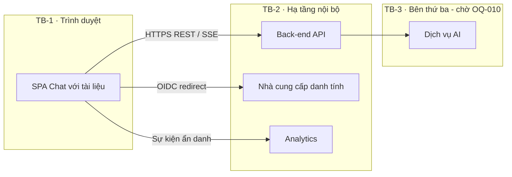
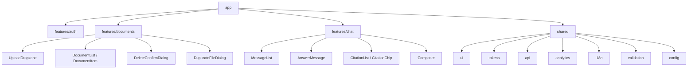
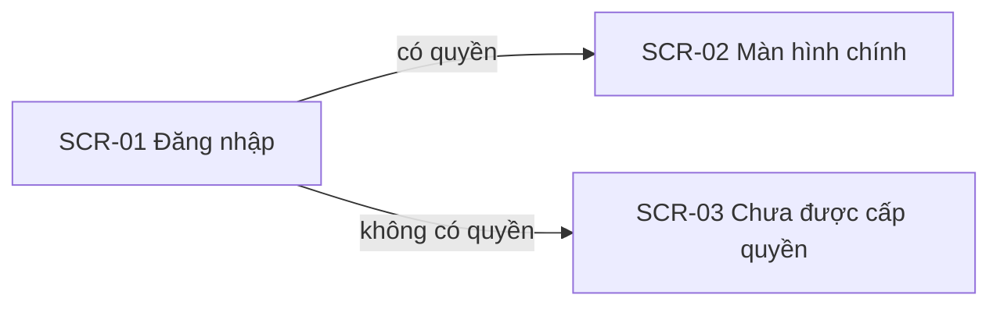
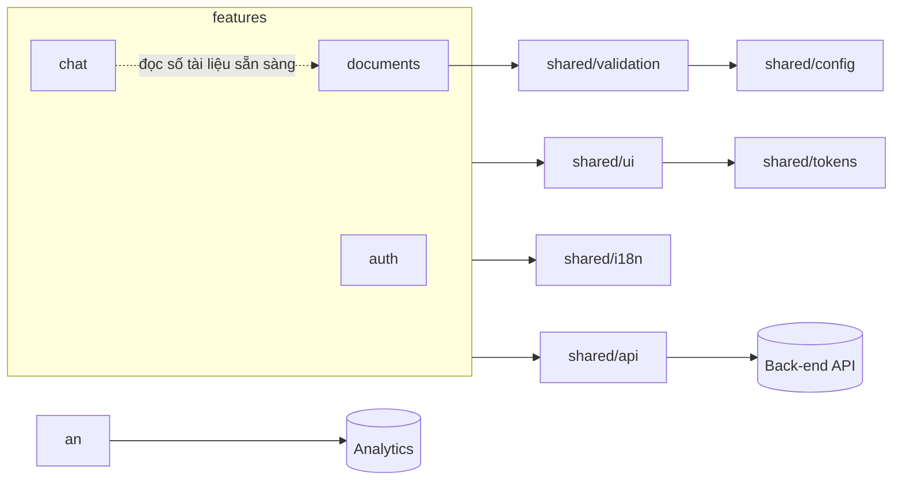
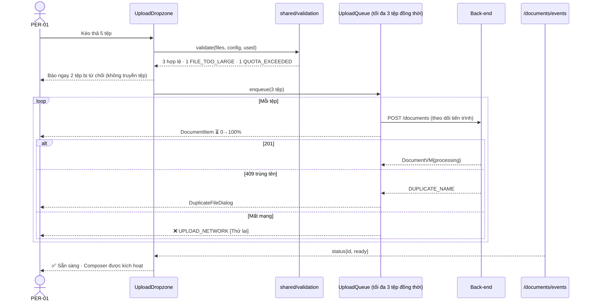
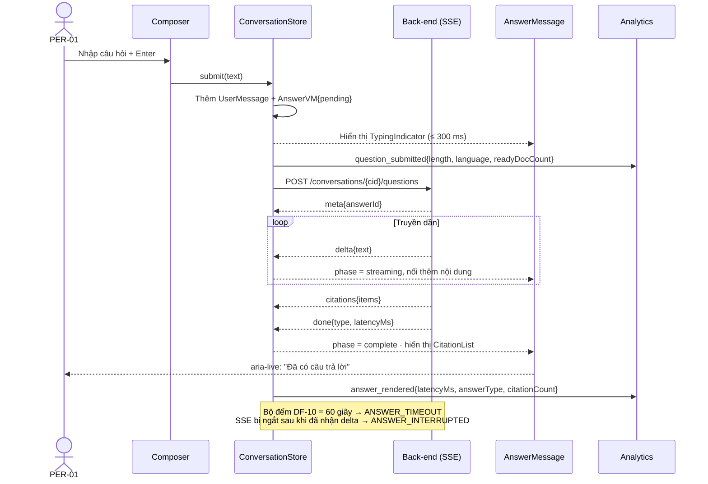
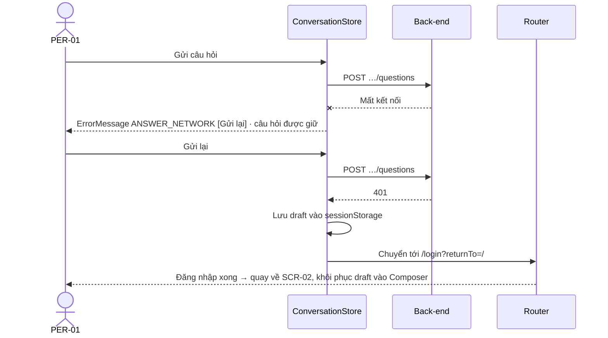
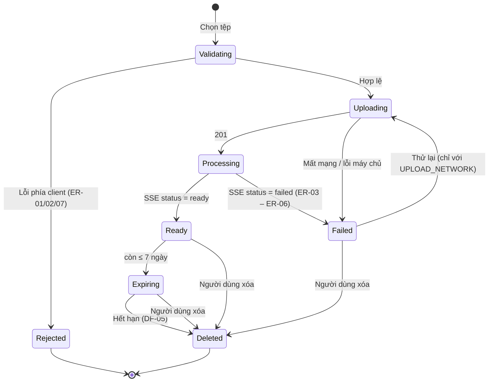
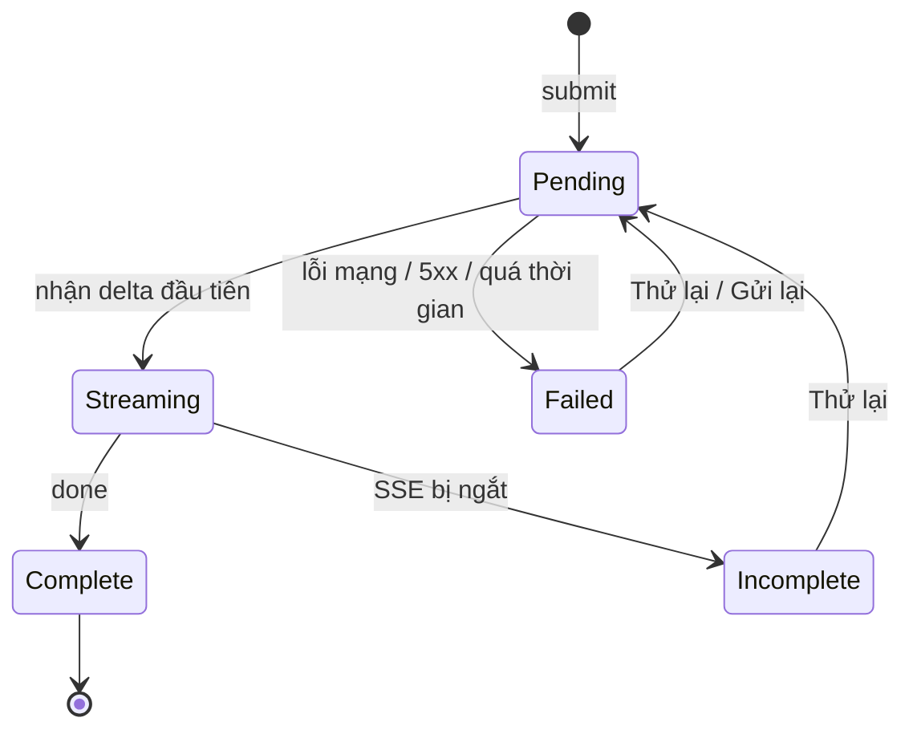

# Bản thiết kế UI/UX (Software Design Description) — Chat với tài liệu (MVP-lite)

> **Tiêu chuẩn:** IEEE 1016-2009 — Software Design Descriptions
> **Phạm vi:** Tầng giao diện người dùng (Web front-end) và hợp đồng giao tiếp giữa UI với back-end
> **Đầu vào:** [PRD v0.2](../requirements/PRD.md) (PRD-CWD-001) · [BRD v0.3](../requirements/BRD.md) (BRD-CWD-001) · Prompt: [`docs/design/bluePrint_design_prompt.md`](bluePrint_design_prompt.md)

---

## 1. Bối cảnh và đối tượng thiết kế

### 1.1 Nhận diện hệ thống

| Thuộc tính | Giá trị |
|---|---|
| **Tên hệ thống** | Chat với tài liệu (Chat with Documents) — MVP |
| **Mã tài liệu** | SDD-CWD-UI-001 |
| **Phiên bản SDD** | v0.3 — MVP-lite |
| **Ngày tài liệu** | 2026-10-19 |
| **Chủ sở hữu tài liệu** | Front-end Lead + UI/UX Designer [TBD] |
| **Người rà soát** | Product Manager, Tech Lead, QA Lead, An toàn thông tin |

**Lịch sử phiên bản**

| Phiên bản | Ngày | Tác giả | Thay đổi |
|---|---|---|---|
| v0.2 | 2026-10-26 | Nhóm UI/UX | Thu hẹp thành MVP-lite, bỏ các màn hình post-MVP |
| v0.3 | 2026-10-27 | Nhóm UI/UX | Dọn các tham chiếu còn sót tới SCR-04 – SCR-06 và `FeedbackButtons` (§2.2, §3.1, §3.2.2, §3.3, §3.4.2, §3.5.3, §3.6.2, §3.8.3, §4.1) cho khớp với phạm vi MVP-lite đã thu hẹp ở v0.2 |

**Mô tả hệ thống.** "Chat với tài liệu" là ứng dụng web giúp nhân viên Phát triển Kinh doanh (PTKD) tra cứu thông tin trong nhiều tài liệu PDF:
- Người dùng tải PDF lên, đặt câu hỏi bằng tiếng Việt hoặc tiếng Anh, và nhận câu trả lời tổng hợp từ **toàn bộ** tài liệu đã tải lên.
- Mỗi câu trả lời **luôn kèm nguồn** (tên tệp, số trang). Khi tài liệu không chứa thông tin, hệ thống trả lời "không tìm thấy" thay vì bịa câu trả lời.

Tài liệu này mô tả thiết kế **tầng UI**: cấu trúc màn hình, cấu trúc thành phần, trạng thái, luồng tương tác, hệ thống thiết kế (design system), và hợp đồng dữ liệu mà UI cần từ back-end.

### 1.2 Phạm vi hệ thống và ranh giới bên ngoài

| Loại ranh giới | Mô tả |
|---|---|
| **Mục đích hệ thống** | Giảm thời gian tìm và tổng hợp thông tin từ nhiều PDF (PRD O1), với câu trả lời kiểm chứng được (O2). Tầng UI chịu trách nhiệm làm cho việc tải lên, hỏi và kiểm chứng nguồn trở nên nhanh, minh bạch và đáng tin. |
| **Hệ thống bên ngoài (so với UI)** | (1) **Back-end API** của ứng dụng: tài liệu và hỏi đáp · (2) **Nhà cung cấp danh tính** cho đăng nhập · (3) Dịch vụ AI/LLM **không được UI gọi trực tiếp**; mọi truy cập đi qua back-end (BR-019) |
| **Loại người dùng** | PER-01 Chuyên viên PTKD; người vận hành pilot cấp quyền bằng cấu hình/CLI |
| **Giao diện bên ngoài** | REST/JSON qua HTTPS cho thao tác CRUD · `multipart/form-data` để tải tệp lên · **Server-Sent Events (SSE)** để truyền câu trả lời dần dần (streaming) và cập nhật trạng thái tài liệu · OIDC redirect cho đăng nhập (nếu dùng SSO) |
| **Ranh giới tin cậy** | **TB-1** Trình duyệt người dùng (không tin cậy) ↔ **TB-2** Back-end API (tin cậy, qua HTTPS) ↔ **TB-3** Dịch vụ AI bên thứ ba (ngoài tổ chức, chờ phê duyệt OQ-010). UI không lưu nội dung tài liệu trong `localStorage`, không gửi nội dung tới analytics, và không giữ token trong bộ nhớ có thể đọc bằng JavaScript (dùng cookie `HttpOnly`). |
| **Môi trường triển khai** | Ứng dụng trang đơn (SPA) dạng tệp tĩnh, phân phối qua CDN hoặc web server nội bộ `[Đề xuất — chờ SAD]`. Trình duyệt hỗ trợ: Chrome, Edge, Firefox (2 phiên bản mới nhất) (PRD G-10). |



### 1.3 Giả định và ràng buộc

| Loại | Mô tả |
|---|---|
| **Ràng buộc kỹ thuật** | Ứng dụng web chạy trên trình duyệt (BRD CON-001). Không cài đặt phía máy người dùng. UI không gọi dịch vụ AI trực tiếp. Công nghệ front-end đề xuất: **React 18 + TypeScript + Vite**; TanStack Query cho dữ liệu từ máy chủ; Zustand cho trạng thái giao diện; CSS Variables cho design token `[Đề xuất — chờ SAD xác nhận]`. |
| **Ràng buộc nghiệp vụ** | MVP-lite chỉ có đăng nhập, tài liệu, hỏi đáp, citation, not_found, xóa và retention. Feedback, report, evaluation UI, follow-up và admin UI là post-MVP. |
| **Giả định môi trường** | Người dùng làm việc trên máy tính trong mạng nội bộ/văn phòng, độ trễ mạng < 100 ms tới back-end, màn hình ≥ 1280px (PRD ASM-P01). |
| **Giả định dữ liệu** | Tối đa 50 tài liệu/người dùng, 20 MB/tệp, 300 trang/tệp, lưu 90 ngày (PRD DF-01 – DF-05, đề xuất). Lịch sử hội thoại chỉ giữ trong phiên (DF-09). Giao diện tiếng Việt; câu hỏi và câu trả lời tiếng Việt hoặc tiếng Anh (DF-06). |

---

## 2. Bên liên quan và mối quan tâm

### 2.1 Nhận diện bên liên quan

| Mã | Bên liên quan | Vai trò | Mối quan tâm chính |
|---|---|---|---|
| SH-01 | Chuyên viên PTKD (PER-01) | Người dùng chính | Dễ dùng, nhanh, câu trả lời kiểm chứng được |
| SH-02 | Quản lý / nhà tài trợ (PER-02) | Người ra quyết định | Báo cáo sử dụng rõ ràng; bằng chứng về giá trị |
| SH-03 | Người đánh giá MVP (PER-03) | BA / trưởng nhóm | Chấm điểm câu trả lời hiệu quả, nhất quán |
| SH-04 | Quản trị viên (PER-04) | Vận hành | Cấp và thu hồi quyền nhanh, không nhầm lẫn |
| SH-05 | Front-end Developer | Đội kỹ thuật | Dễ bảo trì, dễ kiểm thử, cấu trúc thành phần rõ ràng |
| SH-06 | UI/UX Designer | Đội thiết kế | Nhất quán với design system, khả năng truy cập |
| SH-07 | QA Engineer | Đội chất lượng | Trạng thái và lỗi có thể tái hiện và kiểm thử |
| SH-08 | An toàn thông tin / Pháp chế | Tuân thủ | Không rò rỉ nội dung tài liệu qua UI, bộ nhớ trình duyệt hay analytics |
| SH-09 | Product Manager | Sản phẩm | Đo được phễu kích hoạt và các OKR |

### 2.2 Mối quan tâm của bên liên quan

| Mã | Bên liên quan | Mối quan tâm | Ưu tiên | Tiêu chí chấp nhận |
|---|---|---|---|---|
| CN-01 | SH-01 | Tin được câu trả lời | Cao | 100% câu trả lời có nội dung hiển thị ≥ 1 thẻ nguồn (KR2.3); câu trả lời "không tìm thấy" được phân biệt rõ bằng hình thức hiển thị (UX-06) |
| CN-02 | SH-01 | Biết tài liệu nào đã sẵn sàng | Cao | Mỗi tài liệu luôn có 1 trong 4 trạng thái hiển thị bằng biểu tượng + chữ; trạng thái cập nhật ≤ 5 giây sau khi máy chủ thay đổi |
| CN-03 | SH-01 | Phản hồi nhanh khi hỏi | Cao | Chỉ báo "Đang tìm…" xuất hiện ≤ 300 ms; p90 thời gian có câu trả lời đầy đủ ≤ 15 giây (KR1.2) |
| CN-04 | SH-01 | Ít thao tác | Cao | Mọi chức năng chính nằm trên **một màn hình**, cách tối đa 1 lần nhấn |
| CN-05 | SH-01 | Phục hồi khi gặp lỗi | Cao | 100% lỗi trong PRD §4.2 có thông báo tiếng Việt kèm hành động khắc phục; không mất câu hỏi đang soạn |
| CN-06 | SH-08 | Không rò rỉ nội dung tài liệu | Cao | 0 sự kiện analytics chứa nội dung; không có nội dung tài liệu/câu hỏi trong `localStorage`/`IndexedDB` (AC-020.1) |
| CN-07 | SH-08 | Phân quyền đúng | Cao | UI chỉ hiển thị dữ liệu do API trả về cho người dùng hiện tại; không ẩn dữ liệu bằng CSS thay cho kiểm soát quyền |
| CN-08 | SH-06 | Khả năng truy cập | Trung bình | Đạt WCAG 2.1 AA (IX-07) |
| CN-09 | SH-05 | Dễ bảo trì | Trung bình | Thành phần UI thuần (presentational) không gọi API trực tiếp; thay đổi một tính năng ảnh hưởng ≤ 2 module khác |
| CN-10 | SH-07 | Dễ kiểm thử | Trung bình | Mọi phần tử tương tác có `data-testid`; mỗi trạng thái của state machine có ít nhất 1 ca kiểm thử |
| CN-11 | SH-09 | Đo lường được | Trung bình | 14 sự kiện ở PRD §5.2 được phát đúng thời điểm; phễu kích hoạt tính được |

> Mối quan tâm của SH-02 (báo cáo tuần), SH-03 (chấm điểm) và SH-04 (quản trị quyền) không có thành phần UI trong MVP-lite (BRD §5.4, PRD §0.4: cấp quyền qua cấu hình/CLI, đánh giá chất lượng ngoài sản phẩm). Các mã CN-12 – CN-14 đã được gỡ khỏi phiên bản v0.2 cùng với SCR-04 – SCR-06; sẽ được khôi phục nếu các màn hình này quay lại phạm vi.

### 2.3 Kịch bản thuộc tính chất lượng (định dạng 6 phần)

| Thuộc tính | Nguồn | Tác nhân kích thích | Đối tượng | Môi trường | Phản hồi | Thước đo |
|---|---|---|---|---|---|---|
| **Hiệu năng** | PER-01 | Gửi một câu hỏi | Composer + luồng SSE | Bình thường, 10 người dùng đồng thời | Hiển thị chỉ báo đang trả lời, sau đó hiện câu trả lời dần dần | Chỉ báo ≤ 300 ms; token đầu tiên ≤ 3 giây `[Đề xuất]`; câu trả lời đầy đủ p90 ≤ 15 giây |
| **Hiệu năng tải trang** | PER-01 | Mở ứng dụng | SPA bundle | Mạng văn phòng, cache trống | Hiển thị khung ứng dụng | LCP < 2,5 giây; JS ban đầu ≤ 250 KB gzip |
| **Khả năng mở rộng (UI)** | PER-01 | Có 50 tài liệu trong danh sách | DocumentList | Bình thường | Cuộn mượt, không giật | 60 fps khi cuộn; render danh sách ≤ 100 ms |
| **Tính sẵn sàng** | Hạ tầng | Back-end hoặc dịch vụ AI lỗi | ChatPanel | Lỗi một phần | UI vẫn hoạt động; hiển thị NE-04 kèm Thử lại; danh sách tài liệu vẫn xem được | 0 màn hình trắng; 100% lỗi API được bắt bởi error boundary |
| **Bảo mật** | Người dùng A | Truy cập URL tài liệu của B | Router + API | Đã đăng nhập | API trả 403/404; UI hiển thị "Không tìm thấy tài liệu" | 0 dữ liệu của B hiển thị (AC-002.3) |
| **Bảo mật dữ liệu phía client** | Kiểm tra ATTT | Đọc bộ nhớ trình duyệt sau phiên | Storage | Sau đăng xuất | Không còn nội dung tài liệu, câu hỏi, câu trả lời | 0 bản ghi nội dung trong Web Storage / IndexedDB; cache của TanStack Query bị xóa khi đăng xuất |
| **Bảo trì** | Developer | Thêm một mã lỗi mới | Danh mục thông báo lỗi | Phát triển | Chỉ sửa 1 tệp danh mục (`messages.vi.ts`) | ≤ 1 module bị thay đổi |
| **Kiểm thử** | QA | Chạy bộ kiểm thử UI | Component + E2E | CI | Toàn bộ chạy tự động | Độ bao phủ unit ≥ 80% cho `features/*`; E2E luồng chính chạy < 5 phút |
| **Triển khai** | DevOps | Phát hành phiên bản UI mới | Gói tệp tĩnh | Production | Người dùng tự nhận bản mới khi tải lại trang; phiên đang mở không bị ngắt | Tên tệp có hash; `index.html` không bị cache |
| **Khả năng quan sát** | Dev / PM | Có lỗi JS ở phía người dùng | Error boundary + analytics | Production | Ghi lại `error_code` và `app_version`, **không** kèm nội dung | 100% lỗi chưa được xử lý đều được ghi lại |

### 2.4 Kịch bản chất lượng UX/UI

| Thuộc tính | Kịch bản UX/UI |
|---|---|
| **Tính dễ dùng** | Người dùng lần đầu, không được hướng dẫn, tải được tài liệu đầu tiên và nhận câu trả lời đầu tiên có nguồn trong ≤ 3 phút (không tính thời gian xử lý tệp); ≥ 80% người tham gia UAT đạt `[Đề xuất]`. |
| **Khả năng truy cập** | Mọi phần tử tương tác dùng được bằng bàn phím với thứ tự Tab hợp lý. Trình đọc màn hình (NVDA) đọc được trạng thái tài liệu và thông báo khi câu trả lời hoàn tất (`aria-live="polite"`). Đạt WCAG 2.1 AA. |
| **Hiệu năng cảm nhận** | FCP < 1,5 giây, LCP < 2,5 giây; mọi thao tác bất đồng bộ có phản hồi hình ảnh ≤ 300 ms. |
| **Đáp ứng kích thước màn hình** | Bố cục hai cột từ ≥ 1024px. Từ 768–1023px, thư viện tài liệu chuyển thành ngăn trượt. Dùng được (không tối ưu) ở 360px. Không có thanh cuộn ngang từ 360px đến 2560px. |
| **Nhất quán thị giác** | 100% màu, cỡ chữ, khoảng cách lấy từ design token (§3.8); không dùng mã màu cố định trong component (kiểm tra bằng lint). |
| **Phục hồi lỗi** | Lỗi hiển thị **tại chỗ** (trên dòng tài liệu, trong bong bóng câu trả lời). Người dùng khắc phục bằng nút Thử lại mà không cần tải lại trang; câu hỏi đang soạn không bị mất. |
| **Phản hồi và gợi ý thao tác** | Mọi phần tử nhấn được có trạng thái hover / focus / active / disabled. Nút bị vô hiệu luôn có tooltip giải thích lý do (ví dụ: "Tải tài liệu lên để bắt đầu hỏi"). |
| **Kiến trúc thông tin** | Người dùng PER-01 làm mọi việc trên một màn hình duy nhất (`/`). Màn hình của PER-02, PER-03, PER-04 cách 1 lần nhấn từ menu người dùng. |
| **Quốc tế hóa** | Giao diện tiếng Việt, toàn bộ chuỗi chữ nằm ngoài code. Bố cục chịu được chữ dài thêm 30% (cho bản tiếng Anh sau này). Ngày theo định dạng `dd/MM/yyyy`; số theo `vi-VN`. Không cần hỗ trợ ngôn ngữ viết từ phải sang trái. Font hỗ trợ đầy đủ dấu tiếng Việt. |
| **Trải nghiệm trên thiết bị nhỏ** | Không phải mục tiêu của MVP. Ở < 1024px, vùng chạm tối thiểu 44×44px; kéo thả được thay bằng nút chọn tệp. |

### 2.5 Ma trận ràng buộc UX/UI

| Ràng buộc | Yêu cầu | Công cụ / chuẩn | Phương pháp xác minh |
|---|---|---|---|
| **Độ tương phản màu** | Chữ thường ≥ 4,5:1; chữ lớn và đường viền thành phần ≥ 3:1 | WCAG 2.1 AA | axe-core trong CI + kiểm tra thủ công bằng Contrast Checker |
| **Kiểu chữ** | Chữ nội dung 16px, chiều cao dòng 1,5; phóng to 200% không vỡ bố cục | Design token §3.8 | Rà soát thiết kế + kiểm thử zoom trên trình duyệt |
| **Vùng chạm** | ≥ 44×44px ở < 1024px; ≥ 32×32px trên desktop | WCAG 2.5.5 / Material | Kiểm thử UI |
| **Trạng thái đang tải** | Skeleton hoặc spinner xuất hiện ≤ 300 ms; không chặn toàn màn hình | Thực hành UX | Đo bằng Performance API trong E2E |
| **Thông báo lỗi** | Cấu trúc: *Điều gì xảy ra* + *Làm gì tiếp*; không có thuật ngữ kỹ thuật hay mã HTTP | Danh mục thông báo (§3.4.3) | Rà soát nội dung |
| **Trạng thái trống** | Mọi trạng thái trống (ES-01 – ES-05) đều chỉ dẫn hành động tiếp theo | PRD §4.2 | Kiểm kê UI |
| **Thông báo nổi (toast)** | Chỉ dùng cho xác nhận thao tác (đã xóa, đã gửi phản hồi); tự ẩn sau 4 giây; không dùng toast cho lỗi cần xử lý | Thực hành UX | Kiểm thử người dùng |
| **Trợ giúp và hướng dẫn** | Hướng dẫn 3 bước ở trạng thái trống; tooltip trên nút bị vô hiệu; liên kết "Trợ giúp" ở header | Thực hành UX | Đo tỷ lệ hoàn thành tác vụ trong UAT |
| **Ghi chú về AI** | Dòng nhắc "Câu trả lời do AI tạo — hãy kiểm tra nguồn" luôn hiển thị dưới ô nhập | BRD BRU-002, PRD UX-05 | Kiểm tra UI |
| **Quyền riêng tư phía client** | Không lưu nội dung vào Web Storage; analytics đi qua bộ lọc cho phép (allow-list) | PRD §5.2, AC-020.1 | Code review + kiểm thử tự động bộ lọc |

---

## 3. Các góc nhìn thiết kế (IEEE 1016-2009)

| # | Góc nhìn | Mối quan tâm được giải quyết |
|---|---|---|
| 3.1 | Thành phần (Composition) | CN-09, CN-10 |
| 3.2 | Logic (Logical) | CN-01, CN-02, CN-04, CN-09 |
| 3.3 | Phụ thuộc (Dependency) | CN-06, CN-09 |
| 3.4 | Thông tin (Information) | CN-01, CN-05, CN-06 |
| 3.5 | Giao diện (Interface) | CN-03, CN-04, CN-07 |
| 3.6 | Tương tác (Interaction) | CN-02, CN-03, CN-05 |
| 3.7 | Động thái trạng thái (State Dynamics) | CN-02, CN-05, CN-10 |
| 3.8 | Sử dụng mẫu thiết kế (Patterns Use) | CN-08, CN-11, nhất quán thị giác |

---

### 3.1 Góc nhìn thành phần (Composition View)

**Mục đích:** Phân rã ứng dụng front-end thành module, tính năng và gói.
**Mối quan tâm:** Khả năng bảo trì, dễ hiểu, tính mô-đun (CN-09, CN-10).

**Nguyên tắc:** Tổ chức theo tính năng (feature-sliced). Mỗi `feature` tự chứa component, hook và API của riêng nó. `shared` không được phụ thuộc ngược vào `features`.

| Phần tử | Loại | Thuộc | Trách nhiệm | Phụ thuộc |
|---|---|---|---|---|
| `app` | Gói gốc | Hệ thống | Khởi tạo, router, provider (Query, Auth, i18n), error boundary toàn cục | Tất cả `features`, `shared` |
| `features/auth` | Module tính năng | `app` | Đăng nhập, phiên, chặn route khi chưa đăng nhập, trang không có quyền (US-001) | `shared/api`, `shared/ui` |
| `features/documents` | Module tính năng | `app` | Thư viện tài liệu: tải lên, danh sách, trạng thái, xóa, hết hạn (EP-02) | `shared/api`, `shared/ui`, `shared/validation` |
| `features/chat` | Module tính năng | `app` | Hội thoại: composer, tin nhắn, câu trả lời streaming, trích dẫn (EP-03, EP-04) | `shared/api`, `shared/ui`, `features/documents` |
| `shared/ui` | Thư viện thành phần | `shared` | Design system: Button, Badge, Dialog, Toast, Tooltip, Skeleton, Banner, EmptyState | `shared/tokens` |
| `shared/tokens` | Gói cấu hình | `shared` | Design token: màu, chữ, khoảng cách, bo góc, bóng (§3.8) | — |
| `shared/api` | Hạ tầng | `shared` | HTTP client, SSE client, ánh xạ lỗi sang `ErrorCode`, chuyển hướng khi nhận 401 | `shared/i18n` |
| `shared/i18n` | Hạ tầng | `shared` | Danh mục chuỗi `messages.vi.ts`, định dạng ngày và số | — |
| `shared/validation` | Tiện ích | `shared` | Kiểm tra tệp phía client: loại tệp (magic bytes `%PDF-`), dung lượng, hạn mức | `shared/config` |
| `shared/config` | Cấu hình | `shared` | Giá trị DF-01 – DF-10 nhận từ API `/config` (không cố định trong code) | — |



---

### 3.2 Góc nhìn logic (Logical View)

**Mục đích:** Mô tả cấu trúc màn hình và cây thành phần.
**Mối quan tâm:** CN-01, CN-02, CN-04, CN-09.

#### 3.2.1 Sơ đồ màn hình (Information Architecture)

| Mã | Route | Màn hình | Persona | Story | Truy cập |
|---|---|---|---|---|---|
| SCR-01 | `/login` | Đăng nhập | Tất cả | US-001 | Công khai |
| SCR-02 | `/` | **Màn hình chính** (thư viện tài liệu + hội thoại) | PER-01 (và mọi người dùng) | US-002 – US-021 | Người dùng được cấp quyền |
| SCR-03 | `/no-access` | Chưa được cấp quyền | Người không có quyền | AC-001.2 | Đã xác thực nhưng chưa được cấp quyền |
| SCR-07 | `*` | Không tìm thấy trang | Tất cả | — | — |



#### 3.2.2 Bố cục màn hình chính SCR-02

```
┌───────────────────────────────────────────────────────────────────────────────┐
│ AppHeader:  [Logo] Chat với tài liệu          [＋ Cuộc trò chuyện mới] [?] [Tên ▾]│
├─────────────────────────────┬─────────────────────────────────────────────────┤
│ DocumentPanel (w: 320–400px)│ ChatPanel (flex: 1)                              │
│ ┌─────────────────────────┐ │ ┌─────────────────────────────────────────────┐ │
│ │ PanelHeader             │ │ │ MessageList (cuộn, aria-live)               │ │
│ │ "Tài liệu" · 12/50      │ │ │  UserMessage                                │ │
│ ├─────────────────────────┤ │ │  AnswerMessage                              │ │
│ │ UploadDropzone          │ │ │   ├ AnswerBody (markdown, trích dẫn [n])   │ │
│ │ ⬆ Tải PDF lên / kéo thả │ │ │   └ CitationList → CitationChip × n        │ │
│ │ PDF · ≤20 MB · ≤300 tr. │ │ │  NotFoundMessage (ℹ nền xám)                │ │
│ │ DocumentList            │ │ │  ErrorMessage (⚠ + Thử lại)                 │ │
│ │  DocumentItem           │ │ │  TypingIndicator "Đang tìm trong 9 tài liệu…"│ │
│ │   [icon] tên · trạng thái│ │ └─────────────────────────────────────────────┘ │
│ │   [lý do lỗi][Thử lại][🗑]│ │ ┌─────────────────────────────────────────────┐ │
│ │  …                      │ │ │ Composer                                    │ │
│ └─────────────────────────┘ │ │ [ QuestionInput (autosize ≤ 6 dòng)   ] [➤] │ │
│                             │ │ CharCounter 0/2000 · AIDisclaimer           │ │
│                             │ └─────────────────────────────────────────────┘ │
├─────────────────────────────┴─────────────────────────────────────────────────┤
│ OfflineBanner (chỉ hiện khi mất mạng) · ToastRegion (góc dưới phải)           │
└───────────────────────────────────────────────────────────────────────────────┘
```

#### 3.2.3 Cây thành phần

| Thành phần | Loại | Props / trạng thái chính | Story / UX |
|---|---|---|---|
| `AppShell` | Bố cục | `user`, `role` | UX-01 |
| `AppHeader` | Bố cục | `onNewConversation`, menu theo vai trò | IX-06 |
| `DocumentPanel` | Container | Lấy dữ liệu bằng `useDocuments()` | EP-02 |
| `DocumentCounter` | Hiển thị | `used`, `max` | UX-02, US-007 |
| `UploadDropzone` | Tương tác | `disabled` (khi đạt hạn mức), `onFilesSelected` | IX-01, US-003, US-004 |
| `DocumentList` | Hiển thị | `documents[]` sắp xếp theo `uploadedAt` mới nhất | US-009 |
| `DocumentItem` | Hiển thị | `document`, `onDelete`, `onRetry` | US-010, UX-03 |
| `StatusBadge` | Hiển thị | `status`, `errorCode?`, `progress?` | UX-03 |
| `ExpiryBadge` | Hiển thị | `expiresAt` (hiện khi ≤ 7 ngày) | AC-021.2 |
| `DeleteConfirmDialog` | Hộp thoại | `documentName`, `onConfirm` | US-008, IX-04 |
| `DuplicateFileDialog` | Hộp thoại | `fileName`, lựa chọn Thay thế / Giữ cả hai | ER-08 |
| `ChatPanel` | Container | `useConversation()` | EP-03 |
| `EmptyState` | Hiển thị | `variant: ES-01…ES-05` | PRD §4.2 |
| `MessageList` | Hiển thị | `messages[]`, tự cuộn xuống cuối khi có tin mới, trừ khi người dùng đang cuộn lên | — |
| `UserMessage` | Hiển thị | `text` | — |
| `AnswerMessage` | Hiển thị | `answer` (`AnswerViewModel`) | US-011, US-012 |
| `NotFoundMessage` | Hiển thị | `partial?` | US-013, UX-06 |
| `ErrorMessage` | Hiển thị | `errorCode`, `onRetry` | NE-02, NE-04 – NE-06 |
| `CitationList` / `CitationChip` | Hiển thị | `citations[]`: `index`, `documentName`, `page?` | US-014, US-015, UX-04 |
| `TypingIndicator` | Hiển thị | `readyDocCount` | IX-03 |
| `Composer` | Tương tác | `disabledReason?`, `onSubmit`, giữ bản nháp | IX-02, ER-09, ER-10 |
| `AIDisclaimer` | Hiển thị | — | UX-05 |
| `OfflineBanner` | Toàn cục | `navigator.onLine` | NE-03 |
| `ToastRegion` | Toàn cục | hàng đợi toast | §2.5 |

---

### 3.3 Góc nhìn phụ thuộc (Dependency View)

**Mục đích:** Xác định phụ thuộc giữa các module và với bên ngoài.
**Mối quan tâm:** CN-06, CN-09.

**Quy tắc phụ thuộc (kiểm tra tự động bằng `eslint-plugin-boundaries` hoặc công cụ tương đương):**

| Mã | Quy tắc |
|---|---|
| DR-01 | `features/*` chỉ được import `shared/*`, và import feature khác **chỉ qua `index.ts` công khai** của feature đó. |
| DR-02 | `shared/*` không được import `features/*`. |
| DR-03 | Component trong `shared/ui` không gọi API và không phát sự kiện analytics. |
| DR-04 | Chỉ `shared/api` được gọi `fetch` hoặc `EventSource`. |
| DR-05 | Chỉ `shared/analytics` được gửi dữ liệu tới dịch vụ phân tích. Mọi thuộc tính phải nằm trong allow-list; khóa không có trong danh sách sẽ bị **loại bỏ và ghi cảnh báo** ở môi trường phát triển. |
| DR-06 | Không có phụ thuộc vòng giữa các feature. |



**Phụ thuộc bên ngoài (đề xuất):**

| Thư viện | Mục đích | Lý do chọn |
|---|---|---|
| React 18 + TypeScript | Khung UI | Phổ biến, có kiểu dữ liệu chặt chẽ |
| Vite | Build | Build nhanh, chia nhỏ gói theo route |
| React Router | Định tuyến | Điều hướng SCR-01, SCR-02, SCR-03, SCR-07 |
| TanStack Query | Dữ liệu từ máy chủ | Cache, retry, polling trạng thái tài liệu |
| Zustand | Trạng thái giao diện | Nhẹ; quản lý composer và hội thoại |
| Radix UI (primitives) | Dialog, Tooltip, Menu có sẵn khả năng truy cập | Đáp ứng CN-08 mà không phải tự viết ARIA |
| react-markdown + rehype-sanitize | Hiển thị câu trả lời | **Bắt buộc sanitize** để chống XSS từ nội dung AI hoặc tài liệu |
| axe-core, Playwright, Vitest, Testing Library | Kiểm thử | CN-08, CN-10 |

---

### 3.4 Góc nhìn thông tin (Information View)

**Mục đích:** Mô hình dữ liệu phía UI, danh mục mã lỗi và chính sách lưu trữ phía client.
**Mối quan tâm:** CN-01, CN-05, CN-06.

#### 3.4.1 Mô hình dữ liệu (view model)

```ts
type DocumentStatus = 'uploading' | 'processing' | 'ready' | 'failed';

interface DocumentVM {
  id: string;
  name: string;              // tên tệp gốc, chỉ hiển thị trong UI, không gửi analytics
  sizeBytes: number;
  pageCount?: number;
  status: DocumentStatus;
  uploadProgress?: number;   // 0–100, chỉ khi status = 'uploading'
  errorCode?: DocErrorCode;  // chỉ khi status = 'failed'
  uploadedAt: string;        // ISO 8601
  expiresAt: string;         // uploadedAt + DF-05
}

type AnswerType = 'answered' | 'partial' | 'not_found';
type AnswerPhase = 'pending' | 'streaming' | 'complete' | 'failed' | 'incomplete';

interface CitationVM {
  index: number;             // khớp với [n] trong nội dung câu trả lời
  documentId: string;
  documentName: string;
  page?: number;             // P1 — US-015
}

interface AnswerVM {
  id: string;
  questionId: string;
  phase: AnswerPhase;
  type?: AnswerType;         // có khi phase = 'complete'
  markdown: string;          // nội dung tích lũy dần khi streaming
  citations: CitationVM[];   // nhận ở sự kiện 'citations' — chỉ hiển thị khi phase = 'complete'
  latencyMs?: number;
  errorCode?: ChatErrorCode;
}

interface MessageVM {
  id: string;
  role: 'user' | 'assistant';
  text?: string;             // role = 'user'
  answer?: AnswerVM;         // role = 'assistant'
  createdAt: string;
}

interface ConversationState {
  conversationId: string;    // tạo mới khi nhấn "Cuộc trò chuyện mới" (IX-06)
  messages: MessageVM[];
  draft: string;             // bản nháp trong composer, được giữ khi gặp NE-02 / NE-07
}

interface AppConfig {        // GET /config — các giá trị DF
  maxFileSizeBytes: number;  // DF-01
  maxDocuments: number;      // DF-02
  maxPages: number;          // DF-03
  retentionDays: number;     // DF-05
  maxQuestionLength: number; // DF-07
  answerTimeoutMs: number;   // DF-10
}
```

#### 3.4.2 Quy tắc dữ liệu phía UI

| Mã | Quy tắc | Mối quan tâm |
|---|---|---|
| IR-01 | Thẻ nguồn chỉ hiển thị khi `phase = 'complete'`. Khi `phase = 'incomplete'` hoặc `failed`, **ẩn toàn bộ** thẻ nguồn (NE-06). | CN-01 |
| IR-02 | Nếu `type = 'answered'` nhưng `citations` rỗng, UI hiển thị câu trả lời với nhãn cảnh báo "Không xác định được nguồn — vui lòng kiểm chứng" và phát `answer_rendered` với `citation_count = 0` để theo dõi vi phạm KR2.3. | CN-01, CN-11 |
| IR-03 | `[n]` trong nội dung không khớp với `CitationVM.index` nào thì được hiển thị dạng chữ thường, không tạo liên kết. | CN-01 |
| IR-04 | Nội dung câu trả lời luôn qua `rehype-sanitize`; không cho phép HTML thô, script hay iframe. | CN-06 |

#### 3.4.3 Danh mục mã lỗi và thông báo (`messages.vi.ts`)

| Mã lỗi | Nguồn | Thông báo (Điều gì xảy ra + Làm gì tiếp) | Hành động | PRD |
|---|---|---|---|---|
| `FILE_NOT_PDF` | Client / Server | Chỉ hỗ trợ tệp PDF. | — | ER-01 |
| `FILE_TOO_LARGE` | Client | Tệp vượt quá {maxMB} MB. Hãy nén hoặc tách tệp rồi tải lại. | — | ER-02 |
| `TOO_MANY_PAGES` | Server | Tệp vượt quá {maxPages} trang. Hãy tách tệp rồi tải lại. | Xóa | ER-03 |
| `PDF_ENCRYPTED` | Server | Tệp được bảo vệ bằng mật khẩu. Hãy gỡ mật khẩu và tải lại. | Xóa | ER-04 |
| `PDF_CORRUPTED` | Server | Không đọc được tệp. Tệp có thể bị hỏng. | Xóa | ER-05 |
| `PDF_NO_TEXT` | Server | Tệp không có nội dung văn bản (có thể là bản scan). Hiện chưa hỗ trợ loại tệp này. | Xóa | ER-06 |
| `QUOTA_EXCEEDED` | Client / Server | Đã đạt tối đa {max} tài liệu. Xóa bớt tài liệu để tải thêm. | — | ER-07 |
| `UPLOAD_NETWORK` | Client | Mất kết nối khi tải lên. | Thử lại · Xóa | NE-01 |
| `ANSWER_NETWORK` | Client | Mất kết nối. Câu hỏi chưa được trả lời. | Gửi lại | NE-02 |
| `SERVICE_BUSY` | Server (5xx / 503) | Hệ thống đang bận, vui lòng thử lại sau ít phút. | Thử lại | NE-04 |
| `ANSWER_TIMEOUT` | Client (DF-10) | Hệ thống phản hồi quá lâu. Vui lòng thử lại. | Thử lại | NE-05 |
| `ANSWER_INTERRUPTED` | Client | Câu trả lời chưa hoàn chỉnh do bị gián đoạn. | Thử lại | NE-06 |
| `SESSION_EXPIRED` | Server (401) | Phiên đăng nhập đã hết hạn. Vui lòng đăng nhập lại. | Chuyển tới đăng nhập | NE-07 |
| `NOT_AUTHORIZED` | Server (403) | Bạn chưa được cấp quyền sử dụng. Liên hệ quản trị viên. | — | AC-001.2 |
| `DOC_NOT_FOUND` | Server (404) | Không tìm thấy tài liệu. Tài liệu có thể đã bị xóa. | Làm mới danh sách | AC-002.3, NE-08 |

#### 3.4.4 Chính sách lưu trữ phía client

| Dữ liệu | Nơi lưu | Thời gian | Lý do |
|---|---|---|---|
| Token / phiên | Cookie `HttpOnly; Secure; SameSite=Lax` (do back-end đặt) | Theo phiên | Không đọc được bằng JS (TB-1) |
| Danh sách tài liệu, câu trả lời | Bộ nhớ RAM (cache của TanStack Query, Zustand) | Đến khi đóng tab hoặc đăng xuất | DF-09; CN-06 |
| Bản nháp câu hỏi | `sessionStorage` | Đến khi đóng tab | Giữ bản nháp khi phiên hết hạn (AC-001.3). **Ngoại lệ có kiểm soát**, bị xóa khi gửi câu hỏi hoặc đăng xuất. Cần ATTT xác nhận. |
| Tùy chọn giao diện (ví dụ: ngăn tài liệu đang mở hay đóng) | `localStorage` | Lâu dài | Không chứa nội dung |
| Nội dung tài liệu, câu hỏi, câu trả lời | **Không lưu** trong Web Storage hay IndexedDB | — | CN-06 |

---

### 3.5 Góc nhìn giao diện (Interface View)

**Mục đích:** Đặc tả giao diện người dùng (màn hình, phím tắt) và hợp đồng API mà UI tiêu thụ.
**Mối quan tâm:** CN-03, CN-04, CN-07.

#### 3.5.1 Hợp đồng API mà UI cần `[Đề xuất — chốt trong SRS/SAD]`

| Mã | Phương thức & đường dẫn | Mục đích | Phản hồi chính | Story |
|---|---|---|---|---|
| API-01 | `GET /me` | Người dùng hiện tại và vai trò | `{ id, displayName, roles[] }` · 401 / 403 | US-001 |
| API-02 | `GET /config` | Giá trị DF | `AppConfig` | DF-01 – DF-10 |
| API-03 | `GET /documents` | Danh sách tài liệu của người dùng | `DocumentVM[]`, `{ used, max }` | US-009 |
| API-04 | `POST /documents` (multipart, mỗi tệp một request) | Tải lên | `201 DocumentVM{status:'processing'}` · `409 DUPLICATE_NAME` · `413` · `422 QUOTA_EXCEEDED` | US-003, US-004 |
| API-05 | `POST /documents?onDuplicate=replace\|keep_both` | Xử lý trùng tên | như API-04 | ER-08 |
| API-06 | `GET /documents/events` (SSE) | Cập nhật trạng thái tài liệu theo thời gian thực | `event: status` `{id, status, errorCode?, pageCount?}` | US-010, CN-02 |
| API-07 | `DELETE /documents/{id}` | Xóa tài liệu | `204` · `404` | US-008 |
| API-08 | `POST /conversations` | Tạo hội thoại mới | `{ conversationId }` | IX-06 |
| API-09 | `POST /conversations/{cid}/questions` → luồng SSE | Gửi câu hỏi và nhận câu trả lời | Chuỗi sự kiện: `meta` `{answerId, readyDocCount}` → `delta` `{text}` × n → `citations` `{items: CitationVM[]}` → `done` `{type, latencyMs}` · hoặc `error` `{code}` | US-011 – US-017 |

**Quy ước lỗi chung:** `{ "code": "<ErrorCode>", "params": { … } }`. UI ánh xạ `code` sang thông báo ở §3.4.3 và **không hiển thị nguyên văn thông báo của máy chủ**.

#### 3.5.2 Giao diện người dùng — phím tắt và thao tác

| Thao tác | Bàn phím | Chuột / chạm |
|---|---|---|
| Gửi câu hỏi | `Enter` | Nút ➤ |
| Xuống dòng | `Shift+Enter` | — |
| Đặt con trỏ vào ô câu hỏi | `/` (khi focus không nằm trong ô nhập) | Nhấn vào ô |
| Cuộc trò chuyện mới | `Ctrl+Shift+O` | Nút ＋ ở header |
| Đóng hộp thoại | `Esc` | Nút Hủy / ✕ |
| Mở chọn tệp | `Enter` / `Space` khi focus ở UploadDropzone | Nhấn hoặc kéo thả |
| Duyệt danh sách tài liệu | `↑` `↓` | — |

#### 3.5.3 Màn hình phụ (tóm tắt)

| Màn hình | Thành phần chính | Ghi chú |
|---|---|---|
| SCR-01 Đăng nhập | Nút "Đăng nhập bằng tài khoản công ty" (SSO) hoặc biểu mẫu tài khoản | Phụ thuộc PRD OQ-P01 |
| SCR-03 Chưa được cấp quyền | Biểu tượng, thông báo `NOT_AUTHORIZED`, nút Đăng xuất | Không tiết lộ thông tin hệ thống |

> Báo cáo tuần (US-019), chấm điểm (US-022) và quản lý quyền truy cập (US-023) không có màn hình trong MVP-lite — xem §2.3 và BRD §5.4.

---

### 3.6 Góc nhìn tương tác (Interaction View)

**Mục đích:** Mô tả luồng tương tác theo thời gian giữa người dùng, các thành phần UI và back-end.
**Mối quan tâm:** CN-02, CN-03, CN-05.

#### 3.6.1 Tải lên nhiều tệp (US-003, US-004, US-006, US-007)



#### 3.6.2 Hỏi đáp có streaming và trích dẫn (US-011 – US-014)



#### 3.6.3 Phục hồi khi mất mạng hoặc phiên hết hạn (NE-02, NE-07)



---

### 3.7 Góc nhìn động thái trạng thái (State Dynamics View)

**Mục đích:** Các máy trạng thái chi phối hành vi UI.
**Mối quan tâm:** CN-02, CN-05, CN-10. Mỗi trạng thái và mỗi chuyển trạng thái đều phải có ca kiểm thử.

#### 3.7.1 Vòng đời tài liệu



| Trạng thái | Biểu tượng | Màu (token) | Chữ hiển thị | Hành động |
|---|---|---|---|---|
| Uploading | ⏳ + thanh tiến trình | `--color-info` | Đang tải lên 45% | Hủy |
| Processing | ⏳ (xoay) | `--color-info` | Đang xử lý… | — |
| Ready | ✅ | `--color-success` | Sẵn sàng | Xóa |
| Expiring | ⚠ | `--color-warning` | Sẽ bị xóa sau N ngày | Xóa |
| Failed | ❌ | `--color-danger` | Thông báo theo `errorCode` | Thử lại (nếu áp dụng) · Xóa |

#### 3.7.2 Vòng đời câu trả lời



| Trạng thái | Hiển thị | Thẻ nguồn | Phản hồi 👍👎 | Composer |
|---|---|---|---|---|
| Pending | TypingIndicator "Đang tìm trong N tài liệu…" | Ẩn | Ẩn | Bị khóa |
| Streaming | Nội dung hiện dần + con trỏ nhấp nháy | Ẩn | Ẩn | Bị khóa |
| Complete · answered | Nội dung + `[n]` | **Hiện** | Hiện | Mở |
| Complete · partial | Nội dung + ghi chú "Một phần thông tin không tìm thấy" | Hiện | Hiện | Mở |
| Complete · not_found | `NotFoundMessage` (ℹ nền xám) | Không có | Hiện | Mở |
| Failed | `ErrorMessage` + Thử lại | Ẩn | Ẩn | Mở |
| Incomplete | Nội dung đã nhận (mờ) + "Câu trả lời chưa hoàn chỉnh" + Thử lại | **Ẩn** (IR-01) | Ẩn | Mở |

#### 3.7.3 Trạng thái của Composer

| Điều kiện (theo thứ tự ưu tiên) | Trạng thái | Tooltip / gợi ý |
|---|---|---|
| Đang ngoại tuyến | Khóa | "Bạn đang ngoại tuyến" |
| Không có tài liệu nào | Khóa | "Tải tài liệu lên để bắt đầu hỏi" (ES-01) |
| Mọi tài liệu đang xử lý | Khóa | "Tài liệu đang được xử lý, vui lòng chờ…" (ES-02) |
| Mọi tài liệu đều lỗi | Khóa | "Không có tài liệu nào sẵn sàng" (ES-03) |
| Đang chờ câu trả lời trước | Khóa nút Gửi (vẫn gõ được) | "Đang trả lời câu hỏi trước…" |
| Ô trống hoặc > DF-07 ký tự | Khóa nút Gửi | Bộ đếm ký tự chuyển đỏ khi vượt giới hạn |
| Còn lại | Sẵn sàng | — |

---

### 3.8 Góc nhìn sử dụng mẫu thiết kế (Patterns Use View)

**Mục đích:** Design system, mẫu UI và mẫu kỹ thuật được dùng xuyên suốt.
**Mối quan tâm:** CN-08, CN-11, nhất quán thị giác.

#### 3.8.1 Design token

**Màu sắc** (chế độ sáng; chế độ tối hoãn sau MVP). Tỷ lệ tương phản tính trên nền `#FFFFFF`:

| Token | Giá trị | Dùng cho | Tương phản |
|---|---|---|---|
| `--color-text` | `#1F2937` | Chữ chính | 14,7:1 ✅ |
| `--color-text-muted` | `#4B5563` | Chữ phụ, nhãn | 7,6:1 ✅ |
| `--color-primary` | `#1D4ED8` | Nút chính, liên kết, focus ring | 6,7:1 ✅ |
| `--color-primary-hover` | `#1E40AF` | Hover | 8,7:1 ✅ |
| `--color-success` | `#15803D` | Trạng thái Sẵn sàng | 5,0:1 ✅ |
| `--color-warning` | `#B45309` | Sắp hết hạn | 5,0:1 ✅ |
| `--color-danger` | `#B91C1C` | Lỗi, nút xóa | 6,5:1 ✅ |
| `--color-info` | `#1D4ED8` | Đang xử lý | 6,7:1 ✅ |
| `--color-border-strong` | `#6B7280` | Viền ô nhập, viền thành phần | 4,8:1 ✅ (≥ 3:1) |
| `--color-border-subtle` | `#E5E7EB` | Đường phân cách trang trí | Trang trí, không yêu cầu |
| `--color-surface` | `#FFFFFF` | Nền chính | — |
| `--color-surface-muted` | `#F3F4F6` | Nền NotFoundMessage, cột trái | Chữ `--color-text` trên nền này đạt 13,4:1 ✅ |
| `--color-user-bubble` | `#EFF6FF` | Bong bóng câu hỏi | Chữ `--color-text` đạt ≥ 13:1 ✅ |

**Kiểu chữ:** họ font `Inter, "Segoe UI", Roboto, sans-serif` (Inter hỗ trợ đầy đủ dấu tiếng Việt).

| Token | Cỡ / chiều cao dòng | Độ đậm | Dùng cho |
|---|---|---|---|
| `--font-title` | 20 / 28 | 600 | Tiêu đề màn hình |
| `--font-heading` | 16 / 24 | 600 | Tiêu đề panel |
| `--font-body` | 16 / 24 | 400 | Nội dung, câu trả lời |
| `--font-small` | 14 / 20 | 400 | Trạng thái, thẻ nguồn, bộ đếm |
| `--font-caption` | 12 / 16 | 400 | AIDisclaimer (tương phản vẫn ≥ 4,5:1) |

**Khoảng cách và hình khối:** thang 4px (`--space-1` = 4px … `--space-8` = 32px); bo góc `--radius-sm` 4px / `--radius-md` 8px / `--radius-lg` 12px; focus ring `2px solid var(--color-primary)` cách phần tử 2px.

**Điểm ngắt màn hình:** `sm` 360 · `md` 768 · `lg` 1024 · `xl` 1280.

#### 3.8.2 Mẫu UI

| Mẫu | Áp dụng | Lý do |
|---|---|---|
| **Trích dẫn nội tuyến + danh sách nguồn** | `[n]` trong câu trả lời, liên kết tới `CitationChip` (di chuột vào `[n]` sẽ làm nổi bật chip tương ứng) | Trụ cột "kiểm chứng được" (CN-01) |
| **Tiết lộ dần (progressive disclosure)** | Lý do lỗi một dòng; thông tin chi tiết hiện trong tooltip | Giữ thư viện tài liệu gọn |
| **Phản hồi tại chỗ** | Lỗi nằm trên dòng tài liệu hoặc trong bong bóng câu trả lời, không dùng hộp thoại | CN-05 |
| **Xác nhận thao tác phá hủy** | Xóa tài liệu, thu hồi quyền | Không có hoàn tác (IX-04) |
| **Optimistic UI có giới hạn** | Chỉ dùng cho 👍👎; **không** dùng cho xóa tài liệu (chờ máy chủ trả 204) | Tránh hiển thị sai phạm vi truy vấn |
| **Skeleton loading** | Danh sách tài liệu khi tải lần đầu; báo cáo tuần | Hiệu năng cảm nhận |
| **Trạng thái trống có hướng dẫn** | ES-01 – ES-05 | §2.5 |
| **Quy tắc viết nội dung** | Câu ngắn; dùng "bạn"; động từ ở nút ("Tải lên", "Thử lại"); không dùng thuật ngữ kỹ thuật | §2.5 |

#### 3.8.3 Mẫu kỹ thuật

| Mẫu | Áp dụng |
|---|---|
| Container / Presentational | `DocumentPanel`, `ChatPanel` lấy dữ liệu; các thành phần con thuần hiển thị (CN-09, DR-03) |
| State machine tường minh | Vòng đời tài liệu và vòng đời câu trả lời được cài đặt bằng reducer có kiểu dữ liệu (§3.7) |
| Adapter cho lỗi | `shared/api` ánh xạ HTTP / SSE sang `ErrorCode` (§3.4.3) |
| Allow-list cho analytics | `track()` chỉ nhận các khóa đã khai báo (DR-05) |
| Error boundary | Mỗi panel một boundary; lỗi ở ChatPanel không làm sập DocumentPanel |
| Feature flag | Bật/tắt story P1 (US-015 — số trang trong trích dẫn) qua `/config` |

#### 3.8.4 Đo lường (instrumentation) theo thành phần

| Sự kiện (PRD §5.2) | Phát ra từ |
|---|---|
| `session_started` | `features/auth` sau khi `GET /me` thành công |
| `empty_state_viewed` | `EmptyState` (mỗi `variant` một lần trong phiên) |
| `document_upload_started`, `document_upload_rejected_client` | `UploadDropzone` |
| `document_processing_succeeded`, `document_processing_failed` | Bộ xử lý SSE trong `features/documents` |
| `document_deleted` | `DeleteConfirmDialog` sau khi nhận 204 (`trigger=user`); với `trigger=retention`, phía máy chủ phát |
| `question_submitted`, `answer_rendered`, `answer_failed`, `retry_clicked` | `ConversationStore` |
| `citation_viewed` | `CitationChip` (hover ≥ 500 ms hoặc nhấn) |

---

## 4. Ma trận truy xuất

### 4.1 Mối quan tâm → Góc nhìn → Phần tử thiết kế → Xác minh

| Mối quan tâm | Góc nhìn | Phần tử thiết kế | Story / UX (PRD) | Xác minh |
|---|---|---|---|---|
| CN-01 Tin được câu trả lời | 3.4, 3.7, 3.8 | `AnswerMessage`, `CitationList`, `NotFoundMessage`, IR-01 – IR-03 | US-013, US-014, UX-04, UX-06 | E2E + phiếu đánh giá KR2.3 |
| CN-02 Biết tài liệu sẵn sàng | 3.2, 3.6, 3.7 | `StatusBadge`, máy trạng thái tài liệu, API-06 (SSE) | US-010, UX-03 | E2E với từng trạng thái |
| CN-03 Phản hồi nhanh | 2.3, 3.5, 3.6 | `TypingIndicator`, API-09 (streaming) | IX-03, KR1.2 | Đo hiệu năng (G-03) |
| CN-04 Ít thao tác | 3.2 | SCR-02 một màn hình, phím tắt §3.5.2 | UX-01 | Kiểm thử khả năng sử dụng (§2.4) |
| CN-05 Phục hồi lỗi | 3.4, 3.6, 3.7 | Danh mục lỗi §3.4.3, `ErrorMessage`, giữ draft | PRD §4.2 | E2E mô phỏng lỗi mạng |
| CN-06 Không rò rỉ nội dung | 1.2, 3.3, 3.4 | DR-05, §3.4.4, IR-04 | US-020 | Kiểm thử bộ lọc analytics + rà soát ATTT (G-06) |
| CN-07 Phân quyền đúng | 3.2, 3.5 | Route guard, API-01, xử lý 403/404 | US-002, US-023 | Kiểm thử phân quyền (G-04) |
| CN-08 Khả năng truy cập | 2.4, 2.5, 3.8 | Token màu, Radix primitives, `aria-live` | IX-07 | axe-core + NVDA |
| CN-09 Bảo trì | 3.1, 3.3 | Cấu trúc feature-sliced, DR-01 – DR-06 | — | Lint ranh giới module |
| CN-10 Kiểm thử | 3.7 | Máy trạng thái tường minh, `data-testid` | — | Độ bao phủ ≥ 80% |
| CN-11 Đo lường | 3.8.4 | `shared/analytics`, bảng phát sự kiện | PRD §5.2 | Kiểm thử sự kiện |

### 4.2 Story của PRD → Thành phần UI

| Story | Thành phần | API |
|---|---|---|
| US-001 | `features/auth`, SCR-01, SCR-03 | API-01 |
| US-002 | Route guard, `DocumentList` | API-03 |
| US-003, US-004 | `UploadDropzone`, `UploadQueue`, `DocumentItem` | API-04, API-06 |
| US-005 | `StatusBadge` + `messages.vi` | API-06 |
| US-006, US-007 | `shared/validation`, `DocumentCounter` | API-02, API-04 |
| US-008 | `DeleteConfirmDialog` | API-07 |
| US-009, US-010 | `DocumentList`, `StatusBadge` | API-03, API-06 |
| US-011, US-012, US-017 | `Composer`, `AnswerMessage` | API-09 |
| US-013 | `NotFoundMessage` | API-09 (`done.type`) |
| US-014, US-015 | `CitationList`, `CitationChip` | API-09 (`citations`) |
| US-016 | Post-MVP; không có UI trong MVP-lite | — |
| US-018 | Post-MVP; không có UI trong MVP-lite | — |
| US-019 | Post-MVP; không có UI trong MVP-lite | — |
| US-020 | Bộ lọc log/metric, không có UI | — |
| US-021 | `ExpiryBadge` | API-03 (`expiresAt`) |
| US-022 | Script đánh giá offline, không có UI | — |
| US-023 | Cấp quyền bằng CLI/config, không có UI bắt buộc | — |

**Độ bao phủ MVP-lite:** Các story cốt lõi có thành phần UI cần thiết. US-016, US-018, US-019, US-022 và UI quản trị của US-023 là post-MVP; US-026 vẫn có thể bổ sung sau vì `CitationChip` giữ `documentId` và `page`.

---

## 5. Vấn đề mở về thiết kế

| Mã | Vấn đề | Ảnh hưởng | Chủ sở hữu |
|---|---|---|---|
| DQ-01 | Xác nhận bộ công nghệ front-end (§1.3) trong SAD | §3.1, §3.3 | Tech Lead |
| DQ-02 | Phương thức đăng nhập (PRD OQ-P01) | SCR-01, API-01 | Tech Lead + ATTT |
| DQ-03 | Có dùng streaming hay không (PRD OQ-P02). Nếu không, `Streaming` bị bỏ khỏi §3.7.2 và TypingIndicator kéo dài tới khi có câu trả lời | §3.6.2, §3.7.2 | PM + Thiết kế |
| DQ-04 | ATTT có chấp nhận lưu bản nháp câu hỏi trong `sessionStorage` không (§3.4.4) | AC-001.3 | ATTT |
| DQ-05 | Hành vi mặc định khi trùng tên tệp (PRD OQ-P04) | `DuplicateFileDialog` | PM |
| DQ-06 | Có cần thương hiệu (logo, màu chủ đạo) của tổ chức không? Token hiện tại là trung tính | §3.8.1 | Nhà tài trợ |
| DQ-07 | Định dạng `CitationVM.page` khi một đoạn trích trải dài nhiều trang (ví dụ: `12–13`) | `CitationChip` | Tech Lead |
