# Tài liệu User Story — Chat với tài liệu (MVP-lite)

> **Mã tài liệu:** US-CWD-001 · **Phiên bản:** 0.4 — Bản nháp · **Ngày:** 2026-10-27
> **Đầu vào:** [BRD v0.3](../requirements/BRD.md) (BRD-CWD-001) · [PRD v0.2](../requirements/PRD.md) (PRD-CWD-001) · [SDD UI/UX v0.3](SDD_UI_UX_Blueprint.md) (SDD-CWD-UI-001) · [SADD v0.2](../requirements/SADD.md) (SADD-CWD-001)
> **Ảnh màn hình:** thư mục [`html_design/`](html_design/) — xem [Mục 2](#2-danh-mục-ảnh-màn-hình-thiết-kế)

---

## 1. Giới thiệu

### 1.1 Mục đích

Tài liệu này gom user story của **MVP-lite** vào một chỗ để đội Phát triển, QA và Thiết kế dùng khi lập kế hoạch sprint và kiểm thử. MVP-lite chỉ bao phủ luồng đăng nhập → tải PDF → xử lý → hỏi → kiểm chứng → xóa tài liệu.

- Phát biểu story theo mẫu *Là … tôi muốn … để …*
- Thông tin truy xuất: Epic, ưu tiên, BR (BRD), màn hình (SDD), thành phần UI, API
- Tiêu chí nghiệm thu dạng *Given – When – Then*
- Trường hợp biên và thông báo lỗi liên quan
- **Ghi chú kiến trúc (SADD):** hành vi phía máy chủ, module back-end và ràng buộc kỹ thuật mà story phụ thuộc
- Ảnh màn hình thiết kế tương ứng trong `html_design/`

Nội dung story và tiêu chí nghiệm thu lấy từ PRD §3. Với các story **P1**, PRD chưa viết tiêu chí nghiệm thu; tài liệu này bổ sung tiêu chí dựa trên quy tắc UX của PRD §4 và SDD §3.7, được đánh dấu `[Đề xuất]` và cần PM xác nhận.

### 1.2 Quy ước

| Ký hiệu | Ý nghĩa |
|---|---|
| **P0** | Bắt buộc để qua Pilot Gate (BRD: Must) |
| **P1** | Có thể triển khai sau khi luồng cốt lõi ổn định |
| **P2** | Backlog, không thuộc MVP-lite |
| `[Đề xuất]` | Giá trị hoặc tiêu chí chưa được phê duyệt |
| DF-xx | Giá trị mặc định đề xuất (PRD §0.3): 20 MB/tệp, 50 tài liệu, 300 trang, lưu 90 ngày, câu hỏi ≤ 2.000 ký tự, chờ trả lời ≤ 60 giây |
| ER-xx / NE-xx / ES-xx | Lỗi đầu vào / Sự cố mạng và dịch vụ / Trạng thái trống (PRD §4.2) |
| SCR-xx | Màn hình (SDD §3.2.1) |
| API-xx | Hợp đồng API (SDD §3.5.1), đã chốt đường dẫn và lỗi trong SADD §2.4.2 — mọi đường dẫn có tiền tố `/api/v1` |
| ADR-xx / AQ-xx | Quyết định kiến trúc / Vấn đề mở về kiến trúc (SADD Phụ lục C, §6.2) |

### 1.3 Persona

| Mã | Persona | Vai trò |
|---|---|---|
| PER-01 | Chuyên viên Phát triển Kinh doanh | Người dùng chính: tải PDF lên, hỏi, kiểm chứng nguồn |
| PER-02 | Quản lý / Trưởng nhóm PTKD | Nhà tài trợ: đánh giá kết quả UAT |
| PER-03 | Người đánh giá MVP (BA / trưởng nhóm) | Chấm bộ câu hỏi chuẩn offline |
| PER-04 | Quản trị viên | Cấp quyền bằng cấu hình/CLI trong pilot |
| STK-006 | Chủ sở hữu tài liệu | Bên liên quan về lưu trữ và quyền riêng tư dữ liệu |

### 1.4 Tổng quan Epic

| Epic | Tên | Story | P0 / P1 / P2 |
|---|---|---|---|
| EP-01 | Truy cập và phân quyền | US-001, US-002, US-023 | 2 / 1 / 0 |
| EP-02 | Quản lý tài liệu | US-003 – US-010, US-021 | 7 / 2 / 0 |
| EP-03 | Hỏi đáp trên tài liệu | US-011 – US-013, US-016, US-017 | 4 / 0 / 1 |
| EP-04 | Trích dẫn và kiểm chứng | US-014, US-015 | 1 / 1 / 0 |
| EP-05 | Phản hồi và đo lường MVP | US-018, US-019, US-020, US-022 | 1 / 0 / 3 |
| EP-06 | Backlog đề xuất | US-024 – US-030 | 0 / 0 / 7 |
| | **Tổng** | **30 story** | **15 / 4 / 11** |

> EP-05 đổi tên theo PRD §3.4 (trước đây gọi là "Đánh giá tối thiểu"). US-018, US-019 và US-022 là post-MVP (BRD §5.4) — không có màn hình trong MVP-lite, chỉ còn trong tài liệu để tham khảo backlog.

### 1.5 Definition of Done (áp dụng cho story MVP-lite)

- [ ] 100% tiêu chí nghiệm thu của story MVP-lite đạt và có ca kiểm thử truy xuất được (PRD Pilot Gate)
- [ ] Giao diện khớp ảnh thiết kế trong `html_design/` ở chiều rộng 1280px và 1024px
- [ ] Mọi phần tử tương tác có `data-testid`, dùng được bằng bàn phím, đạt WCAG 2.1 AA (axe-core không còn lỗi)
- [ ] Thông báo lỗi lấy từ `messages.vi.ts`, không hiển thị nguyên văn lỗi máy chủ
- [ ] Số liệu tối thiểu, nếu có, **không** chứa nội dung câu hỏi, câu trả lời, tên tệp (US-020)
- [ ] Chạy đúng trên Chrome, Edge, Firefox (2 phiên bản mới nhất)
- [ ] Hành vi máy chủ khớp SADD (mã lỗi, phân quyền theo `owner_id`); log, trace và metric **không** chứa nội dung tài liệu, câu hỏi, câu trả lời (SADD P-03)

---

## 2. Danh mục ảnh màn hình thiết kế

Ảnh được lưu trong `docs/design/html_design/` và được nhúng vào từng story ở Mục 3. Tên tệp theo quy ước `<Mã màn hình>_<Số thứ tự>_<trạng thái>.png`.

> Mỗi ảnh `.png` được chụp từ tệp `.html` cùng tên trong `html_design/` (mỗi tệp HTML là một màn hình độc lập, kích thước chụp 1440×900; riêng ảnh tablet là 900px). Mở [`html_design/index.html`](html_design/index.html) để xem danh mục toàn bộ màn hình. Khi sửa thiết kế HTML, cần chụp lại ảnh **đúng tên tệp** để tài liệu này cập nhật theo.
>
> Bộ ảnh hiện có **29 màn hình**, đúng theo phạm vi điều hướng MVP-lite của SDD v0.3 §3.2.1 (chỉ SCR-01, SCR-02, SCR-03, SCR-07). US-016 (hỏi tiếp nối), US-018 (feedback), US-019 (báo cáo tuần), US-022 (chấm điểm) và màn hình quản trị của US-023 là post-MVP (BRD §5.4) nên **không có ảnh thiết kế**.

| # | Tệp ảnh | Màn hình / trạng thái | Story |
|---|---|---|---|
| 1 | `SCR-01_login.png` | Đăng nhập | US-001 |
| 2 | `SCR-01_login-session-expired.png` | Đăng nhập lại sau khi phiên hết hạn (NE-07) | US-001 |
| 3 | `SCR-03_no-access.png` | Chưa được cấp quyền | US-001 |
| 4 | `SCR-02_01_empty-first-login.png` | Màn hình chính — lần đầu, chưa có tài liệu (ES-01, hướng dẫn 3 bước) | US-003, US-011 |
| 5 | `SCR-02_02_uploading-multiple.png` | Đang tải lên nhiều tệp, mỗi tệp có thanh tiến trình | US-003, US-004 |
| 6 | `SCR-02_03_document-statuses.png` | Danh sách tài liệu với đủ trạng thái ⏳ ✅ ❌ ⚠ và bộ đếm 12/50 | US-002, US-009, US-010 |
| 7 | `SCR-02_04_processing-only.png` | Có tài liệu nhưng tất cả đang xử lý; ô câu hỏi bị khóa (ES-02) | US-010 |
| 8 | `SCR-02_05_upload-failed-reasons.png` | Tài liệu lỗi kèm lý do (mật khẩu, scan, hỏng, mất kết nối + Thử lại) | US-005, US-006 |
| 9 | `SCR-02_06_all-failed-banner.png` | Tất cả tài liệu đều lỗi — banner ES-03 | US-005 |
| 10 | `SCR-02_07_rejected-client.png` | Tệp bị từ chối tại trình duyệt (> 20 MB, không phải PDF) | US-006 |
| 11 | `SCR-02_08_quota-reached.png` | Đạt tối đa 50 tài liệu; vùng tải lên bị khóa | US-007 |
| 12 | `SCR-02_09_delete-confirm.png` | Hộp thoại xác nhận xóa tài liệu | US-008 |
| 13 | `SCR-02_10_duplicate-file.png` | Hộp thoại tệp trùng tên (Thay thế / Giữ cả hai) | US-003 |
| 14 | `SCR-02_11_expiring-badge.png` | Tài liệu có nhãn "Sẽ bị xóa sau 7 ngày" | US-021 |
| 15 | `SCR-02_12_ready-suggestions.png` | Có tài liệu sẵn sàng, chưa có câu hỏi — câu hỏi mẫu (ES-04) | US-011 |
| 16 | `SCR-02_13_typing-indicator.png` | Đang trả lời — "Đang tìm trong N tài liệu…" | US-011 |
| 17 | `SCR-02_14_answer-with-citations.png` | Câu trả lời hoàn chỉnh có trích dẫn [1] [2] và thẻ nguồn `tên tệp · tr. X` | US-011, US-014, US-015 |
| 18 | `SCR-02_15_answer-multi-source.png` | Câu trả lời tổng hợp từ nhiều tài liệu / thông tin mâu thuẫn | US-012 |
| 19 | `SCR-02_16_not-found.png` | Câu trả lời "không tìm thấy" (ℹ nền xám) | US-013 |
| 20 | `SCR-02_17_partial-answer.png` | Câu trả lời một phần — "Một phần thông tin không tìm thấy" | US-013 |
| 21 | `SCR-02_18_last-document-deleted.png` | ES-05: xóa tài liệu cuối cùng — thư viện về trạng thái trống, hội thoại cũ vẫn hiển thị, ô câu hỏi bị khóa | US-008 |
| 22 | `SCR-02_19_english-question.png` | Hỏi bằng tiếng Anh, trả lời bằng tiếng Anh | US-017 |
| 23 | `SCR-02_21_answer-error-retry.png` | Lỗi khi trả lời (mất kết nối / hệ thống bận / chưa hoàn chỉnh) + Thử lại | US-011 |
| 24 | `SCR-02_22_offline-banner.png` | Banner "Bạn đang ngoại tuyến" | US-003, US-011 |
| 25 | `SCR-02_23_user-menu.png` | Menu người dùng MVP-lite — Trợ giúp, Đăng xuất | US-001 |
| 26 | `SCR-02_24_streaming.png` | Câu trả lời đang hiện dần; chưa có thẻ nguồn | US-011 |
| 27 | `SCR-02_25_question-too-long.png` | Câu hỏi vượt 2.000 ký tự (ER-09) | US-011 |
| 28 | `SCR-02_26_tablet-drawer.png` | Màn hình < 1024px — thư viện tài liệu dạng ngăn trượt (UX-01) | US-009 |
| 29 | `SCR-07_page-not-found.png` | Không tìm thấy trang | Màn hình dùng chung (§3.0) |

---

## 3. User Story chi tiết

### 3.0 Màn hình dùng chung

Màn hình không thuộc riêng story nào nhưng mọi story đều có thể dẫn tới.

| Màn hình | Khi nào hiển thị | Hành vi |
|---|---|---|
| SCR-07 Không tìm thấy trang | Người dùng đã đăng nhập mở một đường dẫn không tồn tại (route `*`) | Nút "Về trang hỏi đáp". Người chưa đăng nhập luôn được chuyển về SCR-01 trước (AC-001.4) |

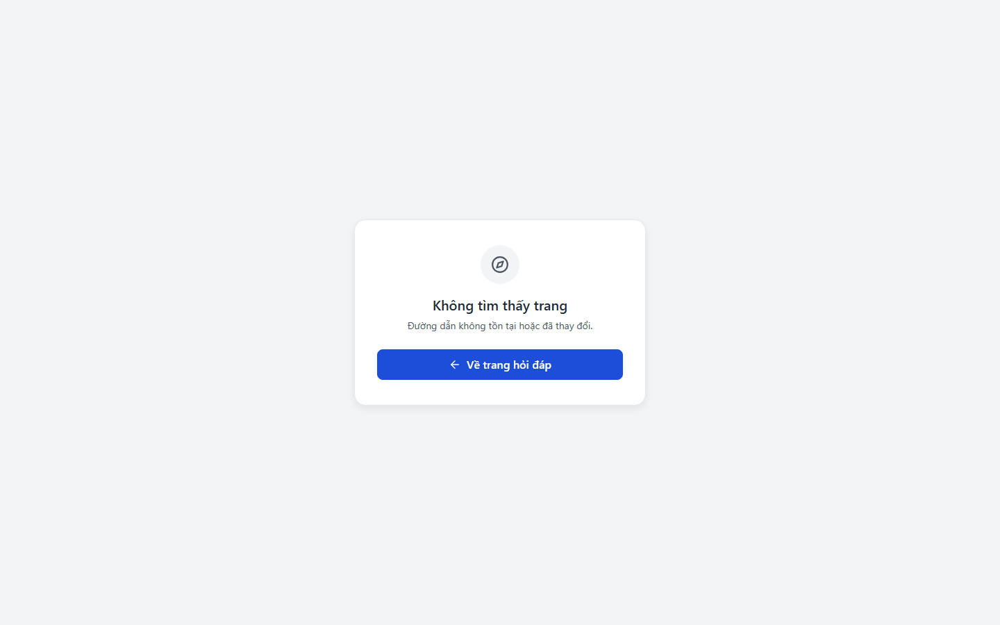
*Hình 3.0.1 — SCR-07 Không tìm thấy trang*

---

### EP-01 — Truy cập và phân quyền

---

#### US-001 — Đăng nhập bằng tài khoản được cấp

| Epic | Ưu tiên | Persona | BR | Màn hình | Thành phần UI | API |
|---|---|---|---|---|---|---|
| EP-01 | **P0** | PER-01 | BR-017 | SCR-01, SCR-03 | `features/auth`, route guard | API-01 `GET /me` |

**Story:** Là **Chuyên viên PTKD**, tôi muốn đăng nhập bằng tài khoản được cấp, để chỉ người được phép mới xem được tài liệu dự án.

**Tiêu chí nghiệm thu**
- **AC-001.1** — *Given* người dùng có tài khoản nằm trong danh sách được cấp quyền, *When* người dùng đăng nhập với thông tin hợp lệ, *Then* hệ thống chuyển tới màn hình chính và hiển thị tập tài liệu của người dùng.
- **AC-001.2** — *Given* người dùng không có trong danh sách được cấp quyền, *When* người dùng cố đăng nhập, *Then* hệ thống từ chối truy cập, hiển thị "Bạn chưa được cấp quyền sử dụng. Liên hệ quản trị viên." và không tiết lộ bất kỳ tài liệu nào.
- **AC-001.3** — *Given* phiên đăng nhập đã hết hạn, *When* người dùng thực hiện bất kỳ thao tác nào, *Then* hệ thống chuyển về trang đăng nhập và giữ lại nội dung câu hỏi đang soạn.
- **AC-001.4** — *Given* người dùng chưa đăng nhập, *When* người dùng truy cập trực tiếp một đường dẫn bên trong ứng dụng, *Then* hệ thống chuyển về trang đăng nhập.

**Trường hợp biên:** NE-07 (phiên hết hạn → `/login?returnTo=/`, khôi phục bản nháp vào ô câu hỏi). Mã lỗi `SESSION_EXPIRED`, `NOT_AUTHORIZED`.

**Ghi chú:** Phương thức đăng nhập (SSO nội bộ hay tài khoản riêng) chưa chốt — PRD OQ-P01 / SDD DQ-02 / SADD AQ-03. Việc lưu bản nháp vào `sessionStorage` chờ ATTT duyệt (DQ-04).

**Ghi chú kiến trúc (SADD §2.4.2, §4.1.1, ADR-08)**
- Đăng nhập theo OIDC Authorization Code + PKCE, back-end giữ token (mẫu BFF). Trình duyệt chỉ nhận cookie phiên `cwd_sid` (`HttpOnly; Secure; SameSite=Lax`). Endpoint: `GET /auth/login`, `GET /auth/callback`, `POST /auth/logout`, `GET /me`.
- Đăng nhập OIDC thành công **chưa đủ**: tài khoản phải có `app_user.active = true`, nếu không thì chuyển tới `/no-access` (AC-001.2).
- Phiên hết hạn sau 2 giờ không hoạt động hoặc tối đa 12 giờ; khi đó API trả 401 `SESSION_EXPIRED` và UI thực hiện AC-001.3.
- Mọi request ghi dữ liệu gửi kèm `X-CSRF-Token` lấy từ `GET /me`.
- Đăng nhập được ghi vào `audit_log`; sự kiện `session_started` phát sau khi `GET /me` thành công.

**Màn hình thiết kế**

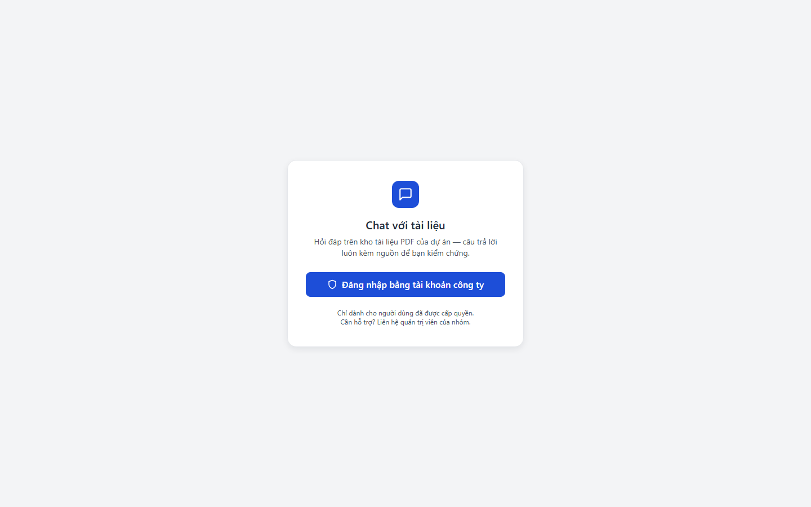
*Hình US-001.1 — SCR-01 Đăng nhập*

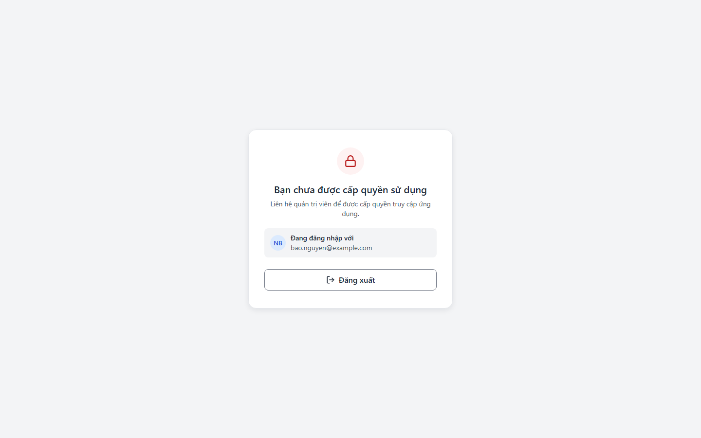
*Hình US-001.2 — SCR-03 Chưa được cấp quyền (AC-001.2)*

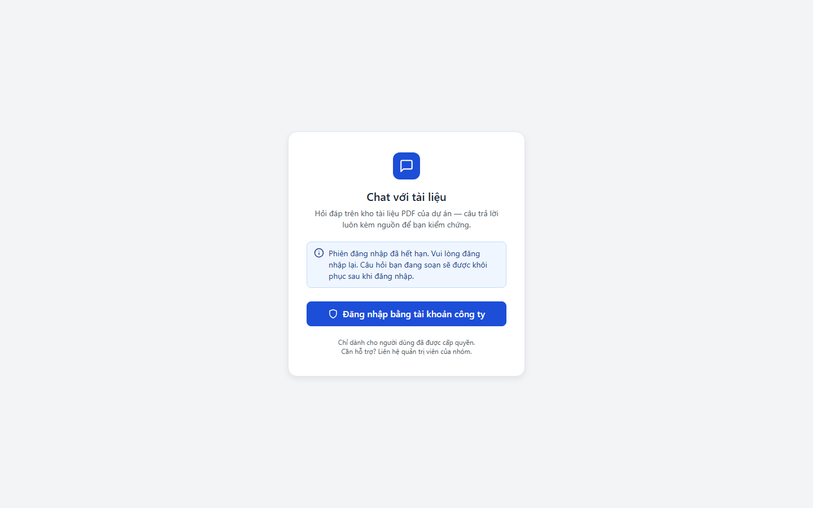
*Hình US-001.3 — Đăng nhập lại sau khi phiên hết hạn; câu hỏi đang soạn được khôi phục (AC-001.3, NE-07)*

---

#### US-002 — Chỉ thấy và chỉ hỏi trên tài liệu của mình

| Epic | Ưu tiên | Persona | BR | Màn hình | Thành phần UI | API |
|---|---|---|---|---|---|---|
| EP-01 | **P0** | PER-01 | BR-018 | SCR-02 | Route guard, `DocumentList` | API-03 `GET /documents` |

**Story:** Là **Chuyên viên PTKD**, tôi muốn chỉ thấy và chỉ hỏi được trên tài liệu do chính tôi tải lên, để tài liệu của tôi không bị người khác truy cập.

**Tiêu chí nghiệm thu**
- **AC-002.1** — *Given* người dùng A và người dùng B mỗi người đã tải lên tài liệu riêng, *When* A đặt câu hỏi về nội dung chỉ có trong tài liệu của B, *Then* hệ thống trả lời "không tìm thấy" và không trích dẫn tài liệu của B.
- **AC-002.2** — *Given* người dùng A đã đăng nhập, *When* A mở danh sách tài liệu, *Then* chỉ tài liệu của A được hiển thị.
- **AC-002.3** — *Given* A biết mã định danh tài liệu của B, *When* A cố truy cập trực tiếp tài liệu đó, *Then* hệ thống từ chối truy cập.

**Trường hợp biên:** API trả 403/404 → UI hiển thị "Không tìm thấy tài liệu. Tài liệu có thể đã bị xóa." (`DOC_NOT_FOUND`). UI không được ẩn dữ liệu bằng CSS thay cho kiểm soát quyền (SDD CN-07).

**Ghi chú:** Mô hình phân quyền theo DF-08 — mỗi người dùng một tập tài liệu riêng.

**Ghi chú kiến trúc (SADD §3.1.3, ADR-06)**
- Cô lập ba lớp: `owner_id` chỉ lấy từ phiên (không nhận từ client) · Row-Level Security của PostgreSQL trên `document`, `chunk`, `answer`, `feedback` · khóa tệp trong object storage có tiền tố `owner/{owner_id}/`.
- Tài liệu của người khác trả **404** `DOC_NOT_FOUND` (không phải 403) để không tiết lộ tài liệu đó có tồn tại.
- Prompt gửi LLM chỉ chứa đoạn trích đã lọc theo `owner_id`; không cache câu trả lời giữa người dùng.
- AC-002.1 – AC-002.3 có kiểm thử tự động với 2 người dùng giả lập, chạy trong CI (Launch Gate G-04).

**Màn hình thiết kế**

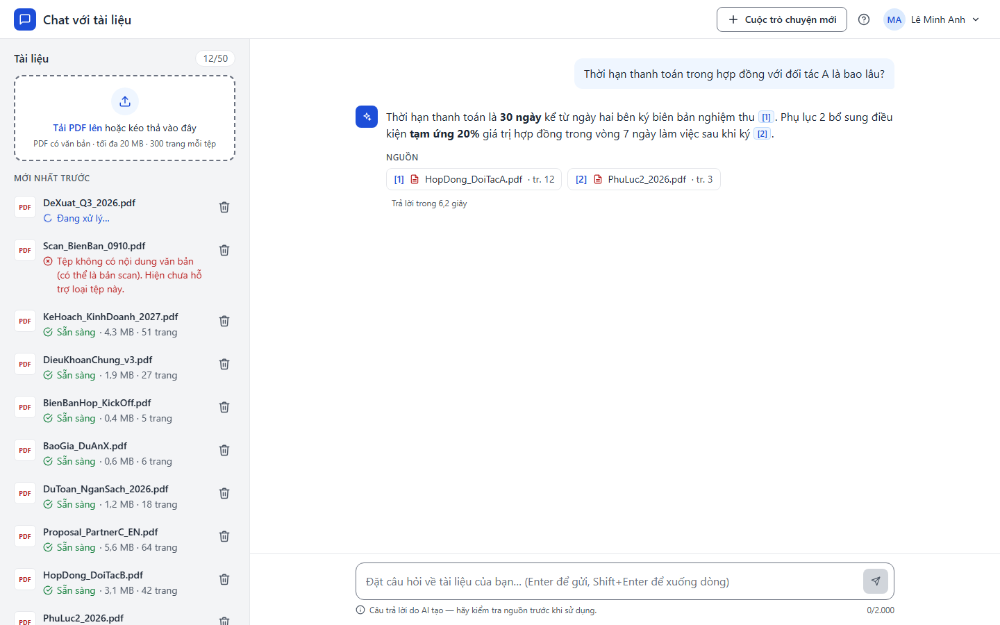
*Hình US-002.1 — Thư viện tài liệu chỉ hiển thị tài liệu của người dùng hiện tại*

---

#### US-023 — Cấp quyền truy cập (CLI/config trong MVP-lite)

| Epic | Ưu tiên | Persona | BR | Màn hình | Thành phần UI | API |
|---|---|---|---|---|---|---|
| EP-01 | **P1** | PER-04 | BR-017 | Không có màn hình bắt buộc | `identity` | Seed/config/CLI; API quản trị là post-MVP |

**Story:** Là **người vận hành**, tôi muốn cấp quyền truy cập cho danh sách người dùng thử nghiệm bằng cấu hình hoặc CLI, để kiểm soát ai được dùng MVP mà không phải xây màn hình quản trị.

**Tiêu chí nghiệm thu**
- **AC-023.1** — *Given* quản trị viên đã đăng nhập, *When* quản trị viên thêm tài khoản của một người dùng vào danh sách được cấp quyền, *Then* người dùng đó đăng nhập được ngay ở lần thử tiếp theo.
- **AC-023.2** — *Given* một người dùng đang có quyền, *When* quản trị viên thu hồi quyền của người dùng đó, *Then* người dùng không thực hiện được thao tác nào ở lần yêu cầu tiếp theo.
- **AC-023.3** `[Đề xuất]` — *Given* quản trị viên nhấn "Thu hồi", *When* hộp xác nhận hiện ra, *Then* hộp ghi rõ email người dùng; quyền chỉ bị thu hồi sau khi nhấn xác nhận. Áp dụng khi có màn hình quản trị (post-MVP); trong MVP-lite, thao tác thực hiện bằng CLI/config nên không có hộp xác nhận trên UI.

**Ghi chú MVP-lite:** Thu hồi quyền có thể thực hiện bằng CLI/config và có hiệu lực ở request tiếp theo. SCR-06 và API quản trị đầy đủ là post-MVP.

**Ghi chú kiến trúc (SADD §2.4.2, §4.1.1)**
- Cấp quyền: `POST /admin/users` `{email, roles[]}`; thu hồi / cấp lại / đổi vai trò: `PATCH /admin/users/{id}` `{active, roles[]}`. Trùng email → 409.
- Thu hồi quyền **xóa mọi phiên** của người dùng đó trong Redis, nên có hiệu lực ngay ở request tiếp theo (AC-023.2).
- Vai trò: `user`, `manager`, `evaluator`, `admin`; kiểm tra ở mỗi route.
- Mọi thao tác cấp/thu hồi được ghi `audit_log` (không chứa nội dung).

**Màn hình thiết kế**

Không có ảnh thiết kế trong MVP-lite — cấp/thu hồi quyền thực hiện bằng CLI/config, không qua UI (SDD v0.3 §3.2.1). Màn hình quản trị (trước đây gọi SCR-06) là post-MVP và đã bị gỡ khỏi `html_design/`.

---

### EP-02 — Quản lý tài liệu

---

#### US-003 — Tải một tệp PDF lên

| Epic | Ưu tiên | Persona | BR | Màn hình | Thành phần UI | API |
|---|---|---|---|---|---|---|
| EP-02 | **P0** | PER-01 | BR-001 | SCR-02 | `UploadDropzone`, `UploadQueue`, `DocumentItem`, `DuplicateFileDialog` | API-04, API-05, API-06 |

**Story:** Là **Chuyên viên PTKD**, tôi muốn tải một tệp PDF lên, để có thể đặt câu hỏi về nội dung của nó.

**Tiêu chí nghiệm thu**
- **AC-003.1** — *Given* người dùng có ít hơn 50 tài liệu (DF-02), *When* người dùng tải lên một PDF có lớp văn bản, ≤ 20 MB (DF-01) và ≤ 300 trang (DF-03), *Then* tài liệu xuất hiện trong danh sách với trạng thái "Đang xử lý" rồi chuyển sang "Sẵn sàng".
- **AC-003.2** — *Given* một tài liệu vừa chuyển sang "Sẵn sàng", *When* người dùng hỏi một câu mà đáp án chỉ có trong tài liệu đó, *Then* câu trả lời đúng và trích dẫn tài liệu đó.
- **AC-003.3** — *Given* một PDF văn bản 20 trang, *When* người dùng tải lên, *Then* tài liệu chuyển sang "Sẵn sàng" trong ≤ 60 giây `[Đề xuất]`.

**Trường hợp biên**

| Mã | Tình huống | Hành vi |
|---|---|---|
| ER-08 | Tệp trùng tên với tệp đã có | Hộp thoại "Thay thế tệp cũ" / "Giữ cả hai" (tệp mới thêm hậu tố `(2)`) — hành vi mặc định chờ OQ-P04 |
| NE-01 | Mất mạng khi đang tải lên | Tệp chuyển "Lỗi — Mất kết nối" kèm nút **Thử lại**; tệp khác không bị ảnh hưởng |
| NE-03 | Ngoại tuyến | Vùng tải lên bị khóa, banner "Bạn đang ngoại tuyến" |
| NE-09 | Tải lại trang khi tệp đang xử lý | Máy chủ vẫn xử lý; trạng thái hiển thị lại khi trang tải xong |

**Ghi chú kiến trúc (SADD §2.2.2, §2.4.2, §3.2.1)**
- **Tiếp nhận (api):** Ingress chặn body > 21 MB → API ghi tệp dần vào object storage và đếm byte → kiểm tra 5 byte đầu `%PDF-` → một giao dịch kiểm tra hạn mức và trùng tên → trả `201 {status: "processing"}` → đưa job vào hàng đợi `ingestion`.
- **Xử lý (worker):** quét mã độc ClamAV → kiểm tra PDF → trích xuất văn bản theo trang → chia đoạn ~500 token (giữ số trang) → embedding nội bộ bằng bge-m3 → `ready`. Ước tính ~10 giây cho PDF 20 trang, trong giới hạn 60 giây của AC-003.3.
- Trạng thái được đẩy về UI qua SSE `GET /documents/events`.
- Trùng tên: `POST /documents?on_duplicate=reject|replace|keep_both`. Mặc định `reject` trả 409 `DUPLICATE_NAME` để UI mở hộp thoại ER-08.
- Tải lên bị gián đoạn không tạo bản ghi tài liệu; tệp tạm được job dọn sau 24 giờ.
- Giới hạn tần suất 60 tệp/giờ/người dùng → 429 `RATE_LIMITED`.

**Màn hình thiết kế**

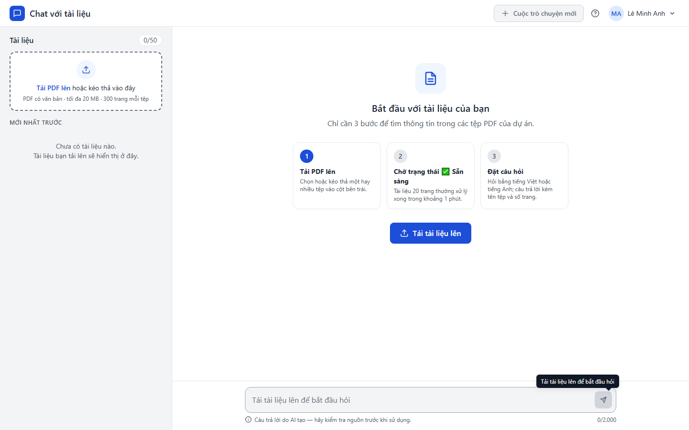
*Hình US-003.1 — Trạng thái trống ES-01 với hướng dẫn 3 bước và nút "Tải PDF lên" nổi bật*

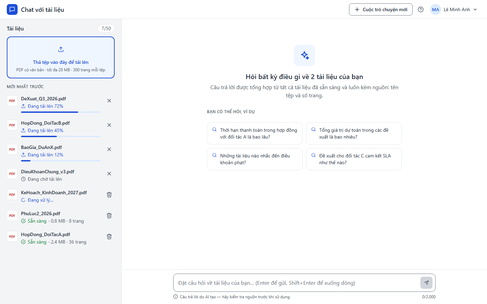
*Hình US-003.2 — Tệp đang tải lên với thanh tiến trình, rồi chuyển sang "Đang xử lý"*

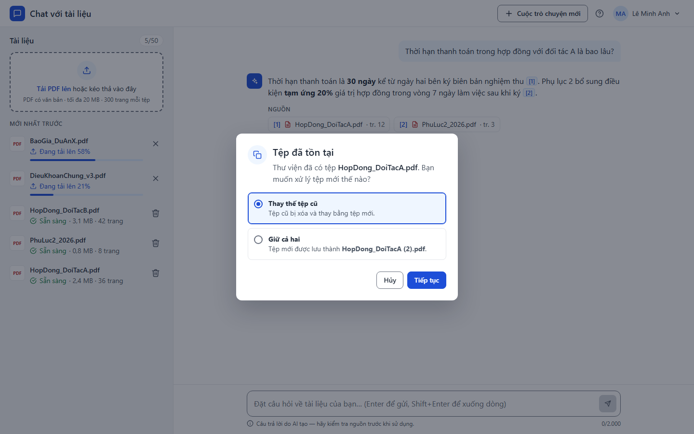
*Hình US-003.3 — Hộp thoại xử lý tệp trùng tên (ER-08)*

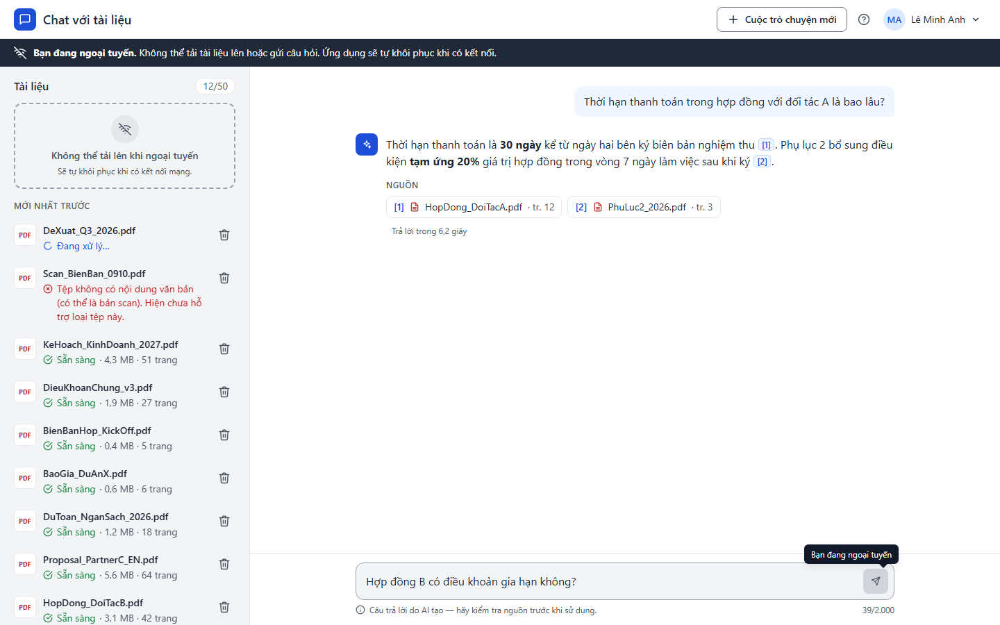
*Hình US-003.4 — Banner ngoại tuyến; vùng tải lên bị khóa (NE-03)*

---

#### US-004 — Tải nhiều tệp PDF trong một lần

| Epic | Ưu tiên | Persona | BR | Màn hình | Thành phần UI | API |
|---|---|---|---|---|---|---|
| EP-02 | **P0** | PER-01 | BR-003 | SCR-02 | `UploadDropzone`, `UploadQueue` (tối đa 3 tệp đồng thời) | API-04, API-06 |

**Story:** Là **Chuyên viên PTKD**, tôi muốn chọn hoặc kéo thả nhiều tệp PDF trong một lần, để không phải tải từng tệp.

**Tiêu chí nghiệm thu**
- **AC-004.1** — *Given* người dùng chọn 10 tệp PDF hợp lệ cùng lúc, *When* tải lên, *Then* cả 10 tệp xuất hiện trong danh sách, mỗi tệp có trạng thái riêng.
- **AC-004.2** — *Given* trong 10 tệp có 1 tệp lỗi, *When* quá trình xử lý kết thúc, *Then* 9 tệp ở trạng thái "Sẵn sàng" và 1 tệp ở trạng thái "Lỗi"; tệp lỗi không ảnh hưởng tới các tệp còn lại.
- **AC-004.3** — *Given* có ≥ 2 tài liệu ở trạng thái "Sẵn sàng", *When* người dùng đặt câu hỏi, *Then* hệ thống tìm câu trả lời trên tất cả tài liệu sẵn sàng mà người dùng không phải chọn tài liệu.

**Tương tác (IX-01):** nhấn vùng tải lên hoặc kéo thả; `Enter` / `Space` khi focus ở vùng tải lên để mở hộp chọn tệp. Ở chiều rộng < 1024px, kéo thả được thay bằng nút chọn tệp.

**Ghi chú kiến trúc (SADD §2.2.2, §2.2.3)**
- Mỗi tệp là một request riêng (UI gửi tối đa 3 tệp song song) và một job ingestion riêng. Worker dùng `acks_late` và retry độc lập, nên một tệp lỗi không ảnh hưởng tệp khác (AC-004.2).
- Hàng đợi `ingestion` tách khỏi hàng đợi `maintenance`; worker tự tăng từ 2 lên tối đa 6 bản sao theo độ dài hàng đợi (kịch bản 500 tệp tải cùng lúc).
- Truy xuất luôn chạy trên **mọi** tài liệu `ready` của người dùng, không cần chọn tài liệu (AC-004.3).

**Màn hình thiết kế**

*Hình US-004.1 — Nhiều tệp tải lên song song, mỗi tệp một thanh tiến trình*

*Hình US-004.2 — Kết quả: mỗi tệp có trạng thái riêng, tệp lỗi không ảnh hưởng tệp khác*

---

#### US-005 — Được báo rõ khi tệp không xử lý được

| Epic | Ưu tiên | Persona | BR | Màn hình | Thành phần UI | API |
|---|---|---|---|---|---|---|
| EP-02 | **P0** | PER-01 | BR-002 | SCR-02 | `StatusBadge`, `DocumentItem`, `messages.vi.ts` | API-06 (SSE `status`) |

**Story:** Là **Chuyên viên PTKD**, tôi muốn được báo rõ khi một tệp không xử lý được và lý do, để biết câu trả lời không bao gồm tệp đó.

**Tiêu chí nghiệm thu**
- **AC-005.1** — *Given* người dùng tải lên tệp hỏng, tệp có mật khẩu, tệp không phải PDF hoặc PDF không có lớp văn bản, *When* quá trình xử lý thất bại, *Then* tệp hiển thị trạng thái "Lỗi" kèm lý do cụ thể theo bảng dưới.
- **AC-005.2** — *Given* một tệp có trạng thái "Lỗi", *When* người dùng đặt câu hỏi, *Then* tệp đó không được dùng làm nguồn và không được trích dẫn.

**Thông báo lỗi**

| Mã | Mã lỗi | Thông báo hiển thị | Hành động |
|---|---|---|---|
| ER-01 | `FILE_NOT_PDF` | Chỉ hỗ trợ tệp PDF. | — |
| ER-04 | `PDF_ENCRYPTED` | Tệp được bảo vệ bằng mật khẩu. Hãy gỡ mật khẩu và tải lại. | Xóa |
| ER-05 | `PDF_CORRUPTED` | Không đọc được tệp. Tệp có thể bị hỏng. | Xóa |
| ER-06 | `PDF_NO_TEXT` | Tệp không có nội dung văn bản (có thể là bản scan). Hiện chưa hỗ trợ loại tệp này. | Xóa |
| NE-01 | `UPLOAD_NETWORK` | Mất kết nối khi tải lên. | Thử lại · Xóa |
| — | `FILE_REJECTED` `[Đề xuất — SADD AQ-05]` | Tệp không an toàn và đã bị từ chối. | Xóa |
| — | `INGESTION_FAILED` `[Đề xuất — SADD AQ-05]` | Không xử lý được tệp do lỗi hệ thống. Vui lòng thử lại. | Thử lại · Xóa |
| ES-03 | — | Banner: "Không có tài liệu nào sẵn sàng. Kiểm tra lỗi ở danh sách bên trái." | — |

**Ghi chú:** Trạng thái không chỉ thể hiện bằng màu — luôn có biểu tượng ❌ và chữ (IX-07). Lý do lỗi hiển thị một dòng; chi tiết trong tooltip.

**Ghi chú kiến trúc (SADD §2.2.2)**
- Phân loại lỗi trong worker: mã hóa → `PDF_ENCRYPTED`; không mở được → `PDF_CORRUPTED`; ≥ 80% số trang có < 20 ký tự → `PDF_NO_TEXT`; phát hiện mã độc → `FILE_REJECTED` (tệp bị xóa ngay).
- Lỗi do **nội dung tệp** không retry. Lỗi **hạ tầng** (embedding, CSDL, kho tệp) retry 3 lần (2 s / 8 s / 32 s) rồi mới chuyển `INGESTION_FAILED`; job treo quá 10 phút cũng chuyển `INGESTION_FAILED`.
- Nút Thử lại gọi `POST /documents/{id}/retry` (chỉ áp dụng cho `UPLOAD_NETWORK` và `INGESTION_FAILED`).
- Truy xuất chỉ đọc chunk của tài liệu `ready`, nên tài liệu lỗi không bao giờ được trích dẫn (AC-005.2).
- Hai mã lỗi mới cần được bổ sung vào danh mục lỗi của SDD §3.4.3 (SADD AQ-05).

**Màn hình thiết kế**

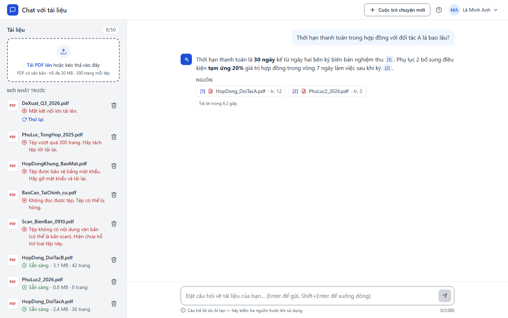
*Hình US-005.1 — Tài liệu lỗi hiển thị ❌ và lý do cụ thể; lỗi mạng có nút Thử lại*

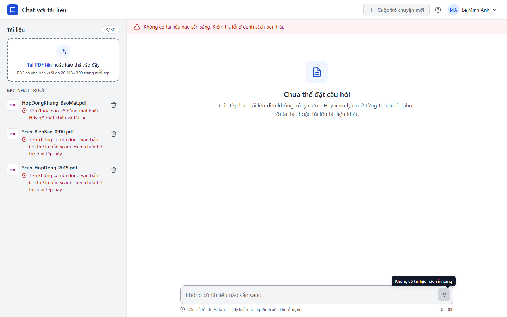
*Hình US-005.2 — Banner ES-03 khi không có tài liệu nào sẵn sàng*

---

#### US-006 — Được báo ngay khi tệp vượt giới hạn

| Epic | Ưu tiên | Persona | BR | Màn hình | Thành phần UI | API |
|---|---|---|---|---|---|---|
| EP-02 | **P0** | PER-01 | BR-006 | SCR-02 | `shared/validation`, `UploadDropzone` | API-02 `GET /config`, API-04 |

**Story:** Là **Chuyên viên PTKD**, tôi muốn được báo ngay khi tệp vượt dung lượng hoặc số trang cho phép, để không phải chờ vô ích.

**Tiêu chí nghiệm thu**
- **AC-006.1** — *Given* một tệp có dung lượng đúng bằng 20 MB (DF-01), *When* người dùng tải lên, *Then* tệp được chấp nhận.
- **AC-006.2** — *Given* một tệp lớn hơn 20 MB, *When* người dùng chọn tệp, *Then* hệ thống từ chối **trước khi truyền tệp đi**, hiển thị "Tệp vượt quá 20 MB" và không tạo dòng nào trong danh sách.
- **AC-006.3** — *Given* một tệp có số trang lớn hơn 300 (DF-03), *When* hệ thống kiểm tra tệp, *Then* tệp chuyển sang "Lỗi" với lý do "Tệp vượt quá 300 trang".

**Ghi chú kỹ thuật:** Giới hạn lấy từ `GET /config`, không cố định trong code. Kiểm tra loại tệp bằng magic bytes `%PDF-` (bắt được tệp đổi đuôi thành `.pdf`). Sự kiện `document_upload_rejected_client` với `reason_code`.

**Ghi chú kiến trúc (SADD §2.4.2)**
- Máy chủ **kiểm tra lại** mọi giới hạn, không tin kiểm tra phía trình duyệt: Ingress chặn body > 21 MB; API trả 413 `FILE_TOO_LARGE` khi vượt DF-01, 415 `FILE_NOT_PDF` khi sai magic bytes.
- Số trang chỉ biết sau khi mở PDF, nên được kiểm tra ở worker → `TOO_MANY_PAGES` (AC-006.3).
- DF-01 – DF-03 nằm trong cấu hình máy chủ (ConfigMap); đổi giá trị không cần build lại.

**Màn hình thiết kế**

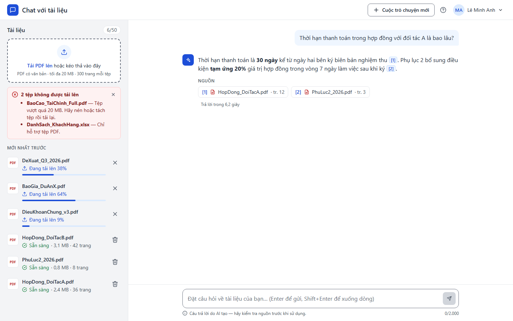
*Hình US-006.1 — Thông báo "Tệp vượt quá 20 MB" hiện ngay khi chọn tệp, không tạo dòng trong danh sách*

*Hình US-006.2 — Tệp vượt 300 trang chuyển sang trạng thái Lỗi (ER-03)*

---

#### US-007 — Được báo khi đạt số tài liệu tối đa

| Epic | Ưu tiên | Persona | BR | Màn hình | Thành phần UI | API |
|---|---|---|---|---|---|---|
| EP-02 | **P0** | PER-01 | BR-007 | SCR-02 | `DocumentCounter`, `UploadDropzone`, `shared/validation` | API-03, API-04 (`422 QUOTA_EXCEEDED`) |

**Story:** Là **Chuyên viên PTKD**, tôi muốn được báo khi tập tài liệu đã đạt số lượng tối đa, để biết cần xóa bớt tài liệu cũ.

**Tiêu chí nghiệm thu**
- **AC-007.1** — *Given* tập truy vấn đã có đúng 50 tài liệu (DF-02), *When* người dùng tải thêm một tệp, *Then* tệp bị từ chối với thông báo "Đã đạt tối đa 50 tài liệu. Xóa bớt tài liệu để tải thêm."
- **AC-007.2** — *Given* tập truy vấn có 48 tài liệu, *When* người dùng tải lên cùng lúc 5 tệp, *Then* 2 tệp đầu được chấp nhận, 3 tệp còn lại bị từ chối kèm thông báo nêu rõ số tệp bị từ chối.

**Ghi chú UX:** Tiêu đề thư viện luôn hiển thị bộ đếm `đã dùng / tối đa` (UX-02). Khi đạt hạn mức, `UploadDropzone` bị khóa kèm tooltip giải thích.

**Ghi chú kiến trúc (SADD §2.4.2)**
- Khi nhiều tệp tải lên song song, API khóa hàng `app_user` (`SELECT … FOR UPDATE`) trong lúc đếm tài liệu. Nhờ đó với 48 tài liệu và 5 tệp gửi cùng lúc, đúng 2 tệp được nhận và 3 tệp nhận 422 `QUOTA_EXCEEDED` (AC-007.2), không có trường hợp vượt 50.
- `GET /documents` trả `{items, used, max}` để hiển thị bộ đếm.

**Màn hình thiết kế**

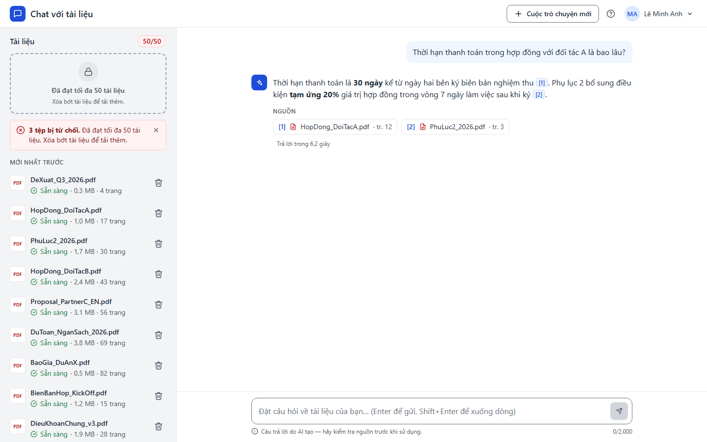
*Hình US-007.1 — Bộ đếm 50/50, vùng tải lên bị khóa và thông báo ER-07*

---

#### US-008 — Xóa một tài liệu

| Epic | Ưu tiên | Persona | BR | Màn hình | Thành phần UI | API |
|---|---|---|---|---|---|---|
| EP-02 | **P0** | PER-01 | BR-005 | SCR-02 | `DocumentItem`, `DeleteConfirmDialog` | API-07 `DELETE /documents/{id}` |

**Story:** Là **Chuyên viên PTKD**, tôi muốn xóa một tài liệu khỏi tập truy vấn, để loại bỏ tài liệu cũ hoặc tải nhầm.

**Tiêu chí nghiệm thu**
- **AC-008.1** — *Given* một tài liệu đang ở trạng thái bất kỳ, *When* người dùng nhấn "Xóa", *Then* hệ thống hiển thị hộp xác nhận ghi tên tệp.
- **AC-008.2** — *Given* người dùng đã xác nhận xóa, *When* thao tác hoàn tất, *Then* tài liệu biến mất khỏi danh sách, và các câu hỏi sau đó không còn trích dẫn tài liệu này.
- **AC-008.3** — *Given* người dùng nhấn "Hủy" trong hộp xác nhận, *When* hộp đóng lại, *Then* tài liệu vẫn còn nguyên.

**Trường hợp biên**
- Không có hoàn tác (IX-04). Không dùng optimistic UI — chỉ xóa khỏi danh sách sau khi máy chủ trả `204`.
- ES-05: xóa tài liệu cuối cùng → quay về trạng thái ES-01; lịch sử hội thoại vẫn hiển thị nhưng ô câu hỏi bị khóa.
- NE-08: tài liệu bị xóa ở tab khác trong khi đang hỏi → câu trả lời không trích dẫn tài liệu đã xóa.
- Sau khi xóa: toast xác nhận, tự ẩn sau 4 giây. `Esc` đóng hộp thoại.

**Ghi chú kiến trúc (SADD §3.2.3)**
- `DELETE /documents/{id}`: đặt trạng thái `deleting` (tài liệu bị loại khỏi truy xuất ngay) → xóa chunk và vector → xóa bản ghi → trả **204** → xóa tệp gốc trong kho tệp (lỗi thì job thử lại) → ghi `audit_log`.
- 204 chỉ được trả khi tài liệu đã thực sự ra khỏi phạm vi truy vấn, nên UI không dùng optimistic UI.
- Câu trả lời đang stream lúc xóa: bước kiểm tra trích dẫn tra lại tài liệu và loại trích dẫn tới tài liệu không còn tồn tại (NE-08).

**Màn hình thiết kế**

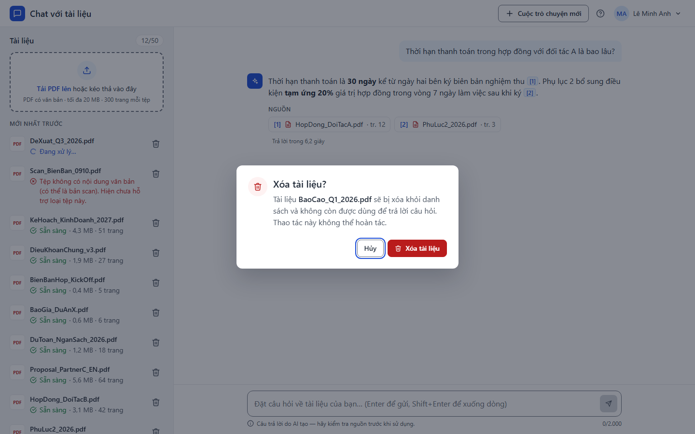
*Hình US-008.1 — Hộp thoại xác nhận xóa ghi rõ tên tệp, có nút Hủy và Xóa*

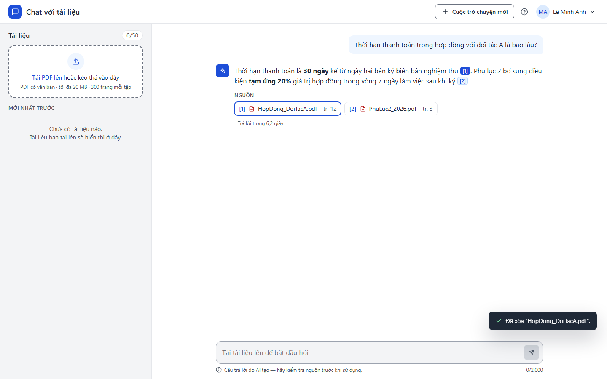
*Hình US-008.2 — ES-05: sau khi xóa tài liệu cuối cùng, thư viện về trạng thái trống nhưng hội thoại cũ vẫn hiển thị; ô câu hỏi bị khóa*

---

#### US-009 — Xem danh sách tài liệu trong tập truy vấn

| Epic | Ưu tiên | Persona | BR | Màn hình | Thành phần UI | API |
|---|---|---|---|---|---|---|
| EP-02 | P1 | PER-01 | BR-004 | SCR-02 | `DocumentPanel`, `DocumentList`, `DocumentCounter` | API-03 `GET /documents` |

**Story:** Là **Chuyên viên PTKD**, tôi muốn xem danh sách tài liệu trong tập truy vấn, để biết câu trả lời dựa trên những tài liệu nào.

**Tiêu chí nghiệm thu** `[Đề xuất]`
- **AC-009.1** — *Given* người dùng có tài liệu, *When* mở màn hình chính, *Then* cột trái hiển thị toàn bộ tài liệu của người dùng, sắp xếp theo thời gian tải lên mới nhất, kèm bộ đếm `đã dùng / tối đa`.
- **AC-009.2** — *Given* danh sách có 50 tài liệu, *When* người dùng cuộn danh sách, *Then* cuộn mượt và danh sách hiển thị trong ≤ 100 ms.
- **AC-009.3** — *Given* màn hình rộng < 1024px, *When* người dùng nhấn nút "Tài liệu", *Then* thư viện mở dạng ngăn trượt (UX-01).
- **AC-009.4** — *Given* danh sách đang tải lần đầu, *When* chưa có dữ liệu, *Then* hiển thị skeleton.

**Ghi chú kiến trúc (SADD §2.4.2, §3.1.2)**
- `GET /documents` trả `{items, used, max}` sắp xếp `uploaded_at` mới nhất, dùng chỉ mục `(owner_id, uploaded_at DESC)`.
- Mỗi `DocumentDTO` có `expires_at` để hiển thị nhãn sắp hết hạn (US-021).

**Màn hình thiết kế**

*Hình US-009.1 — Thư viện tài liệu ở cột trái với bộ đếm 12/50*

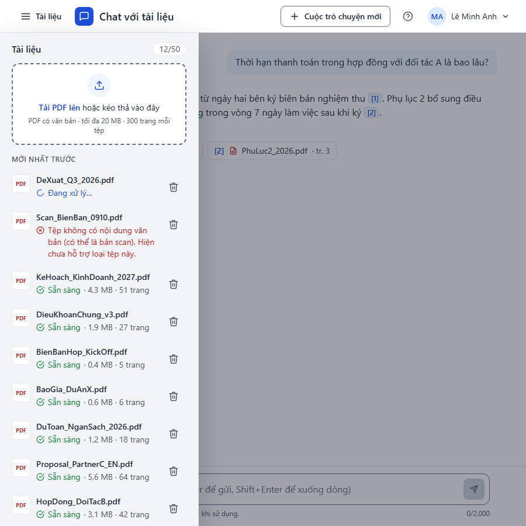
*Hình US-009.2 — AC-009.3: ở chiều rộng < 1024px, thư viện tài liệu mở dạng ngăn trượt*

---

#### US-010 — Thấy trạng thái xử lý của từng tài liệu

| Epic | Ưu tiên | Persona | BR | Màn hình | Thành phần UI | API |
|---|---|---|---|---|---|---|
| EP-02 | P1 | PER-01 | BR-004 | SCR-02 | `StatusBadge`, `DocumentItem`, `Composer` | API-06 (SSE) |

**Story:** Là **Chuyên viên PTKD**, tôi muốn thấy trạng thái xử lý của từng tài liệu (đang xử lý / sẵn sàng / lỗi), để biết khi nào có thể hỏi.

**Tiêu chí nghiệm thu** `[Đề xuất]`
- **AC-010.1** — *Given* một tài liệu thay đổi trạng thái trên máy chủ, *When* sự kiện SSE được gửi, *Then* trạng thái trên UI cập nhật trong ≤ 5 giây (SDD CN-02).
- **AC-010.2** — *Given* mọi tài liệu đều đang xử lý, *When* người dùng nhìn ô câu hỏi, *Then* ô bị khóa với gợi ý "Tài liệu đang được xử lý, vui lòng chờ…" và tự mở khi có ít nhất 1 tài liệu ✅ (ES-02).
- **AC-010.3** — *Given* bất kỳ trạng thái nào, *When* hiển thị, *Then* luôn có biểu tượng **và** chữ, không chỉ màu (IX-07); trình đọc màn hình đọc được trạng thái.

**Bảng trạng thái (SDD §3.7.1)**

| Trạng thái | Biểu tượng | Chữ hiển thị | Hành động |
|---|---|---|---|
| Đang tải lên | ⏳ + thanh tiến trình | Đang tải lên 45% | Hủy |
| Đang xử lý | ⏳ (xoay) | Đang xử lý… | — |
| Sẵn sàng | ✅ | Sẵn sàng | Xóa |
| Sắp hết hạn | ⚠ | Sẽ bị xóa sau N ngày | Xóa |
| Lỗi | ❌ | Thông báo theo mã lỗi | Thử lại (nếu áp dụng) · Xóa |

**Ghi chú kiến trúc (SADD §2.4.2, §3.1.4, §4.2.4)**
- Trạng thái được đẩy qua SSE `GET /documents/events` (`event: status` `{id, status, error_code?, page_count?}`), kèm `: ping` mỗi 15 giây để giữ kết nối qua proxy.
- Worker phát thông báo qua Redis pub/sub; mọi bản sao API nhận và chuyển tới đúng người dùng.
- `document.status` trong PostgreSQL là nguồn sự thật. Khi SSE kết nối lại, UI tải lại `GET /documents` để bù sự kiện bị lỡ.

**Màn hình thiết kế**

*Hình US-010.1 — Đủ các trạng thái ⏳ ✅ ❌ ⚠ trong danh sách*

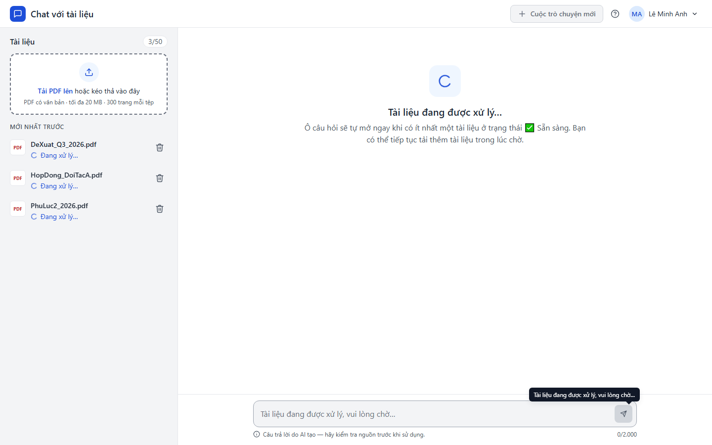
*Hình US-010.2 — ES-02: ô câu hỏi bị khóa khi chưa có tài liệu sẵn sàng*

---

#### US-021 — Tự động xóa tài liệu khi hết hạn lưu trữ

| Epic | Ưu tiên | Persona | BR | Màn hình | Thành phần UI | API |
|---|---|---|---|---|---|---|
| EP-02 | **P0** | STK-006 Chủ sở hữu tài liệu | BR-008 | SCR-02 | `ExpiryBadge` | API-03 (`expires_at`) |

**Story:** Là **chủ sở hữu tài liệu**, tôi muốn tài liệu được tự động xóa khi hết thời hạn lưu trữ, để dữ liệu không bị giữ lâu hơn mức được phép.

**Tiêu chí nghiệm thu**
- **AC-021.1** — *Given* một tài liệu đã được tải lên quá 90 ngày (DF-05), *When* tiến trình dọn dẹp định kỳ chạy (tối thiểu mỗi ngày một lần), *Then* tài liệu và mọi dữ liệu phát sinh từ tài liệu bị xóa, không còn truy vấn hoặc truy xuất được.
- **AC-021.2** — *Given* một tài liệu còn 7 ngày nữa là hết hạn, *When* người dùng mở danh sách tài liệu, *Then* tài liệu hiển thị nhãn "Sẽ bị xóa sau 7 ngày".

**Ghi chú:** AC-021.1 được xác minh trên môi trường kiểm thử với thời hạn rút ngắn (Launch Gate G-08). Sự kiện `document_deleted` với `trigger=retention` do máy chủ phát.

**Ghi chú kiến trúc (SADD §2.2.4, §2.3, §4.2.5)**
- Job `retention.purge_expired` chạy lúc 02:00 hằng ngày, xóa cứng PDF gốc, chunk và vector theo lô 100 tài liệu (`FOR UPDATE SKIP LOCKED`, chạy lại an toàn). Dùng chung use case với US-008.
- **Rủi ro mở (SADD AQ-04):** bản sao lưu CSDL giữ dữ liệu tối đa 7 ngày, nên tài liệu đã xóa vẫn còn trong backup tới 7 ngày. Cần ATTT chấp nhận "xóa hoàn toàn trong ≤ 7 ngày sau khi hết hạn"; nếu không chấp nhận, rút thời gian khôi phục PITR xuống 1 ngày.

**Màn hình thiết kế**

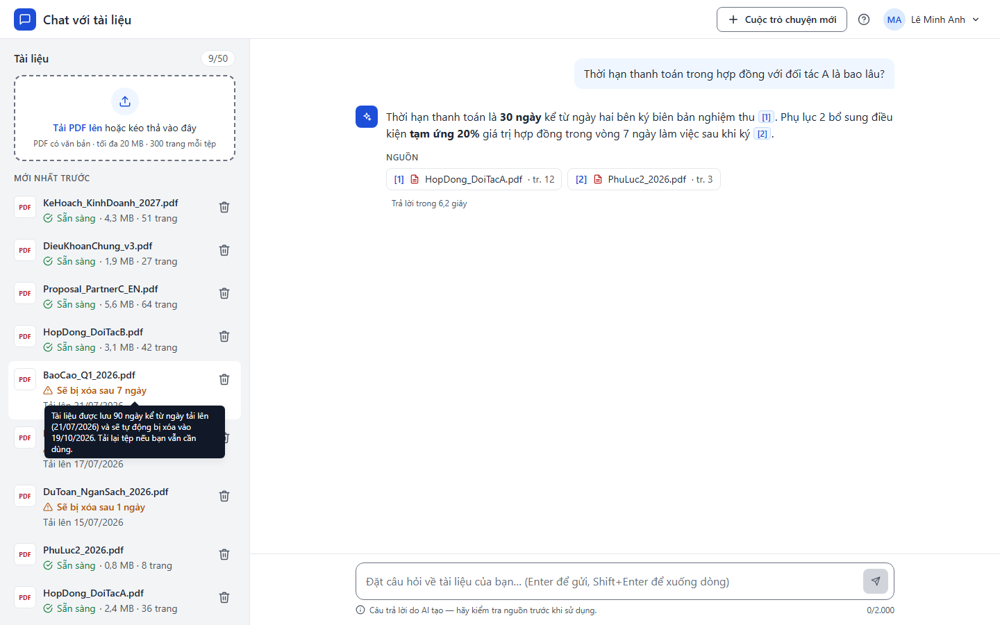
*Hình US-021.1 — Tài liệu có nhãn ⚠ "Sẽ bị xóa sau 7 ngày"*

---

### EP-03 — Hỏi đáp trên tài liệu

---

#### US-011 — Đặt câu hỏi bằng ngôn ngữ tự nhiên

| Epic | Ưu tiên | Persona | BR | Màn hình | Thành phần UI | API |
|---|---|---|---|---|---|---|
| EP-03 | **P0** | PER-01 | BR-009 | SCR-02 | `Composer`, `TypingIndicator`, `AnswerMessage`, `ErrorMessage`, `EmptyState` | API-09 (SSE) |

**Story:** Là **Chuyên viên PTKD**, tôi muốn đặt câu hỏi bằng ngôn ngữ tự nhiên và nhận câu trả lời chỉ dựa trên tài liệu của tôi, để không phải đọc thủ công từng tệp.

**Tiêu chí nghiệm thu**
- **AC-011.1** — *Given* người dùng có ≥ 1 tài liệu "Sẵn sàng", *When* người dùng gửi một câu hỏi có đáp án trong tài liệu, *Then* hệ thống trả về câu trả lời mà mọi thông tin khẳng định trong đó đều tìm thấy được trong tài liệu được trích dẫn.
- **AC-011.2** — *Given* câu hỏi yêu cầu kiến thức chung không có trong tài liệu (ví dụ: "Thủ đô của Pháp là gì?"), *When* người dùng gửi, *Then* hệ thống không trả lời bằng kiến thức bên ngoài mà xử lý theo US-013.
- **AC-011.3** — *Given* người dùng chưa có tài liệu nào "Sẵn sàng", *When* người dùng mở màn hình hỏi đáp, *Then* ô câu hỏi bị vô hiệu hóa kèm gợi ý "Tải tài liệu lên để bắt đầu hỏi".
- **AC-011.4** — *Given* ô câu hỏi trống hoặc chỉ có khoảng trắng, *When* người dùng nhấn Gửi, *Then* câu hỏi không được gửi.
- **AC-011.5** — *Given* bộ câu hỏi chuẩn đã được phê duyệt, *When* chạy toàn bộ bộ câu hỏi, *Then* ≥ 85% câu trả lời được người đánh giá xác nhận đúng (KR2.1) `[Đề xuất]`.

**Tương tác và trạng thái**

| Mã | Hành vi |
|---|---|
| IX-02 | `Enter` gửi, `Shift+Enter` xuống dòng, `/` đưa con trỏ vào ô câu hỏi. Nút Gửi bị khóa khi ô trống, chưa có tài liệu sẵn sàng, hoặc đang chờ câu trả lời trước |
| IX-03 | Chỉ báo "Đang tìm trong N tài liệu…" xuất hiện ≤ 300 ms sau khi gửi; nội dung hiện dần (nếu streaming được duyệt — OQ-P02) |
| ES-04 | Có tài liệu sẵn sàng nhưng chưa hỏi → hiển thị câu hỏi mẫu |
| ER-09 | Câu hỏi > 2.000 ký tự → bộ đếm ký tự chuyển đỏ, nút Gửi bị khóa |
| UX-05 | Dòng cố định dưới ô nhập: "Câu trả lời do AI tạo — hãy kiểm tra nguồn trước khi sử dụng" |

**Lỗi khi trả lời**

| Mã | Mã lỗi | Thông báo | Hành động |
|---|---|---|---|
| NE-02 | `ANSWER_NETWORK` | Mất kết nối. Câu hỏi chưa được trả lời. | Gửi lại (câu hỏi được giữ) |
| NE-04 | `SERVICE_BUSY` | Hệ thống đang bận, vui lòng thử lại sau ít phút. | Thử lại |
| NE-05 | `ANSWER_TIMEOUT` | Hệ thống phản hồi quá lâu. Vui lòng thử lại. (sau 60 giây — DF-10) | Thử lại |
| NE-06 | `ANSWER_INTERRUPTED` | Câu trả lời chưa hoàn chỉnh do bị gián đoạn. Ẩn thẻ nguồn. | Thử lại |
| — | `RATE_LIMITED` `[Đề xuất — SADD §2.4.1]` | Bạn đã gửi quá nhiều câu hỏi. Vui lòng thử lại sau ít phút. | Thử lại (sau `Retry-After`) |
| — | `NO_READY_DOCUMENTS` (409) | Không hiển thị — UI đã khóa ô câu hỏi theo AC-011.3; máy chủ vẫn kiểm tra lại | — |
| — | `QUESTION_INVALID` (400) | Không hiển thị — câu hỏi trống hoặc > 2.000 ký tự đã bị chặn ở UI (ER-09, ER-10) | — |

**Ghi chú kiến trúc (SADD §2.2.3, §3.2.2, ADR-10)**
- **Pipeline trả lời:** phát hiện ngôn ngữ → (viết lại câu hỏi tiếp nối) → embedding câu hỏi → tìm kiếm vector + từ khóa **chỉ trong tài liệu của người dùng** → hợp nhất RRF → rerank giữ 8 đoạn → **cổng bằng chứng** → LLM streaming → **kiểm tra trích dẫn**.
- Thứ tự sự kiện SSE của `POST /conversations/{cid}/questions`: `meta {answer_id, ready_doc_count}` → `delta` × n → `citations` → `done {type, latency_ms}`, hoặc `error {code}`. `ready_doc_count` dùng cho chỉ báo "Đang tìm trong N tài liệu…".
- Ngân sách độ trễ ước tính p90 ~12,8 giây (mục tiêu ≤ 15 giây). Máy chủ hủy lời gọi LLM sau 50 giây, nằm trong giới hạn 60 giây phía client (DF-10).
- LLM lỗi trước token đầu tiên: máy chủ retry 1 lần rồi trả `SERVICE_BUSY`. Lỗi sau khi đã gửi nội dung: không retry, trả `ANSWER_INTERRUPTED`. Client ngắt kết nối: máy chủ hủy lời gọi LLM.
- Giới hạn tần suất: 10 câu hỏi/phút/người dùng.
- Nội dung câu hỏi và câu trả lời **không** được lưu vào CSDL; chỉ lưu metadata (`answer_type`, độ trễ, số trích dẫn, `prompt_version`, `model_id`).
- Nhà cung cấp LLM chưa chốt (SADD ADR-03, AQ-01): API được quản lý trong vùng được duyệt, hoặc mô hình tự lưu trữ. Chỉ câu hỏi và tối đa 8 đoạn trích được gửi tới LLM.

**Màn hình thiết kế**

*Hình US-011.1 — AC-011.3: ô câu hỏi bị khóa kèm gợi ý "Tải tài liệu lên để bắt đầu hỏi"*

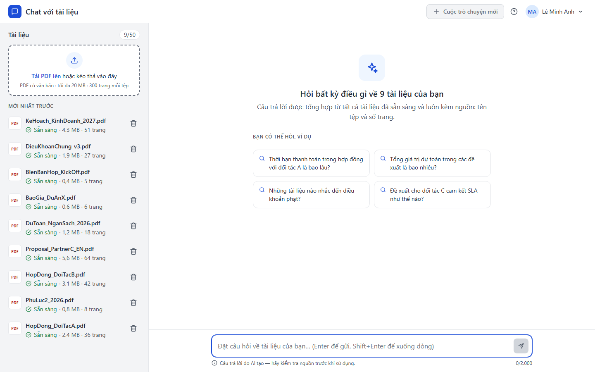
*Hình US-011.2 — ES-04: có tài liệu sẵn sàng, gợi ý câu hỏi mẫu*

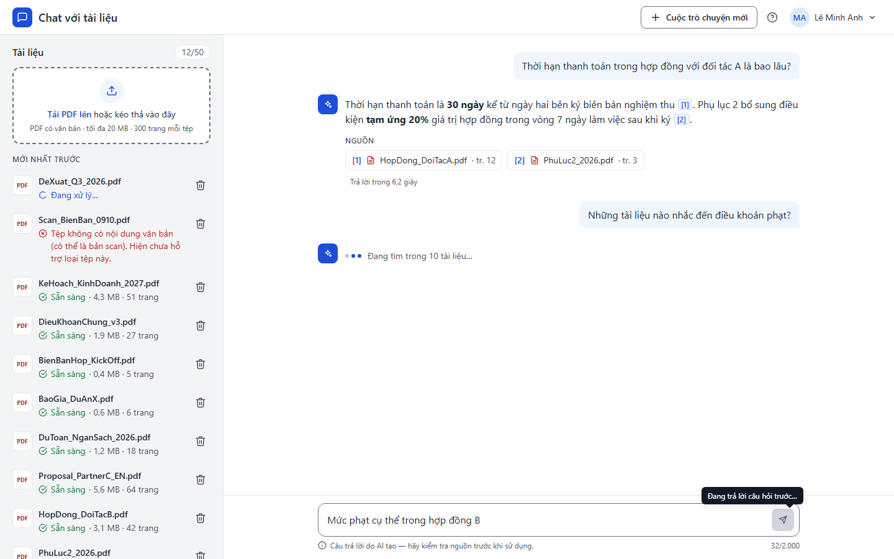
*Hình US-011.3 — Chỉ báo "Đang tìm trong N tài liệu…"*

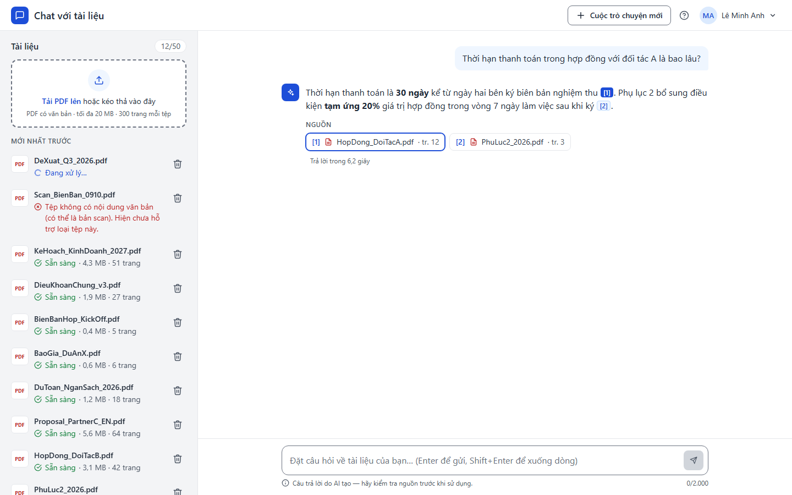
*Hình US-011.4 — Câu trả lời hoàn chỉnh kèm trích dẫn*

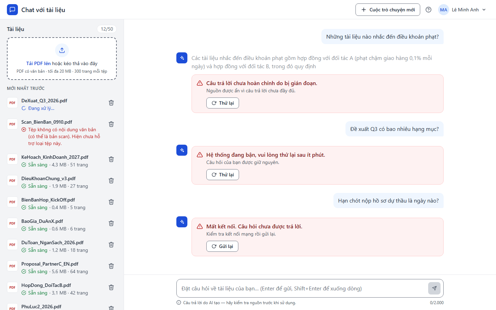
*Hình US-011.5 — Lỗi khi trả lời, có nút Thử lại / Gửi lại*

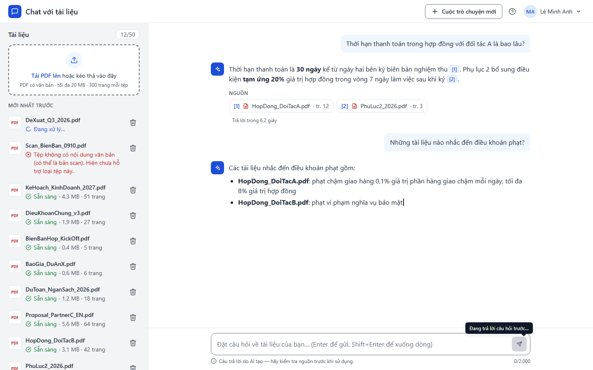
*Hình US-011.6 — Câu trả lời đang hiện dần; thẻ nguồn và 👍 👎 chỉ hiện khi đã hoàn tất*

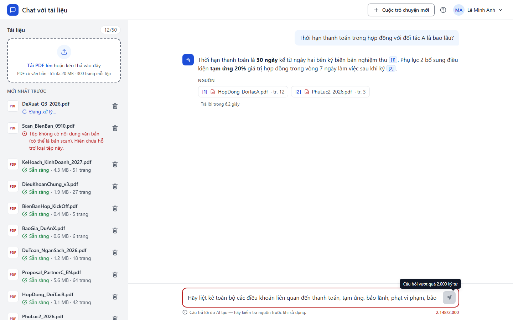
*Hình US-011.7 — ER-09: câu hỏi vượt 2.000 ký tự, bộ đếm chuyển đỏ, nút Gửi bị khóa*

---

#### US-012 — Nhận câu trả lời tổng hợp từ nhiều tài liệu

| Epic | Ưu tiên | Persona | BR | Màn hình | Thành phần UI | API |
|---|---|---|---|---|---|---|
| EP-03 | **P0** | PER-01 | BR-010 | SCR-02 | `AnswerMessage`, `CitationList` | API-09 |

**Story:** Là **Chuyên viên PTKD**, tôi muốn nhận một câu trả lời tổng hợp khi thông tin nằm ở nhiều tài liệu, để không phải tự đối chiếu.

**Tiêu chí nghiệm thu**
- **AC-012.1** — *Given* đáp án của câu hỏi nằm ở 2 tài liệu khác nhau (ví dụ: giá trị hợp đồng ở tài liệu X, điều khoản thanh toán ở tài liệu Y), *When* người dùng hỏi, *Then* câu trả lời chứa thông tin từ cả hai tài liệu và trích dẫn cả X và Y.
- **AC-012.2** — *Given* hai tài liệu có thông tin mâu thuẫn về cùng một nội dung, *When* người dùng hỏi về nội dung đó, *Then* câu trả lời nêu cả hai thông tin và nguồn của từng thông tin, thay vì chỉ chọn một.

**Ghi chú kiến trúc (SADD §2.2.3)**
- Bước rerank giữ tối đa 4 đoạn mỗi tài liệu (trừ khi chỉ một tài liệu liên quan), để các tài liệu khác vẫn có chỗ trong 8 đoạn gửi LLM.
- Tìm kiếm từ khóa (PostgreSQL full-text, `unaccent`) bổ sung cho vector, giúp bắt số hợp đồng, mã, tên riêng nằm ở tài liệu khác.
- System prompt yêu cầu mỗi khẳng định gắn nguồn `[S#]` và nêu cả hai thông tin khi mâu thuẫn (AC-012.2).

**Màn hình thiết kế**

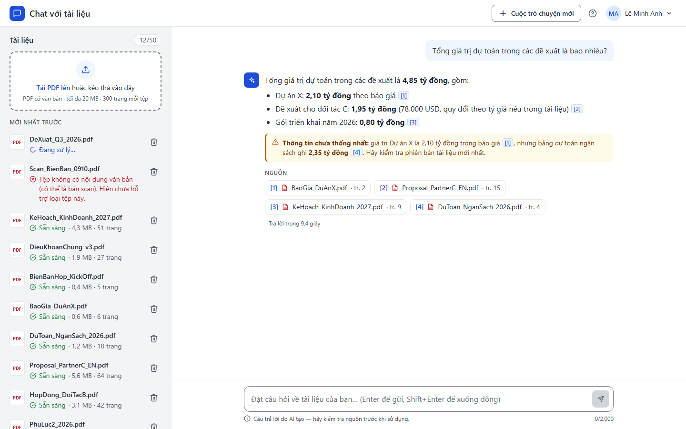
*Hình US-012.1 — Câu trả lời tổng hợp từ nhiều tài liệu, mỗi ý có trích dẫn [n] riêng*

---

#### US-013 — Được báo rõ khi tài liệu không chứa câu trả lời

| Epic | Ưu tiên | Persona | BR | Màn hình | Thành phần UI | API |
|---|---|---|---|---|---|---|
| EP-03 | **P0** | PER-01 | BR-011 | SCR-02 | `NotFoundMessage` | API-09 (`done.type = not_found / partial`) |

**Story:** Là **Chuyên viên PTKD**, tôi muốn được báo rõ khi tài liệu không chứa câu trả lời, để không dùng nhầm thông tin không có căn cứ.

**Tiêu chí nghiệm thu**
- **AC-013.1** — *Given* tập tài liệu không chứa thông tin liên quan, *When* người dùng hỏi, *Then* hệ thống hiển thị "Không tìm thấy thông tin này trong các tài liệu đã tải lên" và không đưa ra câu trả lời khẳng định nào.
- **AC-013.2** — *Given* bộ ≥ 10 câu hỏi kiểm thử không có đáp án, *When* chạy cả bộ, *Then* 100% trả về thông báo "không tìm thấy" (KR2.2).
- **AC-013.3** — *Given* tài liệu chỉ chứa **một phần** thông tin được hỏi, *When* người dùng hỏi, *Then* câu trả lời nêu phần tìm thấy kèm nguồn và nói rõ phần nào không tìm thấy.

**Ghi chú UX (UX-06):** câu trả lời "không tìm thấy" dùng kiểu hiển thị riêng (nền xám nhạt, biểu tượng ℹ), không có thẻ nguồn, vẫn có nút 👍 / 👎.

**Ghi chú kiến trúc (SADD §2.2.3, AR-03)**
- **Cổng bằng chứng:** nếu điểm rerank cao nhất < τ (giá trị khởi điểm 0,15 `[Đề xuất]`), máy chủ trả `done {type: "not_found"}` **mà không gọi LLM**. Như vậy câu hỏi kiến thức chung (AC-011.2) và câu hỏi về tài liệu của người khác (AC-002.1) không bao giờ nhận câu trả lời bịa.
- τ được hiệu chỉnh trên bộ ≥ 10 câu không có đáp án để đạt KR2.2 = 100% mà không làm giảm KR2.1.
- Khi đã qua cổng, LLM vẫn có thể kết luận `not_found` hoặc `partial` (AC-013.3).
- Metric `retrieval_top_score` theo dõi phân bố điểm để phát hiện chất lượng truy xuất bị giảm.

**Màn hình thiết kế**

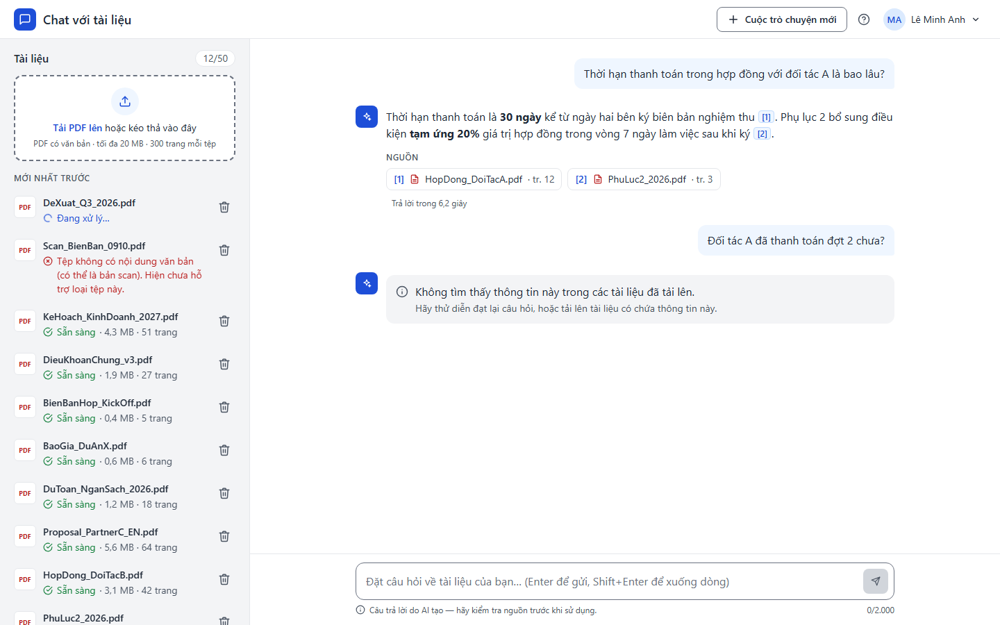
*Hình US-013.1 — NotFoundMessage: nền xám, biểu tượng ℹ, không có thẻ nguồn*

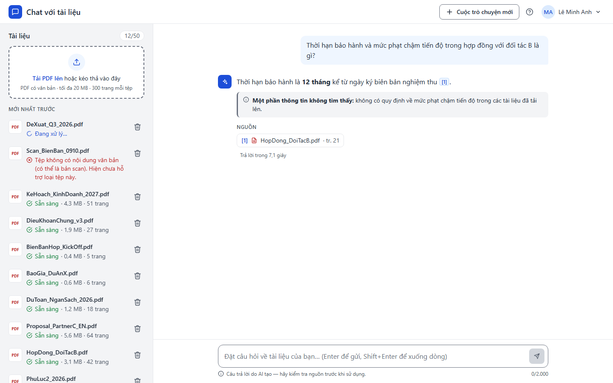
*Hình US-013.2 — Câu trả lời một phần với ghi chú "Một phần thông tin không tìm thấy"*

---

#### US-016 — Hỏi tiếp nối không cần nhắc lại ngữ cảnh (post-MVP)

| Epic | Ưu tiên | Persona | BR | Màn hình | Thành phần UI | API |
|---|---|---|---|---|---|---|
| EP-03 | P2 | PER-01 | BR-014 | SCR-02 (post-MVP) | `ConversationStore` | API-08, API-09 (post-MVP) |

**Story:** Là **Chuyên viên PTKD**, tôi muốn hỏi tiếp nối mà không phải nhắc lại ngữ cảnh, để hỏi đáp tự nhiên như trò chuyện.

**Tiêu chí nghiệm thu** `[Đề xuất]`
- **AC-016.1** — *Given* người dùng vừa hỏi "Thời hạn thanh toán với đối tác A là bao lâu?", *When* người dùng hỏi tiếp "Còn đối tác B thì sao?", *Then* câu trả lời nói về thời hạn thanh toán của đối tác B.
- **AC-016.2** — *Given* đang có hội thoại, *When* người dùng nhấn "Cuộc trò chuyện mới" (hoặc `Ctrl+Shift+O`), *Then* ngữ cảnh hội thoại bị xóa nhưng tài liệu vẫn giữ nguyên; câu hỏi tiếp theo không bị ảnh hưởng bởi ngữ cảnh cũ (IX-06).
- **AC-016.3** — *Given* người dùng tải lại trang hoặc đóng tab, *When* quay lại, *Then* lịch sử hội thoại không còn (DF-09 — chỉ giữ trong phiên).

**Ghi chú:** Bật/tắt qua feature flag trong `/config`. PRD §5.2 hiện không định nghĩa sự kiện `conversation_reset` hay trường `is_followup` (đã bỏ cùng đợt rút gọn MVP-lite) — cần bổ sung lại nếu story này được đưa vào phạm vi.

**Ghi chú kiến trúc (SADD §2.2.3, §2.3)**
- Ngữ cảnh hội thoại chỉ nằm trong Redis `conv:{conversation_id}` (3 lượt gần nhất, câu trả lời được tóm tắt ≤ 300 token), TTL 8 giờ tính từ lần dùng cuối. Không lưu vào CSDL (DF-09).
- Khi có ngữ cảnh, LLM viết lại câu hỏi thành câu hỏi độc lập trước khi truy xuất (timeout 4 giây; lỗi thì dùng câu hỏi gốc).
- "Cuộc trò chuyện mới" gọi `POST /conversations` để tạo ngữ cảnh mới; đăng xuất xóa ngữ cảnh.

**Màn hình thiết kế**

Không có ảnh thiết kế — US-016 là post-MVP (BRD §5.4), chưa được thiết kế trong `html_design/` (SDD v0.3 §3.2.1 chỉ có 4 màn hình điều hướng).

---

#### US-017 — Hỏi bằng tiếng Việt hoặc tiếng Anh

| Epic | Ưu tiên | Persona | BR | Màn hình | Thành phần UI | API |
|---|---|---|---|---|---|---|
| EP-03 | **P0** | PER-01 | BR-015 | SCR-02 | `Composer`, `AnswerMessage` | API-09 |

**Story:** Là **Chuyên viên PTKD**, tôi muốn hỏi bằng tiếng Việt hoặc tiếng Anh và nhận câu trả lời bằng ngôn ngữ tôi đã hỏi, kể cả khi tài liệu viết bằng ngôn ngữ khác.

**Tiêu chí nghiệm thu**
- **AC-017.1** — *Given* tài liệu viết bằng tiếng Anh, *When* người dùng hỏi bằng tiếng Việt, *Then* câu trả lời bằng tiếng Việt và vẫn trích dẫn đúng tài liệu tiếng Anh.
- **AC-017.2** — *Given* người dùng hỏi bằng tiếng Anh, *When* hệ thống trả lời, *Then* câu trả lời bằng tiếng Anh.
- **AC-017.3** — *Given* bộ câu hỏi chuẩn bằng từng ngôn ngữ trong DF-06, *When* chạy cả bộ, *Then* tỷ lệ đúng của mỗi ngôn ngữ đạt KR2.1.

**Ghi chú:** Giao diện luôn bằng tiếng Việt (UX-07); chỉ nội dung câu trả lời theo ngôn ngữ câu hỏi.

**Ghi chú kiến trúc (SADD §2.2.2, §2.2.3, AR-02)**
- Ngôn ngữ câu hỏi được phát hiện trong tập {vi, en}; prompt yêu cầu LLM trả lời đúng ngôn ngữ đó.
- Mô hình embedding bge-m3 và reranker bge-reranker-v2-m3 đều đa ngôn ngữ, nên câu hỏi tiếng Việt tìm được đoạn tiếng Anh (AC-017.1).
- Văn bản được chuẩn hóa Unicode NFC khi trích xuất (giữ đúng dấu tiếng Việt); tìm kiếm từ khóa dùng `unaccent` để khớp cả khi gõ không dấu.

**Màn hình thiết kế**

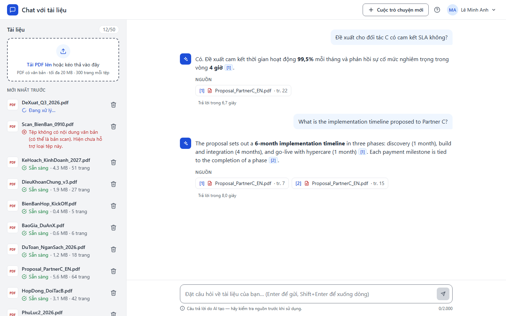
*Hình US-017.1 — Câu hỏi tiếng Anh nhận câu trả lời tiếng Anh; giao diện vẫn tiếng Việt*

---

### EP-04 — Trích dẫn và kiểm chứng

---

#### US-014 — Thấy tên tài liệu nguồn của mỗi câu trả lời

| Epic | Ưu tiên | Persona | BR | Màn hình | Thành phần UI | API |
|---|---|---|---|---|---|---|
| EP-04 | **P0** | PER-01 | BR-012 | SCR-02 | `CitationList`, `CitationChip` | API-09 (sự kiện `citations`) |

**Story:** Là **Chuyên viên PTKD**, tôi muốn thấy tên tài liệu nguồn của mỗi câu trả lời, để kiểm chứng thông tin trước khi dùng.

**Tiêu chí nghiệm thu**
- **AC-014.1** — *Given* hệ thống trả lời một câu hỏi có nội dung, *When* câu trả lời được hiển thị, *Then* có ít nhất một thẻ nguồn ghi tên tệp PDF.
- **AC-014.2** — *Given* câu trả lời tổng hợp từ N tài liệu, *When* câu trả lời được hiển thị, *Then* có thẻ nguồn cho cả N tài liệu.
- **AC-014.3** — *Given* một thẻ nguồn bất kỳ trong bộ câu hỏi chuẩn, *When* người đánh giá mở tệp được trích dẫn, *Then* tệp đó thực sự chứa thông tin được nêu (tính vào KR2.1).
- **AC-014.4** — *Given* câu trả lời là "không tìm thấy", *When* hiển thị, *Then* không có thẻ nguồn nào.

**Quy tắc hiển thị (SDD §3.4.2)**

| Mã | Quy tắc |
|---|---|
| IR-01 | Thẻ nguồn chỉ hiển thị khi câu trả lời đã hoàn tất; ẩn toàn bộ khi câu trả lời bị gián đoạn hoặc lỗi |
| IR-02 | Câu trả lời có nội dung nhưng không có nguồn → nhãn cảnh báo "Không xác định được nguồn — vui lòng kiểm chứng" |
| IR-03 | `[n]` không khớp thẻ nguồn nào → hiển thị chữ thường, không tạo liên kết |
| UX-04 | Di chuột vào `[n]` trong nội dung → làm nổi bật thẻ nguồn tương ứng |

**Ghi chú kiến trúc (SADD §2.2.3)**
- LLM trích dẫn bằng nhãn đoạn `[S#]`; máy chủ đổi sang `[n]` theo thứ tự xuất hiện trước khi gửi `delta`.
- **Kiểm tra trích dẫn:** nhãn không thuộc tập đoạn đã cung cấp bị loại. Câu trả lời có nội dung mà không còn trích dẫn hợp lệ nào được gửi kèm cờ `uncited` → UI hiển thị cảnh báo IR-02, metric `answers_uncited_total` tăng (theo dõi KR2.3).
- Sự kiện `citations` gửi `items: [{index, document_id, document_name, page_start, page_end}]` sau khi nội dung hoàn tất.

**Màn hình thiết kế**

*Hình US-014.1 — Trích dẫn [1] [2] trong nội dung và danh sách thẻ nguồn bên dưới*

---

#### US-015 — Thấy số trang của đoạn được trích dẫn

| Epic | Ưu tiên | Persona | BR | Màn hình | Thành phần UI | API |
|---|---|---|---|---|---|---|
| EP-04 | P1 | PER-01 | BR-013 | SCR-02 | `CitationChip` (`page`) | API-09 (`citations[].page_start`, `page_end`) |

**Story:** Là **Chuyên viên PTKD**, tôi muốn thấy số trang của đoạn nội dung được trích dẫn, để mở đúng chỗ cần kiểm tra.

**Tiêu chí nghiệm thu** `[Đề xuất]`
- **AC-015.1** — *Given* câu trả lời có trích dẫn, *When* hiển thị thẻ nguồn, *Then* thẻ có định dạng `tên tệp · tr. X`.
- **AC-015.2** — *Given* trong bộ câu hỏi chuẩn, *When* người đánh giá mở tệp tại trang được trích dẫn, *Then* trang đó chứa thông tin được nêu.
- **AC-015.3** — *Given* máy chủ không trả về số trang cho một trích dẫn, *When* hiển thị, *Then* thẻ chỉ ghi tên tệp, không hiển thị "tr. undefined".

**Ghi chú:** Định dạng khi đoạn trích trải nhiều trang (ví dụ `tr. 12–13`) chưa chốt — SDD DQ-07. Thiết kế đã sẵn `documentId` + `page` để làm US-026 (mở PDF đúng trang) sau này.

**Ghi chú kiến trúc (SADD §2.2.2, §3.1.1)**
- Mỗi chunk lưu `page_start` và `page_end` ngay khi chia đoạn, nên mọi trích dẫn đều có số trang.
- Đề xuất giải quyết DQ-07: hiển thị `tr. 12` khi hai giá trị bằng nhau, `tr. 12–13` khi khác nhau `[Đề xuất]`.

**Màn hình thiết kế**

*Hình US-015.1 — Thẻ nguồn dạng `HopDong_DoiTacA.pdf · tr. 12`*

---

### EP-05 — Đánh giá tối thiểu (ngoài sản phẩm)

---

#### US-018 — Đánh dấu câu trả lời hữu ích / không hữu ích (post-MVP)

| Epic | Ưu tiên | Persona | BR | Màn hình | Thành phần UI | API |
|---|---|---|---|---|---|---|
| EP-05 | P2 | PER-01 | BR-020 | SCR-02 (post-MVP) | `FeedbackButtons` | API-10 (post-MVP) |

**Story:** Là **Chuyên viên PTKD**, tôi muốn đánh dấu câu trả lời là hữu ích (👍) hoặc không hữu ích (👎), để đội sản phẩm cải thiện chất lượng.

**Tiêu chí nghiệm thu** `[Đề xuất]`
- **AC-018.1** — *Given* câu trả lời đã hoàn tất (kể cả "không tìm thấy"), *When* hiển thị, *Then* có nút 👍 và 👎; khi câu trả lời đang chạy, lỗi hoặc chưa hoàn chỉnh thì không có (quy tắc tương đương IR-01, đã gỡ khỏi SDD v0.3 cùng với `FeedbackButtons`).
- **AC-018.2** — *Given* người dùng nhấn 👍, *When* nhấn lại 👍, *Then* lựa chọn bị bỏ; *When* nhấn 👎, *Then* 👎 thay thế 👍 (IX-05).
- **AC-018.3** — *Given* người dùng nhấn một nút, *When* gửi phản hồi, *Then* nút chuyển trạng thái ngay (optimistic UI) và hiện toast xác nhận; nếu gửi thất bại thì trả về trạng thái cũ.

**Ghi chú kiến trúc (SADD §2.4.2, §3.1.1)**
- `PUT /answers/{id}/feedback` `{rating: "up" | "down" | null}` → 204; idempotent, gửi lại không tạo bản ghi trùng. Chỉ người đã hỏi mới gửi được phản hồi cho câu trả lời đó.
- Phản hồi gắn với metadata `answer` (không có nội dung), đủ để tính MET-004 theo `answer_type`.

**Màn hình thiết kế**

Không có ảnh thiết kế — US-018 là post-MVP (BRD §5.4). `FeedbackButtons` và API-10 đã được gỡ khỏi SDD v0.3 và `html_design/`.

---

#### US-019 — Xem báo cáo sử dụng hằng tuần (post-MVP)

| Epic | Ưu tiên | Persona | BR | Màn hình | Thành phần UI | API |
|---|---|---|---|---|---|---|
| EP-05 | P2 | PER-02 | BR-021 | SCR-04 (post-MVP) | `features/reports` | API-11 (post-MVP) |

**Story:** Là **Quản lý / Trưởng nhóm PTKD**, tôi muốn xem báo cáo hằng tuần về số câu hỏi theo người dùng và tỷ lệ người dùng hoạt động, để đánh giá mức chấp nhận của MVP.

**Tiêu chí nghiệm thu**
- **AC-019.1** — *Given* có người dùng thử nghiệm hoạt động trong tuần, *When* PER-02 mở báo cáo tuần, *Then* báo cáo hiển thị số câu hỏi theo từng người dùng, số người dùng hoạt động / tổng số người dùng thử nghiệm (MET-003), tỷ lệ 👍 (MET-004) và p90 thời gian trả lời.
- **AC-019.2** — *Given* nhật ký kiểm thử ghi nhận N câu hỏi trong tuần, *When* so sánh với báo cáo, *Then* tổng số câu hỏi trong báo cáo bằng đúng N.

**Bố cục `[Đề xuất — chưa có trong SDD v0.3]`:** bộ chọn tuần; 4 thẻ KPI (người dùng hoạt động, tỷ lệ hữu ích, p90 thời gian trả lời, tỷ lệ không tìm thấy); bảng số câu hỏi theo người dùng, hiển thị trên một màn hình. Chỉ vai trò `manager` truy cập được. SDD v0.3 đã gỡ SCR-04 và mối quan tâm CN-12 cùng đợt rút gọn MVP-lite; cần thiết kế lại nếu story được đưa vào phạm vi.

**Ghi chú kiến trúc (SADD §2.2.4, §4.3, ADR-09)**
- Sự kiện analytics được lưu **nội bộ** trong PostgreSQL (`analytics_event`), không gửi tới dịch vụ bên thứ ba.
- `GET /reports/weekly?week=YYYY-Www` đọc từ materialized view `mv_weekly_usage`, làm mới lúc 01:00 hằng ngày.
- Người dùng trong báo cáo được định danh bằng `user_hash` (HMAC-SHA256 của `user_id` với khóa bí mật).

**Màn hình thiết kế**

SCR-04 (Báo cáo tuần) không còn trong `html_design/` — đã bị gỡ khỏi phạm vi cùng US-019 (post-MVP, BRD §5.4).

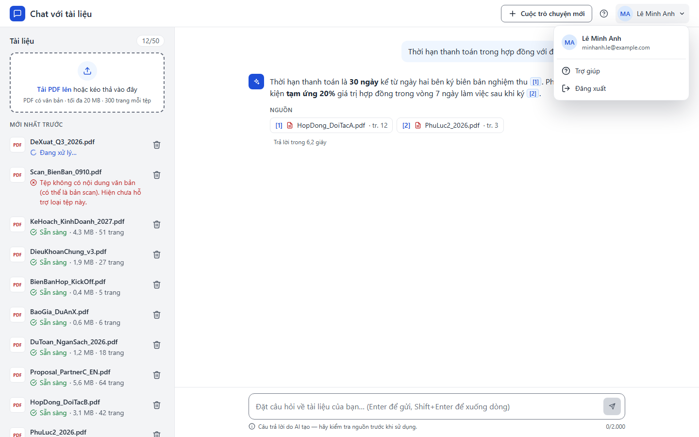
*Hình US-019.1 — Menu người dùng MVP-lite hiện chỉ còn Trợ giúp và Đăng xuất; mục Báo cáo tuần/Chấm điểm/Quản lý quyền đã được gỡ khỏi menu cùng các màn hình post-MVP*

---

#### US-020 — Số liệu vận hành không chứa nội dung nhạy cảm

| Epic | Ưu tiên | Persona | BR | Màn hình | Thành phần UI | API |
|---|---|---|---|---|---|---|
| EP-05 | **P1** | STK-006 Chủ sở hữu tài liệu | BR-021 | Không có màn hình | Bộ lọc log/metric | Không có API analytics |

**Story:** Là **chủ sở hữu tài liệu**, tôi muốn số liệu đo lường không chứa nội dung tài liệu hay nội dung câu hỏi, để thông tin nhạy cảm không bị lộ qua báo cáo.

**Tiêu chí nghiệm thu**
- **AC-020.1** — *Given* toàn bộ sự kiện phân tích ở PRD §5.2, *When* QA kiểm tra dữ liệu thô của sự kiện, *Then* không sự kiện nào chứa nội dung câu hỏi, nội dung câu trả lời, tên tệp hay đoạn trích từ tài liệu.
- **AC-020.2** — *Given* log và metric vận hành, *When* bộ phận An toàn thông tin rà soát, *Then* có xác nhận bằng văn bản rằng chúng không chứa nội dung tài liệu.

**Ghi chú kỹ thuật:** logger/metric chỉ nhận trường trong allow-list; khóa lạ bị loại bỏ và ghi cảnh báo ở môi trường phát triển. Không lưu nội dung tài liệu, câu hỏi, câu trả lời trong `localStorage` / `IndexedDB`.

**Ghi chú kiến trúc (SADD §2.4.2, §4.3, P-03)**
- Máy chủ **kiểm tra lại** allow-list và loại mọi khóa không khai báo trước khi ghi log/metric.
- Bộ lọc log chặn các trường `question`, `answer`, `content`, `text`, `file_name`, `prompt` ở mọi logger; trace chỉ ghi số token và độ trễ. Có kiểm thử tự động cho bộ lọc (AC-020.1, Launch Gate G-06).

**Màn hình thiết kế**

Không có màn hình — US-020 là yêu cầu phía máy chủ (bộ lọc log/metric), không có giao diện người dùng.

---

#### US-022 — Chấm điểm bộ câu hỏi chuẩn (offline, ngoài sản phẩm)

| Epic | Ưu tiên | Persona | BR | Màn hình | Thành phần UI | API |
|---|---|---|---|---|---|---|
| EP-05 | P2 | PER-03 | BRU-004 | Không có route trong MVP-lite | Bộ script đánh giá offline | Không có API sản phẩm |

**Story:** Là **Người đánh giá MVP**, tôi muốn chạy bộ câu hỏi chuẩn và ghi kết quả đúng/sai cho từng câu, để tính được tỷ lệ chính xác MET-002.

**Tiêu chí nghiệm thu** `[Đề xuất]`
- **AC-022.1** — *Given* bộ câu hỏi chuẩn đã được nạp, *When* người đánh giá mở công cụ chấm điểm, *Then* mỗi câu hiển thị câu trả lời của hệ thống (kèm thẻ nguồn), đáp án mong đợi, nút ✔ Đúng / ✘ Sai và ô ghi chú.
- **AC-022.2** — *Given* một câu hỏi chưa chấm, *When* người đánh giá chấm, *Then* hoàn tất trong ≤ 3 thao tác và thanh tiến độ cập nhật.
- **AC-022.3** — *Given* đã chấm toàn bộ bộ câu hỏi, *When* xem tổng kết, *Then* hiển thị tỷ lệ đúng tổng và theo từng ngôn ngữ (phục vụ KR2.1, AC-017.3).

**Ghi chú:** Chỉ vai trò `evaluator` truy cập được. Bật/tắt qua feature flag.

**Ghi chú kiến trúc (SADD §2.2.1, §2.3, §4.3)**
- `POST /evaluation/runs` chạy bộ câu hỏi chuẩn ở worker trên **tập tài liệu kiểm thử được phép** (BRD DEP-003); `PUT /evaluation/items/{id}` `{verdict, note?}` lưu kết quả chấm.
- Đây là nơi **duy nhất** câu trả lời được lưu kèm nội dung (`evaluation_result`), để người đánh giá đọc lại; dữ liệu bị xóa khi kết thúc MVP.
- Mỗi lần chạy ghi `prompt_version` và `model_id`. CI chạy lại đánh giá mỗi khi đổi prompt, mô hình hoặc tham số chia đoạn, và chặn phát hành nếu KR2.1 hoặc KR2.2 giảm.

**Màn hình thiết kế**

Không có ảnh thiết kế — US-022 chạy ngoài sản phẩm (script/công cụ offline), không thuộc điều hướng MVP-lite nên không có trong `html_design/`.

---

### EP-06 — Backlog đề xuất (chưa thuộc phạm vi MVP)

Các story dưới đây **chưa được thiết kế** và **không** phát triển cho đến khi BRD OQ-011 được phê duyệt (BRD BRU-005). Vì vậy chưa có ảnh màn hình.

| ID | User story | Ưu tiên | Nguồn |
|---|---|---|---|
| US-024 | Là PER-01, tôi muốn giới hạn câu hỏi vào một nhóm tài liệu được chọn, để câu trả lời tập trung hơn. | P2 | BRD P-03 |
| US-025 | Là PER-01, tôi muốn lưu và xem lại các cuộc hội thoại trước, để tái sử dụng kết quả tra cứu. | P2 | BRD P-04, OQ-013 |
| US-026 | Là PER-01, tôi muốn nhấn vào thẻ nguồn để mở PDF đúng trang được trích dẫn, để kiểm chứng nhanh hơn. | P2 | Đề xuất PM (SN-003) |
| US-027 | Là PER-01, tôi muốn yêu cầu tóm tắt một tài liệu, để nắm nhanh nội dung. | P2 | BRD P-01 |
| US-028 | Là PER-01, tôi muốn so sánh nội dung giữa các tài liệu, để đối chiếu điều khoản và số liệu. | P2 | BRD P-02 |
| US-029 | Là PER-01, tôi muốn sao chép câu trả lời kèm nguồn, để đưa vào báo cáo. | P2 | BRD P-06 |
| US-030 | Là PER-01, tôi muốn dùng chung một tập tài liệu với cả nhóm, để không phải mỗi người tải lại. | P2 | BRD P-07, OQ-004 |

> **Khuyến nghị của PM (PRD §3.7):** nếu được mở rộng phạm vi, ưu tiên **US-026** và **US-029** — tăng trực tiếp độ tin cậy và giá trị sử dụng với chi phí thấp.

---

## 4. Ma trận truy xuất

| Story | Ưu tiên | BR (BRD) | Màn hình (SDD) | Module back-end (SADD §2.2.1) | Ảnh thiết kế | Launch Gate |
|---|---|---|---|---|---|---|
| US-001 | P0 | BR-017 | SCR-01, SCR-03 | `identity` | `SCR-01_login`, `SCR-01_login-session-expired`, `SCR-03_no-access` | G-01, G-04 |
| US-002 | P0 | BR-018 | SCR-02 | `documents`, `retrieval` + RLS | `SCR-02_03` | G-01, G-04 |
| US-003 | P0 | BR-001 | SCR-02 | `documents`, `ingestion` | `SCR-02_01`, `_02`, `_10`, `_22` | G-01 |
| US-004 | P0 | BR-003 | SCR-02 | `documents`, `ingestion` | `SCR-02_02`, `_03` | G-01 |
| US-005 | P0 | BR-002 | SCR-02 | `ingestion` | `SCR-02_05`, `_06` | G-01 |
| US-006 | P0 | BR-006 | SCR-02 | `documents`, `ingestion` | `SCR-02_07`, `_05` | G-01, G-13 |
| US-007 | P0 | BR-007 | SCR-02 | `documents` | `SCR-02_08` | G-01, G-13 |
| US-008 | P0 | BR-005 | SCR-02 | `documents` | `SCR-02_09`, `_18` | G-01 |
| US-009 | P1 | BR-004 | SCR-02 | `documents` | `SCR-02_03`, `_26` | — |
| US-010 | P1 | BR-004 | SCR-02 | `documents` (SSE) | `SCR-02_03`, `_04` | — |
| US-011 | P0 | BR-009 | SCR-02 | `qa`, `retrieval` | `SCR-02_01`, `_12`, `_13`, `_14`, `_21`, `_24`, `_25` | G-01, G-02, G-03 |
| US-012 | P0 | BR-010 | SCR-02 | `retrieval`, `qa` | `SCR-02_15` | G-02 |
| US-013 | P0 | BR-011 | SCR-02 | `retrieval` (cổng bằng chứng), `qa` | `SCR-02_16`, `_17` | G-02 |
| US-014 | P0 | BR-012 | SCR-02 | `qa` (kiểm tra trích dẫn) | `SCR-02_14` | G-02 |
| US-015 | P1 | BR-013 | SCR-02 | `ingestion`, `qa` | `SCR-02_14` | — |
| US-016 | P2 | BR-014 | SCR-02 (post-MVP) | `qa` (post-MVP) | — | — |
| US-017 | P0 | BR-015 | SCR-02 | `ingestion`, `retrieval`, `qa` | `SCR-02_19` | G-02, G-13 |
| US-018 | P2 | BR-020 | SCR-02 (post-MVP) | `feedback` (post-MVP) | — | — |
| US-019 | P2 | BR-021 | SCR-04 (post-MVP) | `analytics` (post-MVP) | `SCR-02_23` | — |
| US-020 | P1 | BR-021 | Không có màn hình | `core` (bộ lọc log) | — | Pilot Gate privacy |
| US-021 | P0 | BR-008 | SCR-02 | `retention` | `SCR-02_11` | G-08 |
| US-022 | P2 | BRU-004 | Offline | `evaluation` (script) | — | Offline evaluation |
| US-023 | P1 | BR-017 | Không có màn hình bắt buộc | `identity` | — | Pilot Gate access |

**Độ bao phủ MVP-lite:** 16 story cốt lõi có màn hình hoặc trạng thái UI cần thiết, với ảnh thiết kế trong `html_design/`. US-016, US-018, US-019, US-022 và giao diện quản trị của US-023 là post-MVP (BRD §5.4) — không có ảnh thiết kế, chỉ giữ làm backlog tham khảo, không phải tiêu chí phát hành. BR-019 được kiểm soát bằng SADD và Pilot Gate privacy.

---

## 5. Vấn đề mở ảnh hưởng tới story

| Mã | Vấn đề | Story bị ảnh hưởng | Chủ sở hữu |
|---|---|---|---|
| OQ-P01 / DQ-02 / AQ-03 | Phương thức đăng nhập: SSO nội bộ hay Keycloak tự lưu trữ | US-001, US-023 | Tech Lead + ATTT |
| OQ-010 / AQ-01 | Nhà cung cấp LLM: API được quản lý trong vùng hay mô hình tự lưu trữ (SADD ADR-03) | US-011 – US-017 | ATTT + Nhà tài trợ |
| AQ-04 | ATTT có chấp nhận việc backup giữ tài liệu đã xóa tối đa 7 ngày không | US-008, US-021 | ATTT |
| AQ-05 | Bổ sung mã lỗi `FILE_REJECTED`, `INGESTION_FAILED`, `RATE_LIMITED` vào danh mục lỗi SDD §3.4.3 | US-003, US-005, US-011 | Front-end Lead |
| OQ-P02 / DQ-03 | Có dùng streaming cho câu trả lời không | US-011, US-014 | PM + Thiết kế |
| OQ-P04 / DQ-05 | Hành vi mặc định khi tải tệp trùng tên | US-003 | PM |
| DQ-04 | ATTT có chấp nhận lưu bản nháp câu hỏi trong `sessionStorage` không | US-001 (AC-001.3) | ATTT |
| DQ-07 | Định dạng số trang khi đoạn trích trải nhiều trang | US-015 | Tech Lead |
| — | Tiêu chí nghiệm thu `[Đề xuất]` của các story P1 cần PM xác nhận | US-009, US-010, US-015, US-016, US-018, US-022 | PM |

---

## 6. Lịch sử phiên bản

| Phiên bản | Ngày | Tác giả | Thay đổi |
|---|---|---|---|
| 0.1 | 2026-10-21 | BA / PM | Bản nháp đầu tiên, tổng hợp từ PRD v0.1 và SDD v0.1; bổ sung tiêu chí nghiệm thu đề xuất cho story P1; gắn ảnh thiết kế theo màn hình |
| 0.2 | 2026-10-21 | BA / PM | Bổ sung SADD v0.1 làm đầu vào: thêm mục "Ghi chú kiến trúc (SADD)" cho 23 story; chỉnh API theo SADD §2.4.2 (API-12 dùng `PATCH`, `expires_at`, `page_start/page_end`); thêm mã lỗi đề xuất `FILE_REJECTED`, `INGESTION_FAILED`, `RATE_LIMITED`; thêm mục 3.0 với ảnh SCR-07; thêm cột module back-end vào ma trận; thêm vấn đề mở AQ-01, AQ-04, AQ-05 |
| 0.3 | 2026-10-26 | BA / PM | Đồng bộ theo BRD v0.3 / PRD v0.2 MVP-lite: gắn nhãn post-MVP cho US-016, US-018, US-019, US-022 và giao diện quản trị của US-023; đổi tên EP-05 thành "Phản hồi và đo lường MVP" theo PRD §3.4 *(ghi nhận hồi tố — chưa được log khi thực hiện)* |
| 0.4 | 2026-10-27 | BA / PM | Đồng bộ với SDD v0.3 và bộ ảnh `html_design/` đã dọn (29 màn hình): sửa toàn bộ Mục 2 và ma trận Mục 4 cho khớp tên tệp hiện có; gỡ ảnh đã xóa của US-016, US-018, US-019 (SCR-04), US-022 (SCR-05), US-023 (SCR-06); cập nhật ảnh menu người dùng (US-019) theo menu MVP-lite đã rút gọn; bổ sung ảnh ES-05 mới (`SCR-02_18_last-document-deleted.png`) cho US-008; sửa số liệu Epic EP-03/EP-05 trong Mục 1.4; gỡ tham chiếu CN-12/13/14 và IR-05 đã bị xóa khỏi SDD v0.3 |
