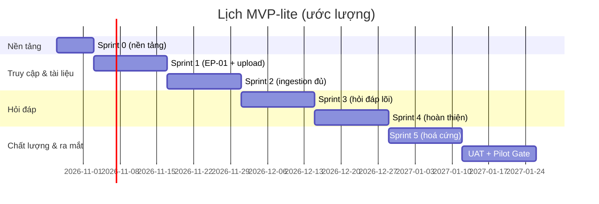

# Kế hoạch Phát triển — Chat với tài liệu (MVP-lite)

> **Đầu vào:** [SADD v0.3](../requirements/SADD.md) (SADD-CWD-001) · [User Stories v0.4](../design/User_Stories.md) (US-CWD-001)
> **Tham chiếu thêm:** [PRD v0.2](../requirements/PRD.md) (DF-01 – DF-10, Pilot Gate §5.1) · [SDD UI/UX v0.3](../design/SDD_UI_UX_Blueprint.md) (thành phần UI, mã lỗi hiển thị) · [BRD v0.3](../requirements/BRD.md) (BR, AC gốc) · Ảnh thiết kế: [`html_design/`](../design/html_design/) (29 màn hình)
> **Người đọc:** Tech Lead, developer (back-end, front-end, AI/ML), QA, DevOps, PM.
> **Task chi tiết:** mỗi công việc ở Mục 5 có một tệp riêng trong [`tasks/`](tasks/README.md) (47 tệp). **Tệp task là nơi developer đọc khi nhận việc** — chứa hợp đồng API, schema, các bước triển khai, mã lỗi và ca kiểm thử. Kế hoạch này là nơi xem thứ tự, phụ thuộc, ước lượng và phạm vi tổng thể.

---

## 0. Thông tin tài liệu

| Trường | Giá trị |
|---|---|
| Số tài liệu | IMP-CWD-001 |
| Phiên bản | 0.2 — Bản nháp |
| Ngày | 2026-10-27 |
| Tác giả | Tech Lead [TBD] |
| Người rà soát | Product Manager, Front-end Lead, QA Lead, DevOps, An toàn thông tin (ATTT) |
| Người phê duyệt | Nhà tài trợ / Chủ sở hữu sản phẩm |

**Ký hiệu:** T-xxx = công việc (task) · M-x = mốc · D-xx = quyết định cần chốt · CL-xx = điểm cần làm rõ trong tài liệu đầu vào · R-xx = rủi ro · `[Đề xuất]` = chưa được phê duyệt. Ước lượng tính bằng **ngày công lý tưởng** (1 người, không tính họp/review).

---

## 1. Tóm tắt

Kế hoạch đưa **19 user story P0/P1** của MVP-lite "Chat với tài liệu" từ kiến trúc (SADD v0.3) và đặc tả (User Stories v0.4) tới thử nghiệm pilot, trong **6 sprint (2 tuần) + Sprint 0 (1 tuần) + UAT (2 tuần)** — khoảng **13 tuần**, với đội khoảng 6–7 người.

| Hạng mục | Nội dung |
|---|---|
| Phạm vi | 15 story P0 + 4 story P1 (19/30); 11 story P2 (US-016, US-018, US-019, US-022, US-024 – US-030) **ngoài phạm vi**, giữ làm backlog |
| Khối lượng | 47 công việc, ước lượng **~108 ngày công lý tưởng** |
| Cách làm | Dựng khung chạy được trước (Sprint 0), sau đó mỗi sprint giao một lát cắt dọc từ giao diện tới CSDL, bám theo module trong SADD §2.2.1 |
| Mốc chính | M-2 tải PDF → "Sẵn sàng" (cuối Sprint 2) · M-3 hỏi → câu trả lời có nguồn (cuối Sprint 3) · M-4 đủ tính năng MVP-lite (cuối Sprint 4) · M-6 Pilot Gate ký duyệt (cuối UAT) |
| Rủi ro lớn nhất | (1) chất lượng câu trả lời không đạt ngưỡng G-02 · (2) ATTT chưa chốt phương án LLM (OQ-010/AQ-01) · (3) bộ câu hỏi chuẩn và tài liệu kiểm thử đến muộn |

Điều đội cần biết trước khi bắt đầu:
- **Phạm vi đã được thu hẹp chủ động về MVP-lite** (BRD §5.0, PRD §0.4): chỉ một luồng chính — đăng nhập → tải PDF → xử lý → hỏi → nhận câu trả lời có nguồn → xóa/hết hạn. Hỏi tiếp nối (US-016), đánh dấu hữu ích (US-018), báo cáo tuần (US-019), màn hình chấm điểm (US-022) và màn hình quản trị (phần UI của US-023) **không nằm trong kế hoạch này**.
- **Chất lượng câu trả lời là rủi ro chính, không phải hạ tầng.** Bộ đánh giá chất lượng (T-501) có từ Sprint 5 và hỗ trợ Pilot Gate G-02; một vòng hiệu chỉnh bổ sung nằm cuối Sprint 5 nếu cần.
- **SADD thiết kế theo Modular Monolith + worker** (ADR-01), module đi qua port/adapter nên không phụ thuộc cứng vào lựa chọn LLM hay hạ tầng — giảm rủi ro khi D-01/D-02 chưa chốt.
- **7 quyết định (D-01 – D-07) cần chốt trước các mốc cụ thể** (Mục 6); kế hoạch đã chọn sẵn hướng đi mặc định cho từng điểm để đội không phải chờ hoàn toàn.
- **Một điểm lệch số hiệu Pilot Gate giữa các tài liệu đầu vào đã được phát hiện** (CL-01, Mục 9) — kế hoạch này dùng số hiệu G-01 – G-07 theo PRD v0.2 §5.1 làm chuẩn.

---

## 2. Phạm vi và đầu vào

### 2.1 Phạm vi

| Trong phạm vi (19 story) | Ngoài phạm vi (11 story, post-MVP/backlog) |
|---|---|
| **P0 (15):** US-001, 002, 003, 004, 005, 006, 007, 008, 011, 012, 013, 014, 017, 020, 021 | **P2 trong MVP-lite:** US-016 (hỏi tiếp nối), US-018 (feedback 👍👎), US-019 (báo cáo tuần), US-022 (chấm điểm offline) |
| **P1 (4):** US-009 (danh sách tài liệu), US-010 (trạng thái), US-015 (số trang trích dẫn), US-023 (cấp quyền — chỉ phần CLI/config, **không** xây màn hình quản trị) | **Backlog EP-06 (7):** US-024 – US-030 — chờ BRD OQ-011 phê duyệt |
| Back-end `api` + `worker` (modular monolith, SADD §2.2.1), SPA, hạ tầng `local` / `staging` / `prod` | Đa vùng, vận hành 24/7 (OQ-P03/AQ-07 còn mở) |
| Bộ đánh giá chất lượng RAG chạy ngoài sản phẩm (hỗ trợ Pilot Gate G-02), kiểm thử hồi quy/cô lập tự động | Module `feedback/`, `analytics/` (phần báo cáo tuần), `evaluation` API/UI — đều đã đánh dấu Post-MVP trong SADD §2.2.1 |
| UAT, chuẩn bị bằng chứng Pilot Gate G-01 – G-07 (PRD §5.1) | Huấn luyện/fine-tune mô hình; tích hợp kho tài liệu khác PDF |

Story P1 được phép trễ sang ngay sau Pilot Gate nếu năng lực đội thiếu, miễn không ảnh hưởng luồng chính P0 (thứ tự cắt giảm ở Mục 5, cuối mỗi sprint).

### 2.2 Đầu vào đã có

| Tài liệu | Dùng cho |
|---|---|
| SADD v0.3 | Kiến trúc modular monolith, 9 module nghiệp vụ (§2.2.1), pipeline ingestion (§2.2.2) và hỏi đáp (§2.2.3), API cốt lõi API-01 – API-09 (§2.4.2), mô hình dữ liệu (§3.1), bảo mật/RLS (§3.1.3), vận hành (§4), ADR (Phụ lục C) |
| User Stories v0.4 | 30 story (19 trong phạm vi), tiêu chí nghiệm thu (AC), trường hợp biên, ghi chú kiến trúc theo từng story, 29 ảnh thiết kế trong `html_design/` |
| SDD UI/UX v0.3 | Cây thành phần front-end, view model, danh mục mã lỗi hiển thị (§3.4.3), máy trạng thái tài liệu/câu trả lời (§3.7), phím tắt (§3.5.2) |
| PRD v0.2 | Giá trị mặc định DF-01 – DF-10 (§0.3), sự kiện analytics tối thiểu (§5.2), Pilot Gate G-01 – G-07 (§5.1) |

### 2.3 Giả định

| Mã | Giả định | Ảnh hưởng nếu sai |
|---|---|---|
| A-01 | Đội như Mục 3.1, làm toàn thời gian từ ngày bắt đầu Sprint 0 | Lịch kéo dài tương ứng; thứ tự công việc giữ nguyên |
| A-02 | Có môi trường Docker cho `local` và một nền tảng cho `staging` trước hết Sprint 0 (phụ thuộc D-02) | Không có staging để chạy E2E từ Sprint 2 |
| A-03 | Nghiệp vụ cung cấp ≥ 10–15 PDF không nhạy cảm trước hết Sprint 2 và bộ câu hỏi chuẩn (≥ 10 câu không có đáp án theo KR2.2) trước hết Sprint 5 | Không đo được chất lượng (G-02) |
| A-04 | Có tài khoản dùng thử nhà cung cấp LLM (phương án A, ADR-03) cho tài liệu không nhạy cảm từ Sprint 3, kể cả khi D-01 chưa chốt | Không phát triển được luồng hỏi đáp thật |
| A-05 | ATTT tham gia rà soát từ Sprint 1 (không chỉ ở cuối), để không chặn G-04 ở Sprint 6 | Rủi ro chặn ra mắt vào phút cuối (AR-01) |

---

## 3. Đội ngũ và nguyên tắc triển khai

### 3.1 Đội ngũ `[Đề xuất]`

Nhỏ hơn kế hoạch MVP đầy đủ trước đây vì phạm vi đã giảm từ 23 xuống 19 story (bỏ feedback, báo cáo, chấm điểm, admin UI).

| Vai trò | Số người | Mã | Phụ trách chính (module SADD §2.2.1) |
|---|---|---|---|
| Tech Lead (kiêm back-end) | 1 | TL | Kiến trúc, CI, LLM adapter, RLS, review |
| Back-end Engineer (Python) | 1–2 | BE | `identity`, `documents`, `ingestion`, `retention`, `core` |
| AI/ML Engineer | 1 | AI | `retrieval`, `qa`, prompt, chia đoạn, bộ đánh giá RAG offline |
| Front-end Engineer (React) | 1–2 | FE | SPA theo SDD v0.3; một người kiêm design system (`shared/ui`) |
| QA Engineer | 1 | QA | Chiến lược kiểm thử, E2E, cô lập dữ liệu, hiệu năng, quyền riêng tư |
| DevOps | 0,5 | OPS | Môi trường, Ingress, quan sát (§4.3), sao lưu |
| PM · BA | Bán thời gian | PM · BA | Làm rõ yêu cầu, bộ câu hỏi chuẩn, UAT |
| An toàn thông tin | Bán thời gian | ATTT | Phê duyệt dữ liệu AI (G-04), rà soát bảo mật, quyền riêng tư |

### 3.2 Nguyên tắc triển khai (bám theo SADD §1.2)

| Mã | Nguyên tắc | Áp dụng vào kế hoạch |
|---|---|---|
| IP-01 | **Lát cắt dọc trước, hoàn thiện sau.** Mỗi sprint từ Sprint 1 giao một luồng chạy được đầu-cuối (UI → API → DB), không làm xong một tầng rồi mới sang tầng khác | Thứ tự task trong mỗi sprint luôn đi từ API/DB tới UI trong cùng sprint |
| IP-02 | **Ranh giới module kiểm tra tự động từ Sprint 0** (`import-linter`, SADD §2.2.1) | T-001, T-003 |
| IP-03 | **Mọi adapter (LLM, IdP, hạ tầng) đi qua port** để không chặn tiến độ khi D-01/D-02/D-03 chưa chốt | T-301 (LLMPort), T-101 (IdP qua chuẩn OIDC) |
| IP-04 | **Chất lượng đo được sớm, không để cuối dự án** | T-501 bắt đầu Sprint 5, không phải Sprint cuối |
| IP-05 | **Không nội dung trong log/metric từ dòng code đầu tiên** (P-03) | T-007 (bộ lọc log) làm ở Sprint 0, không phải việc dọn dẹp cuối kỳ |

### 3.3 Năng lực mỗi sprint (ước lượng)

Năng lực thực = 10 ngày × số người × 70% (trừ họp, review, sửa lỗi). Sprint 0 dài 1 tuần nên bằng một nửa.

| Nhóm | Sprint 2 tuần | Sprint 0 (1 tuần) |
|---|---|---|
| TL | 7 | 3,5 |
| BE (1,5 người) | 10,5 | 5,25 |
| AI | 7 | 3,5 |
| FE (1,5 người) | 10,5 | 5,25 |
| QA | 7 | 3,5 |
| OPS (0,5) | 3,5 | 1,75 |
| **Tổng khả dụng** | **~45,5 ngày / sprint** | **~22,75 ngày** |

---

## 4. Mốc chính và lịch (giả định bắt đầu 2026-10-27)

| Mốc | Mô tả | Hoàn thành sau | Ngày dự kiến |
|---|---|---|---|
| M-0 | Khung chạy được: CI xanh, `docker compose up` chạy cả `api`+`worker`+`web`, `/healthz` trả 200 | Sprint 0 | 2026-11-02 |
| M-1 | Đăng nhập thật + tải 1 tệp PDF thành công, hiển thị "Sẵn sàng" | Sprint 1 | 2026-11-16 |
| M-2 | Tải nhiều tệp, mọi trạng thái/lỗi tài liệu đúng (US-003 – US-010, US-021) | Sprint 2 | 2026-11-30 |
| M-3 | Hỏi một tài liệu → câu trả lời có nguồn hoặc `not_found` (US-011, US-013, US-014) | Sprint 3 | 2026-12-14 |
| M-4 | Đủ 19 story MVP-lite (tổng hợp nhiều tài liệu, đa ngôn ngữ, số trang, số liệu tối thiểu) | Sprint 4 | 2026-12-28 |
| M-5 | Chất lượng đạt ngưỡng đánh giá nội bộ, hoá cứng bảo mật/hiệu năng xong | Sprint 5 | 2027-01-11 |
| M-6 | UAT hoàn tất, Pilot Gate G-01 – G-07 ký duyệt, mở thử nghiệm | UAT (2 tuần) | 2027-01-25 |

---

## 5. Work Breakdown Structure (WBS)

Mỗi task ghi: **story** (User Stories v0.4) · **module/thành phần** (SADD §2.2.1 / SDD §3.1) · **ước lượng** (ngày công).

> **Mã task trong bảng là liên kết tới tệp chi tiết trong [`tasks/`](tasks/README.md).** Mỗi tệp gồm: mục tiêu, tiêu chí nghiệm thu (AC) liên quan, hợp đồng API/giao diện, thay đổi schema, các bước triển khai, mã lỗi và trường hợp biên, ca kiểm thử bắt buộc, Definition of Done. Developer nhận việc đọc tệp task, không cần đọc lại toàn bộ SADD.

### Sprint 0 — Nền tảng (1 tuần, không gắn story cụ thể)

| Task | Mô tả | Module/Thành phần | Ước lượng |
|---|---|---|---|
| [T-001](tasks/T-001_monorepo-setup.md) | Monorepo: cấu trúc `backend/app/{api,modules,ports,adapters,workers,core}` + `frontend/` theo SADD §2.2.1, `import-linter` chặn vi phạm ranh giới module | Toàn hệ thống | 1d |
| [T-002](tasks/T-002_local-dev-environment.md) | Môi trường dev cục bộ: Docker Compose PostgreSQL 16+pgvector, Redis 7, MinIO, ClamAV, TEI (bge-m3) | §2.3 | 2d |
| [T-003](tasks/T-003_ci-pipeline.md) | CI pipeline: lint, kiểm tra ranh giới module, unit test, build image | — | 2d |
| [T-004](tasks/T-004_staging-skeleton.md) | Khung staging (phụ thuộc **D-02**): Ingress, cert-manager, biến môi trường theo `/config` | §4.4 | 2d |
| [T-005](tasks/T-005_database-baseline.md) | DB baseline: migration Alembic cho `APP_USER`, `USER_ROLE`, `DOCUMENT`, `CHUNK`, `ANSWER`; bật RLS rỗng (chưa có policy) | §3.1, ADR-04 | 2d |
| [T-006](tasks/T-006_celery-skeleton.md) | Khung Celery: tiến trình `worker`, `beat`, hàng đợi `ingestion` và `maintenance` tách biệt | §2.2.4 | 1d |
| [T-007](tasks/T-007_logging-and-tracing.md) | `core`: logging có cấu trúc + bộ lọc nội dung (P-03), khung OTel, ánh xạ lỗi miền → `ErrorCode` | §4.3, P-03 | 2d |
| [T-008](tasks/T-008_backend-skeleton.md) | Khung back-end: FastAPI app, `GET /healthz`/`readyz`, dependency auth stub | §2.4.2 | 1d |

**Tổng Sprint 0: 13 ngày công**

### Sprint 1 — Truy cập & bắt đầu tải tài liệu (EP-01 + đầu EP-02)

| Task | Story | Mô tả | Module/API | Ước lượng |
|---|---|---|---|---|
| [T-101](tasks/T-101_oidc-login.md) | US-001 | Đăng nhập OIDC: BFF Authorization Code + PKCE, cookie `HttpOnly;Secure;SameSite=Lax` (ADR-08) | `identity`, `/auth/*` | 3d |
| [T-102](tasks/T-102_session-csrf-me.md) | US-001 | Phiên, CSRF, `GET /me` | `identity`, API-01 | 1d |
| [T-103](tasks/T-103_access-grant-cli.md) | US-023 | Cấp quyền qua CLI/config/seed (không xây màn hình quản trị — BRD §5.0) | `identity` | 1d |
| [T-104](tasks/T-104_owner-scoped-db-access.md) | US-002 | Cô lập `owner_id`: policy RLS trên `document`, `chunk`, `answer`; kiểm thử 2 người dùng | `documents`, ADR-06 | 2d |
| [T-105](tasks/T-105_config-api-and-rate-limit.md) | US-006, US-007 | `GET /config` (API-02) phát DF-01 – DF-10; rate limit 60 tệp/giờ | `core`, API-02 | 1d |
| [T-106](tasks/T-106_frontend-shared-foundation.md) | — | Nền tảng front-end dùng chung: design token, `shared/ui`, `shared/api` (SSE client), `shared/i18n` | SDD §3.1, §3.8 | 3d |
| [T-107](tasks/T-107_auth-screens.md) | US-001 | Màn hình đăng nhập (SCR-01) + chưa cấp quyền (SCR-03) | `features/auth` | 2d |
| [T-108](tasks/T-108_upload-api.md) | US-003, 004, 006, 007 | `POST /documents` (API-04/05): ghi stream vào object storage, kiểm tra magic bytes, giao dịch khóa hạn mức (AC-007.2) | `documents`, API-04/05 | 3d |
| [T-109](tasks/T-109_upload-client.md) | US-003, 004 | Client tải lên: `UploadDropzone`, `UploadQueue` (≤ 3 đồng thời), `DuplicateFileDialog` | `features/documents` | 3d |

**Tổng Sprint 1: 19 ngày công**

### Sprint 2 — Hoàn thiện ingestion & quản lý tài liệu

| Task | Story | Mô tả | Module/API | Ước lượng |
|---|---|---|---|---|
| [T-201](tasks/T-201_ingestion-scan-and-validate.md) | US-003, US-005 | Pipeline ingestion bước 1–2: quét ClamAV → mở/kiểm tra PDF (PyMuPDF) → phân loại lỗi (`PDF_ENCRYPTED`, `PDF_CORRUPTED`, `TOO_MANY_PAGES`, `PDF_NO_TEXT`) | `ingestion` §2.2.2 | 3d |
| [T-202](tasks/T-202_extraction-and-chunking.md) | US-003 | Trích xuất theo trang + chia đoạn ~500 token, giữ `page_start/page_end` | `ingestion` | 2d |
| [T-203](tasks/T-203_embedding-and-indexing.md) | US-003 | Embedding (TEI bge-m3) + ghi `chunk`, chuyển `ready`/`failed` | `ingestion`, ADR-05 | 2d |
| [T-204](tasks/T-204_document-events-sse.md) | US-010 | `GET /documents/events` SSE qua Redis pub/sub, `: ping` 15s | `documents`, API-06 | 2d |
| [T-205](tasks/T-205_document-library-ui.md) | US-009, 010, 021 | Thư viện tài liệu: `DocumentList`, `StatusBadge`, `ExpiryBadge`, bộ đếm `đã dùng/tối đa` | `features/documents` | 3d |
| [T-206](tasks/T-206_delete-document.md) | US-008 | `DELETE /documents/{id}` (API-07): `deleting` → xóa chunk/vector → xóa bản ghi → 204 → xóa object | `documents`, API-07 | 2d |
| [T-207](tasks/T-207_scheduled-jobs-retention.md) | US-021 | Job định kỳ: `retention.purge_expired` (02:00), `ingestion.reap_stuck` (5 phút), `blob.reconcile_orphans` (03:00) | `retention` §2.2.4 | 2d |
| [T-208](tasks/T-208_empty-states-and-delete-confirm.md) | US-003, 008, 010 | Trạng thái trống ES-01 – ES-05, `DeleteConfirmDialog`, toast xác nhận | `features/documents` | 2d |

**Tổng Sprint 2: 18 ngày công**

### Sprint 3 — Hỏi đáp lõi (EP-03, EP-04 bắt đầu)

| Task | Story | Mô tả | Module/API | Ước lượng |
|---|---|---|---|---|
| [T-301](tasks/T-301_llm-port-and-adapters.md) | — | `LLMPort` + 2 adapter theo ADR-03 (API quản lý trong vùng / vLLM tự lưu trữ), phụ thuộc **D-01** | `ports`, `adapters` | 3d |
| [T-302](tasks/T-302_retrieval-and-evidence-gate.md) | US-011, US-013 | Truy xuất vector chính xác trong phạm vi `owner_id` + cổng bằng chứng (ngưỡng τ khởi điểm 0,15) | `retrieval` §2.2.3 | 3d |
| [T-303](tasks/T-303_prompt-v1-and-citation-check.md) | US-011, US-014 | Dựng prompt v1 (nhãn `[S#]`), kiểm tra trích dẫn, ánh xạ `[S#]→[n]` | `qa` §2.2.3 | 2d |
| [T-304](tasks/T-304_question-sse-api.md) | US-011 | `POST /conversations` + `POST /conversations/{cid}/questions` SSE (`meta→delta→citations→done`) | `qa`, API-08/09 | 3d |
| [T-305](tasks/T-305_chat-composer.md) | US-011 | `Composer`, `TypingIndicator` ("Đang tìm trong N tài liệu…" ≤ 300ms) | `features/chat` | 3d |
| [T-306](tasks/T-306_answer-rendering-and-citations.md) | US-011, US-014 | `AnswerMessage`, `CitationList`/`CitationChip`, di chuột nổi bật `[n]` | `features/chat` | 3d |
| [T-307](tasks/T-307_not-found-and-error-handling.md) | US-013 | `NotFoundMessage`, xử lý lỗi `ANSWER_NETWORK`/`SERVICE_BUSY`/`ANSWER_TIMEOUT`/`ANSWER_INTERRUPTED` | `features/chat` | 2d |

**Tổng Sprint 3: 19 ngày công**

### Sprint 4 — Hoàn thiện hỏi đáp & đo lường tối thiểu

| Task | Story | Mô tả | Module/API | Ước lượng |
|---|---|---|---|---|
| [T-401](tasks/T-401_multi-document-synthesis.md) | US-012 | Tổng hợp nhiều tài liệu: FTS + RRF + rerank đa dạng (≤4 chunk/tài liệu), prompt nêu cả hai khi mâu thuẫn | `retrieval`, `qa` | 2d |
| [T-402](tasks/T-402_citation-page-numbers.md) | US-015 | Hiển thị số trang trích dẫn (`tr. 12` / `tr. 12–13`, phụ thuộc DQ-07) | `qa`, `features/chat` | 1d |
| [T-403](tasks/T-403_multilingual-qa.md) | US-017 | Phát hiện ngôn ngữ {vi, en}, trả lời đúng ngôn ngữ câu hỏi | `qa` | 2d |
| [T-404](tasks/T-404_minimal-analytics-events.md) | US-020 | Sự kiện `analytics_event` qua allow-list (PRD §5.2); kiểm thử tự động chặn trường nội dung | `analytics` (minimal), `core` | 2d |
| [T-405](tasks/T-405_ui-polish-and-responsive.md) | — | Hoàn thiện UI: con trỏ hiện dần khi streaming, bộ đếm ký tự, `OfflineBanner`, ngăn tài liệu trên tablet | `shared/ui`, `features/*` | 3d |

**Tổng Sprint 4: 10 ngày công**

### Sprint 5 — Chất lượng & hoá cứng (hỗ trợ Pilot Gate)

| Task | Mô tả | Gate liên quan | Ước lượng |
|---|---|---|---|
| [T-501](tasks/T-501_rag-evaluation-harness.md) | Bộ đánh giá RAG offline: chạy bộ câu hỏi chuẩn (có/không đáp án), tính tỷ lệ đúng và tỷ lệ `not_found` | G-02 | 3d |
| [T-502](tasks/T-502_quality-tuning-round1.md) | Hiệu chỉnh chất lượng vòng 1: điều chỉnh τ, kích thước đoạn, tham số rerank theo kết quả T-501 | G-02 | 3d |
| [T-503](tasks/T-503_security-privacy-hardening.md) | Hoá cứng bảo mật & quyền riêng tư: rà soát luồng dữ liệu AI, canary test không rò rỉ nội dung | G-04 | 2d |
| [T-504](tasks/T-504_isolation-tests-and-e2e.md) | Kiểm thử cô lập dữ liệu tự động (2 người dùng giả lập) + E2E Playwright luồng chính | G-01, G-03 | 2d |
| [T-505](tasks/T-505_performance-smoke-test.md) | Kiểm thử hiệu năng tối thiểu ở quy mô pilot (10 người dùng đồng thời, k6) | G-06 | 2d |
| [T-506](tasks/T-506_quality-tuning-round2.md) | Hiệu chỉnh chất lượng vòng 2 (nếu T-502 chưa đạt ngưỡng) | G-02 | 2d |

**Tổng Sprint 5: 14 ngày công**

### UAT & Pilot Gate (2 tuần)

| Task | Mô tả | Gate liên quan | Ước lượng |
|---|---|---|---|
| [T-601](tasks/T-601_uat-execution.md) | UAT với nhóm người dùng thử nghiệm, theo kịch bản luồng chính | G-07 | 1 tuần |
| [T-602](tasks/T-602_uat-defect-fixing.md) | Khắc phục lỗi chặn phát hiện trong UAT | G-01 – G-07 | Dự phòng |
| [T-603](tasks/T-603_pilot-gate-evidence.md) | Tổng hợp bằng chứng và trình ký Pilot Gate G-01 – G-07 (PRD §5.1) | Tất cả | 2d |
| [T-604](tasks/T-604_pilot-runbook.md) | Runbook vận hành 2 tuần hỗ trợ sau khi mở pilot | — | 2d |

**Tổng ước lượng toàn dự án (không tính UAT theo lịch tuần): Sprint 0–5 = 93 ngày công + chuẩn bị Pilot Gate ~4 ngày công ⇒ ~97–108 ngày công tuỳ mức độ hiệu chỉnh chất lượng cần thiết.**

---

## 6. Quyết định cần chốt (D-xx)

Lấy từ SADD §6.2 (AQ-01 – AQ-07). Mỗi quyết định có hướng mặc định để không chặn tiến độ.

| Mã | Quyết định | Cần chốt trước | Hướng mặc định nếu chưa chốt | Chủ sở hữu |
|---|---|---|---|---|
| D-01 | Phương án LLM: A (API quản lý trong vùng) hay B (vLLM tự lưu trữ) — ADR-03 | T-301 (đầu Sprint 3) | Phát triển với phương án A trên tài liệu không nhạy cảm (Giả định A-04); giữ `LLMPort` để đổi sang B không sửa code miền | ATTT + Nhà tài trợ |
| D-02 | Nền tảng triển khai: Kubernetes nội bộ, cloud được duyệt, hay VM | T-004 (Sprint 0) | Giả định Kubernetes nội bộ sẵn có; DevOps xác nhận tuần đầu Sprint 0 | DevOps + ATTT |
| D-03 | IdP: SSO nội bộ có sẵn hay Keycloak tự lưu trữ (ADR-08) | T-101 (Sprint 1) | Dựng Keycloak làm phương án dự phòng song song, chuyển sang SSO thật nếu có trước Sprint 1 | Tech Lead + ATTT |
| D-04 | Chấp nhận cửa sổ backup giữ tài liệu đã xóa tối đa 7 ngày (AR-05) | T-207 (Sprint 2) | Thiết kế theo 7 ngày; rút PITR xuống 1 ngày nếu ATTT từ chối | ATTT |
| D-05 | Bổ sung mã lỗi `FILE_REJECTED`, `INGESTION_FAILED`, `RATE_LIMITED` vào danh mục SDD §3.4.3 | T-201 (Sprint 2) | FE triển khai theo bảng đã có trong User Stories US-003/US-005; cập nhật SDD song song | Front-end Lead |
| D-06 | Thời gian lưu metadata `answer` và `audit_log` | Trước go-live (Sprint 5) | Giữ 180 ngày (`answer`) / 1 năm (`audit_log`) làm đề xuất ban đầu | ATTT |
| D-07 | Mức sẵn sàng giờ làm việc hay 24/7 trong pilot (OQ-P03) | Sau Pilot Gate, trước Production Gate | Giờ làm việc (08:00–18:00) đủ cho 4 tuần thử nghiệm | Nhà tài trợ |

---

## 7. Rủi ro (R-xx)

Lấy từ SADD §6.1 (AR-01 – AR-06), gắn vào sprint chịu ảnh hưởng.

| Mã | Rủi ro | Sprint bị ảnh hưởng | Giảm thiểu |
|---|---|---|---|
| R-01 | ATTT không cho phép LLM bên ngoài và không có GPU nội bộ cho phương án B | Sprint 3 (T-301) | Chốt D-01 sớm nhất có thể; dự toán GPU song song; `LLMPort` sẵn sàng cho cả hai |
| R-02 | Chất lượng truy xuất tiếng Việt thấp (từ ghép, không dấu) | Sprint 3–5 | FTS `unaccent`, bge-m3 đa ngôn ngữ, rerank, hiệu chỉnh ở T-502/T-506 trước khi khoá thiết kế |
| R-03 | Ngưỡng τ quá cao → "không tìm thấy" sai; quá thấp → bịa | Sprint 5 (T-501, T-502) | Hiệu chỉnh bằng đường cong trên bộ có/không đáp án; theo dõi `retrieval_top_score` |
| R-04 | PDF bảng biểu phức tạp trích xuất sai thứ tự | Sprint 2 (T-202) | Giữ khối theo `blocks`; cân nhắc `pdfplumber` nếu T-501 phát hiện lỗi số liệu |
| R-05 | Backup giữ tài liệu đã xóa quá thời hạn cho phép | Sprint 2 (T-207) | Phụ thuộc D-04; mặc định cửa sổ 7 ngày |
| R-06 | Chi phí LLM vượt dự kiến | Sprint 3–6 | Rate limit, giới hạn token, cổng bằng chứng bỏ qua LLM khi không có bằng chứng (đã có trong T-302) |
| R-07 | Bộ câu hỏi chuẩn/tài liệu kiểm thử đến muộn (Giả định A-03) | Sprint 5 | Theo dõi từ Sprint 2; nếu trễ, dời T-501/T-502 và rút ngắn Sprint 4 |

---

## 8. Pilot Gate và Definition of Done

### 8.1 Ánh xạ Pilot Gate (PRD v0.2 §5.1) → công việc

| Gate | Tiêu chí | Task chính | Người ký |
|---|---|---|---|
| G-01 | Luồng cốt lõi end-to-end | T-101 – T-109, T-201 – T-208, T-301 – T-307, T-504 | QA Lead |
| G-02 | Chất lượng câu trả lời có căn cứ hoặc `not_found` | T-501, T-502, T-506 | BA Lead + PM |
| G-03 | Cô lập dữ liệu giữa người dùng | T-104, T-504 | QA Lead + ATTT |
| G-04 | Quyền riêng tư và AI được ATTT phê duyệt | T-301 (D-01), T-404, T-503 | ATTT |
| G-05 | Xóa và retention không còn truy xuất được | T-206, T-207 | QA Lead |
| G-06 | Hiệu năng tối thiểu ở quy mô pilot | [T-505](tasks/T-505_performance-smoke-test.md) | Tech Lead |
| G-07 | UAT hoàn tất, không còn lỗi chặn | T-601, T-602 | Chủ sở hữu nghiệp vụ |

### 8.2 Definition of Done (mỗi story P0/P1)

- [ ] 100% tiêu chí nghiệm thu (AC) của story đạt, có ca kiểm thử truy xuất được tới User Stories v0.4
- [ ] Giao diện khớp ảnh thiết kế tương ứng trong `html_design/` ở 1280px và 1024px
- [ ] Mọi phần tử tương tác có `data-testid`, dùng được bằng bàn phím, không còn lỗi axe-core nghiêm trọng
- [ ] Thông báo lỗi lấy từ danh mục SDD §3.4.3, không hiển thị nguyên văn lỗi máy chủ
- [ ] Hành vi máy chủ khớp SADD (mã lỗi, phân quyền theo `owner_id`, RLS); log/trace/metric không chứa nội dung tài liệu, câu hỏi, câu trả lời (P-03)
- [ ] Chạy đúng trên Chrome, Edge, Firefox (2 phiên bản mới nhất)

---

## 9. Vấn đề mở cần làm rõ (CL-xx)

| Mã | Vấn đề | Ảnh hưởng | Đề xuất xử lý |
|---|---|---|---|
| CL-01 | **Số hiệu Pilot Gate lệch giữa tài liệu:** PRD v0.2 §5.1 chỉ định nghĩa G-01 – G-07, nhưng SADD và User Stories v0.4 còn dùng G-08, G-10, G-13 ở một số chỗ (ví dụ retention, trình duyệt hỗ trợ) — các mã này không còn tồn tại trong PRD hiện hành | Mục 8.1 của kế hoạch này, truy xuất story → gate | Kế hoạch này dùng G-01 – G-07 theo PRD làm chuẩn; **khuyến nghị rà soát lại SADD §6, User Stories §4 để thay G-08/G-10/G-13 bằng gate đúng của PRD v0.2** trong một đợt sửa riêng |
| CL-02 | Định dạng `CitationVM.page` khi đoạn trích trải nhiều trang (`tr. 12–13`) chưa chốt (SDD DQ-07) | [T-402](tasks/T-402_citation-page-numbers.md) | Dùng định dạng đề xuất trong User Stories US-015; xác nhận lại với Tech Lead trước Sprint 4 |
| CL-03 | Ngưỡng τ khởi điểm (0,15) và kích thước đoạn (~500 token) là giá trị đề xuất, chưa hiệu chỉnh trên dữ liệu thật | T-302, T-501, T-502 | Coi là tham số có thể đổi qua cấu hình (P-06), không hard-code |
| CL-04 | Phương thức đăng nhập (OQ-P01) và nhà cung cấp LLM (OQ-010) là hai quyết định chặn nhiều task nhất | T-101, T-301 | Đề nghị PM/ATTT chốt D-01 và D-03 trong tuần đầu Sprint 0, song song với việc dựng hạ tầng |
| CL-05 | **Giá trị `document.status` không nhất quán trong SADD:** ER §3.1.1 khai báo `processing\|ready\|failed`, luồng xóa §3.2.3 dùng thêm `deleting`, chỉ mục §3.1.2 lại lọc `status <> 'deleted'` — ba tập giá trị khác nhau | T-005 (migration), T-108, T-206, T-302 | Kế hoạch dùng tập `processing \| ready \| failed \| deleting` (4 giá trị, không có `deleted` vì bản ghi bị xóa hẳn). **Tech Lead chốt và cập nhật SADD §3.1.1/§3.1.2 trước khi viết migration T-005** |
| CL-06 | **SADD §2.4.2 chưa có endpoint nhận sự kiện analytics từ client.** API-01 – API-09 không có đường dẫn nào để SPA gửi `session_started`, `citation_viewed`, `empty_state_viewed`… trong khi PRD §5.2 yêu cầu các sự kiện này | T-404 | T-404 đề xuất `POST /events` (batch, allow-list kiểm tra lại phía máy chủ). Cần bổ sung vào SADD §2.4.2 và SDD §3.5.1 khi được duyệt |
| CL-07 | **Ưu tiên US-020 lệch:** PRD §3.4 ghi **P0**, User Stories v0.4 ghi **P1** ở cả mục story lẫn ma trận §4 — nhưng bảng Epic của chính User Stories lại tính EP-05 là `1 / 0 / 3` (tức có 1 story P0, chỉ có thể là US-020) | Phạm vi Mục 2.1 | Kế hoạch này theo **PRD: US-020 = P0**. Đề nghị sửa User Stories v0.4 cho khớp |

---

## 10. Lịch sử phiên bản

| Phiên bản | Ngày | Tác giả | Thay đổi |
|---|---|---|---|
| 0.1 | 2026-10-27 | Tech Lead | Bản kế hoạch đầu tiên dựa trên SADD v0.3 và User Stories v0.4 (MVP-lite, 19 story P0/P1); 47 task trong 6 sprint + Sprint 0 + UAT; ánh xạ Pilot Gate G-01 – G-07 theo PRD v0.2; ghi nhận lệch số hiệu gate giữa SADD/User Stories với PRD (CL-01) |
| 0.2 | 2026-10-27 | Tech Lead | Tách toàn bộ 47 task thành tệp riêng trong [`tasks/`](tasks/README.md), mỗi tệp đủ chi tiết để developer phát triển ngay (mục tiêu, AC, hợp đồng API, schema, các bước, mã lỗi, ca kiểm thử, DoD); mã task trong Mục 5 nay là liên kết tới tệp tương ứng; bổ sung CL-05 – CL-07 từ các điểm chưa nhất quán phát hiện khi viết task chi tiết |
