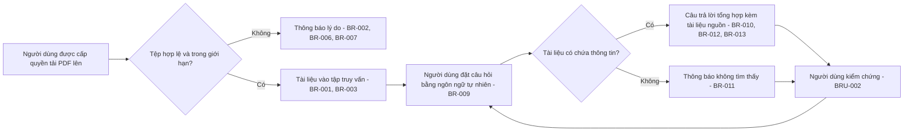

# Tài liệu Yêu cầu Nghiệp vụ (BRD) — Chat với tài liệu (MVP)

> **Tiêu chuẩn:** IEEE 29148-2018 · **Giai đoạn SDLC:** 5.2 Yêu cầu và khám phá
> **Đầu vào:** Phần *Business foundation* đã điền trong [`docs/requirements/BRD_Prompt_IEEE_standard.md`](BRD_Prompt_IEEE_standard.md) (`SRC-001`, `SRC-002`)

## Tóm tắt kiểm định

### Đầu vào đã nhận

| Đầu vào | Trạng thái | Nguồn |
|---|---|---|
| Bản mô tả dự án: đội Phát triển Kinh doanh khó nắm bắt nhiều tài liệu PDF, mất thời gian tổng hợp thông tin từ nhiều tệp | Đã nhận | `SRC-001` |
| Yêu cầu của quản lý: xây dựng MVP ứng dụng web cho phép tải PDF lên và chat với AI để truy vấn nội dung các tài liệu đã tải lên | Đã nhận | `SRC-001` |
| Cho phép đội BA đề xuất thêm tính năng | Đã nhận | `SRC-001` |
| Cấu trúc và quy tắc chất lượng BRD theo IEEE 29148-2018 | Đã nhận | `SRC-002` |

### Thông tin còn thiếu

- Tên tổ chức, nhà tài trợ, chủ sở hữu nghiệp vụ và người phê duyệt (`OQ-001`, `OQ-002`).
- Số liệu baseline về thời gian tra cứu hiện tại, mục tiêu cải thiện, ngưỡng độ chính xác và mục tiêu sử dụng (`OQ-008`).
- Ngân sách, nhân sự và thời hạn (`OQ-005`, `OQ-006`).
- Nhóm người dùng, số lượng người dùng và mô hình phân quyền (`OQ-004`).
- Phân loại bảo mật tài liệu, quy tắc lưu trữ và quy tắc cho phép AI xử lý tài liệu (`OQ-007`, `OQ-010`).
- Giới hạn PDF (dung lượng, số lượng, PDF dạng scan) và ngôn ngữ tài liệu (`OQ-007`, `OQ-012`).

### Ba rủi ro lớn nhất đối với chất lượng yêu cầu

1. **Lợi ích chưa được định lượng:** chưa có baseline nên chưa thể kiểm chứng `BO-001`–`BO-003` (`RSK-001`).
2. **Quản trị thông tin chưa rõ:** chưa biết tài liệu có nhạy cảm không và có được phép đưa vào dịch vụ AI bên ngoài không. Điều này có thể thay đổi đáng kể phạm vi giải pháp (`RSK-002`).
3. **Độ tin cậy của câu trả lời AI:** câu trả lời sai nhưng trông hợp lý có thể bị dùng cho quyết định nghiệp vụ (`RSK-004`).

---

## 1. Kiểm soát tài liệu

| Trường | Giá trị |
|---|---|
| Tên tài liệu | Chat với tài liệu — Tài liệu Yêu cầu Nghiệp vụ |
| Số tài liệu | BRD-CWD-001 |
| Phiên bản | 0.3 |
| Trạng thái | Bản nháp (Draft) |
| Tác giả | Đội Phân tích Nghiệp vụ — [TBD: tên BA phụ trách] |
| Người đóng góp | Đội Phát triển Kinh doanh; Đội Phân tích Nghiệp vụ |
| Người rà soát | [TBD: OQ-009] |
| Người phê duyệt | [TBD: OQ-002] |
| Phân loại bảo mật | Nội bộ — [TBD: OQ-010] |

### Lịch sử phiên bản

| Phiên bản | Ngày | Tác giả | Tóm tắt thay đổi |
|---|---|---|---|
| 0.1 | 2026-10-19 | Đội Phân tích Nghiệp vụ | Bản nháp ban đầu từ bản mô tả dự án |
| 0.2 | 2026-10-19 | Đội Phân tích Nghiệp vụ | Viết lại theo Business foundation đã điền; tách các yêu cầu ghép; bổ sung yêu cầu truy vấn trên nhiều tài liệu, phân quyền và đo lường; bổ sung danh sách tính năng BA đề xuất; thêm `OQ-012`, `OQ-013` |
| 0.3 | 2026-10-26 | Đội Phân tích Nghiệp vụ | Thu hẹp thành MVP-lite: giữ luồng upload → hỏi → kiểm chứng; hoãn hội thoại tiếp nối, feedback, báo cáo tuần và các tính năng vận hành mở rộng |

### Danh sách phân phối

| Đối tượng | Mục đích |
|---|---|
| Nhà tài trợ / quản lý yêu cầu | Xác nhận vấn đề, mục tiêu, phạm vi, ngân sách và phê duyệt |
| Đội Phát triển Kinh doanh | Xác nhận khó khăn hiện tại, nhu cầu và tiêu chí nghiệm thu |
| Đội Phân tích Nghiệp vụ | Duy trì BRD, thiết lập baseline và quản lý tính năng đề xuất |
| Đội Sản phẩm và Phát triển | Xây dựng PRD/SRS sau khi BRD được phê duyệt |
| Bộ phận Tuân thủ / Pháp chế / An toàn thông tin | Xác nhận ràng buộc về dữ liệu và việc dùng AI |

### Quy ước ngôn ngữ chuẩn mực

| Từ trong BRD | Tương đương IEEE | Ý nghĩa |
|---|---|---|
| **phải** | shall | Bắt buộc |
| **nên** | should | Mong muốn, có phương án thay thế |
| **có thể** | may | Được phép, không bắt buộc |

---

## 2. Tóm tắt điều hành

**Vấn đề.** Dự án có nhiều tài liệu PDF mà đội Phát triển Kinh doanh khó nắm bắt đầy đủ. Mỗi lần cần một thông tin, nhân viên phải mở, đọc và tổng hợp thủ công từ nhiều tệp, mất nhiều thời gian (`SRC-001`). Mức thiệt hại (giờ công, số lần tra cứu, số tài liệu) chưa được đo lường `[Chưa xác minh — OQ-008]`.

**Thay đổi đề xuất.** Xây dựng một MVP dạng ứng dụng web. Người dùng được cấp quyền tải tài liệu PDF lên rồi đặt câu hỏi bằng ngôn ngữ tự nhiên. AI trả lời dựa trên nội dung **tất cả** tài liệu đã tải lên và chỉ ra tài liệu nguồn để người dùng kiểm chứng (`SRC-001`).

**Lợi ích kỳ vọng và cách chứng minh.**
- Giảm thời gian tìm và tổng hợp thông tin (`MET-001`).
- Câu trả lời chính xác, kiểm chứng được (`MET-002`).
- Người dùng mục tiêu thực sự sử dụng và đánh giá công cụ là hữu ích (`MET-003`, `MET-004`).

Baseline và mục tiêu cụ thể là `[TBD: OQ-008]`.

**Đầu tư, thời hạn và rủi ro chính.** Ngân sách `[TBD: OQ-006]`; thời hạn `[TBD: OQ-005]`. Rủi ro chính:
- Quản trị thông tin khi đưa tài liệu cho AI xử lý (`RSK-002`).
- AI trả lời sai nhưng trông hợp lý (`RSK-004`).
- Phạm vi phình to do các tính năng đề xuất thêm (`RSK-005`).

**Quyết định cần xin.** Đề nghị nhà tài trợ:
1. Xác nhận phát biểu vấn đề và phạm vi MVP tại Mục 5.
2. Chỉ định chủ sở hữu cho các câu hỏi mở tại Mục 12.
3. Cho phép đội BA đo baseline (`MET-001`) trước khi chuyển sang PRD/SRS.

---

## 3. Bối cảnh nghiệp vụ và phát biểu vấn đề

### 3.1 Quy trình hiện tại

Nguồn: `SRC-001`. Số bước, thời gian mỗi bước và tần suất lặp lại chưa được quan sát hoặc đo lường `[Chưa xác minh — OQ-008]`.

### 3.2 Đối tượng bị ảnh hưởng

| Đối tượng | Ảnh hưởng | Bằng chứng |
|---|---|---|
| Nhân viên Phát triển Kinh doanh | Mất thời gian đọc và tổng hợp thông tin từ nhiều PDF; khó nắm bắt toàn bộ nội dung tài liệu | `SRC-001` |
| Quản lý yêu cầu | Nhận thông tin chậm từ đội; năng suất của đội bị giảm | `SRC-001` (suy luận) `[Chưa xác minh]` |
| Người dùng nghiệp vụ khác | Có thể gặp vấn đề tương tự | `[TBD: OQ-004]` |

### 3.3 Chi phí nếu không hành động

- Tiếp tục mất giờ công cho việc tra cứu thủ công. Chưa định lượng `[TBD: OQ-008]`.
- Có nguy cơ bỏ sót thông tin nằm rải rác ở nhiều tệp, dẫn tới quyết định dựa trên thông tin không đầy đủ `[Chưa xác minh]`.
- Phụ thuộc vào một số cá nhân đã đọc kỹ tài liệu `[Chưa xác minh]`.

Tác động lên doanh thu, chi phí và khách hàng chưa được định lượng. Các điểm trên không được coi là sự thật đã xác lập.

### 3.4 Nguyên nhân gốc và triệu chứng

| Loại | Mô tả | Bằng chứng |
|---|---|---|
| Triệu chứng | Mất nhiều thời gian để tìm một thông tin cụ thể | `SRC-001` |
| Triệu chứng | Đội không nắm bắt hết nội dung các tài liệu | `SRC-001` |
| Nguyên nhân gốc (giả thuyết) | Thông tin phân tán trong nhiều tệp PDF, không có cách hỏi đáp tập trung trên toàn bộ tài liệu | `SRC-001` `[Chưa xác minh]` |
| Nguyên nhân gốc (giả thuyết) | Khối lượng tài liệu vượt khả năng đọc của đội | `[Chưa xác minh — OQ-008]` |

### 3.5 Vì sao cần thực hiện ngay

Quản lý đã yêu cầu phát triển MVP công cụ "Chat với tài liệu" (`SRC-001`). Thời hạn hoặc sự kiện kinh doanh cụ thể tạo ra sự khẩn cấp là `[TBD: OQ-005]`.

---

## 4. Động lực và mục tiêu nghiệp vụ

### 4.1 Mục tiêu nghiệp vụ

| ID | Động lực nghiệp vụ | Mục tiêu (kết quả) | Mã chỉ số | Baseline | Mục tiêu đích | Thời hạn | Nguồn |
|---|---|---|---|---|---|---|---|
| BO-001 | Mất nhiều thời gian tra cứu thông tin từ nhiều PDF | Giảm thời gian người dùng cần để có câu trả lời cho một câu hỏi nghiệp vụ từ tập tài liệu | MET-001 | [TBD: OQ-008] | [TBD: OQ-008] | [TBD: OQ-005] | `SRC-001` |
| BO-002 | Thông tin phân tán, khó nắm bắt đầy đủ | Người dùng nhận được câu trả lời chính xác, có nguồn kiểm chứng, tổng hợp từ nhiều tài liệu | MET-002 | Không áp dụng (năng lực mới) | [TBD: OQ-008] | [TBD: OQ-005] | `SRC-001` |
| BO-003 | Cần xác thực giá trị trước khi đầu tư mở rộng | Xác nhận người dùng mục tiêu sử dụng và đánh giá MVP là hữu ích | MET-003, MET-004 | 0 (chưa có công cụ) | [TBD: OQ-008] | [TBD: OQ-005] | `SRC-001` (yêu cầu MVP) |

### 4.2 Định nghĩa chỉ số

| ID | Định nghĩa | Công thức | Nguồn dữ liệu | Chủ sở hữu | Tần suất | Ngày baseline |
|---|---|---|---|---|---|---|
| MET-001 | Thời gian trung vị để có câu trả lời được chấp nhận cho một câu hỏi trong **bộ câu hỏi chuẩn** | Trung vị (thời điểm có câu trả lời được chấp nhận − thời điểm bắt đầu tìm), so sánh giữa cách thủ công và cách dùng MVP | Bấm giờ trên bộ câu hỏi chuẩn (`SRC-003`) | [TBD: OQ-003] | Một lần trước MVP; một lần khi kết thúc thử nghiệm | [TBD: OQ-008] |
| MET-002 | Tỷ lệ câu trả lời đúng và có căn cứ trong tài liệu | (Số câu trả lời được người đánh giá xác nhận đúng và có nguồn đúng) ÷ (tổng số câu trong bộ câu hỏi chuẩn) × 100% | Phiếu đánh giá của người đánh giá | Trưởng BA [TBD] | Mỗi đợt đánh giá | Không áp dụng |
| MET-003 | Mức độ hoàn thành luồng cốt lõi trong nhóm thử nghiệm | Số người hoàn thành tải PDF → hỏi → kiểm chứng ÷ tổng số người tham gia UAT | Kịch bản UAT và số liệu tối thiểu (`BR-021`) | Chủ sở hữu sản phẩm [TBD] | Một lần trong UAT | Trước UAT |
| MET-004 | Mức độ hữu ích do người dùng đánh giá | Nhận xét trong phiếu UAT hoặc đánh giá thủ công; không bắt buộc nút feedback trong sản phẩm | Phiếu UAT (`BR-020`) | Chủ sở hữu sản phẩm [TBD] | Một lần trong UAT | Trước UAT |

> Chưa có mục tiêu nào hợp lệ cho đến khi `OQ-008` được giải quyết, vì một mục tiêu cần có baseline và phương pháp đo.

---

## 5. Phạm vi

### 5.0 Nguyên tắc thu hẹp MVP-lite

MVP lần này chỉ nhằm kiểm chứng một giả thuyết: người dùng có thể tải PDF lên và tìm được câu trả lời có căn cứ nhanh hơn cách đọc thủ công. Vì vậy:

- Chỉ triển khai một luồng chính: **đăng nhập → tải PDF → chờ xử lý → hỏi → nhận câu trả lời có nguồn**.
- Chỉ hỗ trợ tập tài liệu riêng của từng người dùng; không có cộng tác nhóm.
- Cấp quyền người dùng có thể thực hiện bằng cấu hình hoặc CLI trong giai đoạn thử nghiệm; chưa cần màn hình quản trị riêng.
- Đánh giá chất lượng thực hiện bằng bộ câu hỏi chuẩn ngoài sản phẩm; chưa xây báo cáo tuần hoặc màn hình chấm điểm.
- Mọi yêu cầu không cần cho luồng trên được chuyển sang backlog sau MVP, kể cả khi đã xuất hiện trong BRD phiên bản trước.

### 5.1 Trong phạm vi (MVP)

- Ứng dụng web cho người dùng được cấp quyền (`CON-001`).
- Tải tài liệu PDF lên, trong các giới hạn được phê duyệt (`OQ-007`).
- Xem danh sách tài liệu đã tải lên và xóa tài liệu khỏi tập truy vấn.
- Đặt câu hỏi bằng ngôn ngữ tự nhiên và nhận câu trả lời dựa trên nội dung **toàn bộ** tài liệu đã tải lên.
- Chỉ ra tài liệu nguồn hỗ trợ câu trả lời; thông báo rõ khi tài liệu không chứa câu trả lời.
- Ghi nhận số lượng câu hỏi và trạng thái xử lý ở mức tối thiểu, không lưu nội dung câu hỏi, câu trả lời hoặc tài liệu trong analytics.
- Đo chất lượng bằng bộ câu hỏi chuẩn và đánh giá thủ công/offline.

### 5.2 Ngoài phạm vi

| Hạng mục | Lý do |
|---|---|
| Định dạng khác PDF (Word, Excel, hình ảnh, trang web) | Bản mô tả chỉ yêu cầu PDF (`SRC-001`) |
| Hỏi đáp kiến thức chung không dựa trên tài liệu đã tải lên | Không phục vụ mục tiêu tra cứu tài liệu |
| AI tự đưa ra quyết định hoặc phê duyệt nghiệp vụ | Rủi ro độ tin cậy (`BRU-002`) |
| Chỉnh sửa nội dung tài liệu PDF | Không thuộc nhu cầu đã nêu |
| Triển khai toàn doanh nghiệp | MVP chỉ nhằm xác thực giá trị (`BO-003`) |
| Lựa chọn nhà cung cấp AI, mô hình, kiến trúc, giao diện | Thuộc PRD/SRS/SAD (`CON-003`) |

### 5.3 Hoãn — tính năng do BA đề xuất (chờ phê duyệt `OQ-011`)

Các tính năng sau là **đề xuất**, chưa thuộc baseline. Chúng chỉ được đưa vào phạm vi khi chủ sở hữu sản phẩm/nhà tài trợ phê duyệt (`BRU-005`).

| Mã đề xuất | Tính năng đề xuất | Giá trị nghiệp vụ dự kiến | Liên kết | Ưu tiên đề xuất |
|---|---|---|---|---|
| P-01 | Tóm tắt một tài liệu theo yêu cầu | Nắm nhanh nội dung tài liệu dài | `SN-001` | Could |
| P-02 | So sánh nội dung giữa hai hoặc nhiều tài liệu | Hỗ trợ đối chiếu điều khoản, số liệu | `SN-001` | Could |
| P-03 | Giới hạn câu hỏi vào một nhóm tài liệu được chọn | Câu trả lời tập trung, giảm nhiễu | `SN-001` | Should |
| P-04 | Lưu và xem lại lịch sử hội thoại | Tái sử dụng kết quả tra cứu | `SN-002`, `OQ-013` | Should |
| P-05 | Gợi ý câu hỏi mẫu từ nội dung tài liệu | Giúp người dùng mới bắt đầu | `SN-002` | Could |
| P-06 | Xuất câu trả lời kèm nguồn (sao chép / tải về) | Đưa kết quả vào báo cáo | `SN-003` | Could |
| P-07 | Không gian tài liệu dùng chung theo nhóm | Cả đội cùng truy vấn một kho | `SN-001`, `OQ-004` | Should |
| P-08 | Hỗ trợ PDF dạng scan (nhận dạng ký tự) | Mở rộng loại tài liệu truy vấn được | `OQ-007` | Could |

### 5.4 Hoãn sau MVP-lite

Các yêu cầu sau vẫn có giá trị nhưng không cần để kiểm chứng luồng cốt lõi:

| Hạng mục | Yêu cầu liên quan | Cách thay thế trong MVP-lite |
|---|---|---|
| Hỏi tiếp nối trong hội thoại | BR-014 | Người dùng gửi câu hỏi đầy đủ |
| Đánh dấu hữu ích / không hữu ích | BR-020 | Đánh giá trong UAT và phiếu chấm offline |
| Báo cáo sử dụng hằng tuần | BR-021 | Truy vấn/export số liệu tối thiểu khi cần |
| Cộng tác nhóm, lịch sử hội thoại, scan/OCR | P-04, P-07, P-08 | Không triển khai |

### 5.5 Ranh giới

- **Bắt đầu:** người dùng được cấp quyền tải tài liệu PDF lên.
- **Kết thúc:** người dùng nhận câu trả lời có nguồn hoặc nhận thông báo không tìm thấy câu trả lời.
- **Nằm ngoài sáng kiến:** việc tạo và sở hữu tài liệu gốc, việc lấy tài liệu từ các hệ thống khác, và các hành động nghiệp vụ sau khi có câu trả lời. Những việc này thuộc các quy trình hiện có.

---

## 6. Các bên liên quan và nhu cầu

### 6.1 Danh sách bên liên quan

| ID | Bên liên quan / nhóm | Vai trò nghiệp vụ | Mối quan tâm | Ảnh hưởng | Nhu cầu | Nguồn |
|---|---|---|---|---|---|---|
| STK-001 | Nhân viên Phát triển Kinh doanh | Người dùng chính; tra cứu thông tin trong tài liệu | Tìm thông tin nhanh, chính xác | Cao | SN-001, SN-002, SN-003 | `SRC-001` |
| STK-002 | Quản lý yêu cầu MVP (nhà tài trợ dự kiến) | Ra quyết định đầu tư, phê duyệt | Bằng chứng giá trị, chi phí | Cao | SN-004 | `SRC-001` |
| STK-003 | Đội Phân tích Nghiệp vụ | Thu thập yêu cầu, đề xuất tính năng | Phạm vi rõ, yêu cầu kiểm thử được | Trung bình | SN-005 | `SRC-001` |
| STK-004 | Tuân thủ / Pháp chế / An toàn thông tin | Kiểm soát dữ liệu và việc dùng AI | Bảo mật tài liệu, tuân thủ — **có thể chặn triển khai** | Cao | SN-006 | `[TBD: OQ-010]` |
| STK-005 | Đội Sản phẩm và Phát triển | Chuyển BRD thành PRD/SRS và xây dựng | Yêu cầu rõ, khả thi | Trung bình | SN-007 | `SRC-002` |
| STK-006 | Chủ sở hữu tài liệu nguồn | Cung cấp và chịu trách nhiệm về nội dung PDF | Tài liệu chỉ được người có quyền truy cập | Trung bình | SN-008 | `[Chưa xác minh — OQ-004]` |

### 6.2 Nhu cầu bên liên quan

| ID | Bên liên quan | Phát biểu nhu cầu | Nỗi đau hiện tại | Bằng chứng | Ưu tiên |
|---|---|---|---|---|---|
| SN-001 | STK-001 | Tìm được thông tin nằm rải rác trong nhiều PDF mà không phải đọc thủ công từng tệp | Tra cứu và tổng hợp mất nhiều thời gian | `SRC-001` | Must |
| SN-002 | STK-001 | Đặt câu hỏi bằng ngôn ngữ tự nhiên thay vì tìm từ khóa trong từng tệp | Phải tự chuyển câu hỏi thành nhiều lần tìm kiếm | `SRC-001` | Must |
| SN-003 | STK-001 | Kiểm chứng được câu trả lời bằng cách biết thông tin đến từ tài liệu nào | Không thể tin câu trả lời nếu không biết nguồn | `[Chưa xác minh]` — BA suy luận từ rủi ro AI | Must |
| SN-004 | STK-002 | Có bằng chứng đo được rằng MVP giúp giảm thời gian và cho câu trả lời đúng | Chưa có baseline, chưa có cơ sở quyết định | `SRC-001`, `OQ-008` | Must |
| SN-005 | STK-003 | Có quy trình phê duyệt rõ ràng cho tính năng đề xuất thêm | Đề xuất chưa được ưu tiên, dễ phình phạm vi | `SRC-001` | Should |
| SN-006 | STK-004 | Tài liệu được lưu trữ, truy cập và xử lý bằng AI đúng chính sách quản trị thông tin | Chưa có phân loại và quy tắc xử lý | `[TBD: OQ-007, OQ-010]` | Must |
| SN-007 | STK-005 | Nhận yêu cầu tách biệt khỏi thiết kế, có tiêu chí nghiệm thu khách quan | Chưa có đặc tả | `SRC-002` | Should |
| SN-008 | STK-006 | Chỉ người có quyền mới truy vấn được nội dung tài liệu | Chưa có mô hình phân quyền | `[Chưa xác minh — OQ-004]` | Must |

---

## 7. Yêu cầu nghiệp vụ

Thang ưu tiên: **Must** (thiếu thì sáng kiến thất bại) · **Should** (giá trị đáng kể, có cách làm thay thế) · **Could** (mong muốn) · **Won't** (loại trừ trong lần phát hành này). Không dùng thang 1–5.

### 7.1 Quản lý tài liệu

| ID | Yêu cầu | Lý do | Nguồn | Ưu tiên | Tiêu chí nghiệm thu | Phương pháp xác minh | Trạng thái |
|---|---|---|---|---|---|---|---|
| BR-001 | Khi người dùng được cấp quyền tải lên một tệp PDF nằm trong giới hạn được phê duyệt, giải pháp **phải** đưa tài liệu đó vào tập tài liệu có thể truy vấn của người dùng. | Năng lực cốt lõi của MVP | BO-002 / SN-001 | Must | AC-001 | Trình diễn, Kiểm thử | Draft |
| BR-002 | Khi một tệp tải lên không thể xử lý, giải pháp **phải** thông báo cho người dùng rằng tài liệu đó không được đưa vào tập truy vấn, kèm lý do. | Tránh câu trả lời thiếu dữ liệu mà người dùng không biết | SN-001, SN-003 | Must | AC-002 | Kiểm thử | Draft |
| BR-003 | Giải pháp **phải** cho phép tập tài liệu có thể truy vấn chứa nhiều tệp PDF cùng lúc. | Vấn đề gốc là thông tin nằm rải rác ở nhiều tệp | BO-002 / SN-001 | Must | AC-003 | Kiểm thử | Draft |
| BR-004 | Giải pháp **nên** hiển thị cho người dùng danh sách tài liệu trong tập truy vấn và trạng thái sẵn sàng của từng tài liệu. | Người dùng biết câu trả lời dựa trên những tài liệu nào | SN-003 | Should | AC-004 | Trình diễn | Draft |
| BR-005 | Giải pháp **phải** cho phép người dùng đã tải tài liệu lên xóa tài liệu đó khỏi tập truy vấn. | Loại bỏ tài liệu sai, cũ hoặc tải nhầm | SN-006, SN-008 | Must | AC-005 | Kiểm thử | Draft |
| BR-006 | Giải pháp **phải** từ chối tệp PDF vượt dung lượng tối đa được phê duyệt. | Giữ MVP trong giới hạn năng lực | SN-006 | Must | AC-006 | Kiểm thử | Bị chặn bởi OQ-007 |
| BR-007 | Giải pháp **phải** từ chối tệp tải lên khi tập truy vấn đã đạt số lượng tài liệu tối đa được phê duyệt. | Giữ MVP trong giới hạn năng lực | SN-006 | Must | AC-007 | Kiểm thử | Bị chặn bởi OQ-007 |
| BR-008 | Giải pháp **phải** xóa tài liệu đã tải lên khi hết thời hạn lưu trữ được phê duyệt. | Tuân thủ chính sách lưu trữ dữ liệu | SN-006 | Must | AC-008 | Kiểm tra, Kiểm thử | Bị chặn bởi OQ-007 |

### 7.2 Hỏi đáp về nội dung tài liệu

| ID | Yêu cầu | Lý do | Nguồn | Ưu tiên | Tiêu chí nghiệm thu | Phương pháp xác minh | Trạng thái |
|---|---|---|---|---|---|---|---|
| BR-009 | Khi người dùng được cấp quyền gửi một câu hỏi bằng ngôn ngữ tự nhiên, giải pháp **phải** trả về câu trả lời chỉ dựa trên nội dung các tài liệu trong tập truy vấn của người dùng. | Năng lực nghiệp vụ chính | BO-001, BO-002 / SN-002 | Must | AC-009 | Kiểm thử, Phân tích | Draft |
| BR-010 | Khi thông tin cần thiết nằm ở nhiều tài liệu, giải pháp **phải** tổng hợp nội dung từ các tài liệu đó trong cùng một câu trả lời. | Thay thế việc tổng hợp thủ công | BO-001 / SN-001 | Must | AC-010 | Kiểm thử, Phân tích | Draft |
| BR-011 | Khi tập truy vấn không chứa thông tin để trả lời, giải pháp **phải** thông báo rõ cho người dùng rằng không tìm thấy câu trả lời trong tài liệu. | Không trình bày thông tin không có căn cứ như sự thật | BO-002 / SN-003 | Must | AC-011 | Kiểm thử | Draft |
| BR-012 | Giải pháp **phải** chỉ ra tên tài liệu nguồn hỗ trợ cho mỗi câu trả lời. | Cho phép người dùng kiểm chứng | BO-002 / SN-003 | Must | AC-012 | Kiểm tra, Kiểm thử | Draft |
| BR-013 | Giải pháp **nên** chỉ ra số trang trong tài liệu nguồn hỗ trợ cho mỗi câu trả lời. | Rút ngắn thời gian kiểm chứng | BO-001 / SN-003 | Should | AC-013 | Kiểm tra, Kiểm thử | Draft |
| BR-014 | Trong cùng một cuộc hội thoại, giải pháp **có thể** hiểu câu hỏi tiếp nối có tham chiếu đến câu hỏi hoặc câu trả lời trước đó. | Hỏi đáp tự nhiên, giảm việc nhập lại ngữ cảnh | SN-002 | Could | AC-014 | Trình diễn, Kiểm thử | Hoãn sau MVP-lite |
| BR-015 | Giải pháp **phải** chấp nhận câu hỏi và trả lời bằng các ngôn ngữ được phê duyệt. | Người dùng và tài liệu có thể dùng tiếng Việt và/hoặc tiếng Anh | SN-002 | Must | AC-015 | Kiểm thử | Bị chặn bởi OQ-012 |
| BR-016 | Giải pháp **nên** trả lời mỗi câu hỏi trong bộ câu hỏi chuẩn trong thời gian tối đa được phê duyệt. | Thời gian chờ ảnh hưởng trực tiếp tới BO-001 | BO-001 / SN-001 | Should | AC-016 | Kiểm thử | Bị chặn bởi OQ-008 |

### 7.3 Truy cập và quản trị thông tin

| ID | Yêu cầu | Lý do | Nguồn | Ưu tiên | Tiêu chí nghiệm thu | Phương pháp xác minh | Trạng thái |
|---|---|---|---|---|---|---|---|
| BR-017 | Giải pháp **phải** chỉ cho phép người dùng được cấp quyền truy cập. | Bảo vệ tài liệu nghiệp vụ | SN-006, SN-008 | Must | AC-017 | Kiểm thử | Draft |
| BR-018 | Giải pháp **phải** ngăn người dùng truy vấn tài liệu mà họ không được phép xem theo mô hình phân quyền được phê duyệt. | Tránh lộ thông tin giữa các người dùng | SN-008 | Must | AC-018 | Kiểm thử | Bị chặn bởi OQ-004 |
| BR-019 | Giải pháp **phải** xử lý nội dung tài liệu bằng AI chỉ trong ranh giới xử lý dữ liệu đã được bộ phận An toàn thông tin phê duyệt. | Tuân thủ quản trị thông tin | SN-006 | Must | AC-019 | Rà soát, Kiểm tra | Bị chặn bởi OQ-010 |

### 7.4 Đo lường và phản hồi MVP

| ID | Yêu cầu | Lý do | Nguồn | Ưu tiên | Tiêu chí nghiệm thu | Phương pháp xác minh | Trạng thái |
|---|---|---|---|---|---|---|---|
| BR-020 | Giải pháp **có thể** cho phép người dùng đánh dấu mỗi câu trả lời là "hữu ích" hoặc "không hữu ích". | Dữ liệu cho MET-004 | BO-003 / SN-004 | Could | AC-020 | Trình diễn | Hoãn sau MVP-lite |
| BR-021 | Giải pháp **nên** ghi nhận số lượng câu hỏi và trạng thái xử lý ở mức tối thiểu, nhưng không ghi lại nội dung tài liệu, câu hỏi hoặc câu trả lời vào số liệu đo lường. | Theo dõi thử nghiệm mà không mở rộng thành hệ thống báo cáo | BO-003 / SN-004, SN-006 | Should | AC-021 | Kiểm tra, Kiểm thử | MVP-lite, không có báo cáo tuần |

> **Ghi chú cho PRD/SRS:** Cách thực hiện cụ thể (cách tách nội dung PDF, mô hình AI, cơ chế tìm kiếm, giao diện chat) thuộc PRD/SRS/SAD và không được quyết định trong BRD này (`CON-003`).

---

## 8. Quy tắc nghiệp vụ

| ID | Quy tắc | Loại | Phạm vi | Chủ sở hữu thực thi | Nguồn |
|---|---|---|---|---|---|
| BRU-001 | Người dùng chỉ được tải lên những tài liệu mà họ có quyền sử dụng cho mục đích công việc. | Chính sách | Tải tài liệu lên | Chủ sở hữu nghiệp vụ [TBD: OQ-002] | `SN-008`, `OQ-007` |
| BRU-002 | Câu trả lời của AI chỉ mang tính tham khảo. Trước khi dùng thông tin cho quyết định nghiệp vụ, người dùng phải kiểm chứng với tài liệu nguồn. | Quyết định | Sử dụng câu trả lời | Trưởng đội Phát triển Kinh doanh | `SN-003`, `RSK-004` |
| BRU-003 | Việc lưu trữ, truy cập và xử lý tài liệu bằng AI phải tuân theo chính sách quản trị thông tin đã phê duyệt. | Chính sách / Pháp lý | Toàn bộ tài liệu và dữ liệu phát sinh | Tuân thủ / An toàn thông tin [TBD: OQ-010] | `SN-006` |
| BRU-004 | Chỉ được tuyên bố MVP thành công khi các chỉ số MET-001 đến MET-004 đạt mục tiêu đã phê duyệt, đo trên bộ câu hỏi chuẩn đã phê duyệt. | Quyết định | Đánh giá MVP | Nhà tài trợ [TBD: OQ-002] | `BO-003`, `OQ-008` |
| BRU-005 | Tính năng do BA đề xuất chỉ được đưa vào phạm vi khi chủ sở hữu sản phẩm/nhà tài trợ phê duyệt bằng văn bản. | Quyết định | Quản lý phạm vi | Chủ sở hữu sản phẩm [TBD: OQ-011] | `SRC-001`, `SN-005` |

---

## 9. Ràng buộc

| ID | Ràng buộc | Loại | Bên áp đặt | Tác động | Nguồn |
|---|---|---|---|---|---|
| CON-001 | Sản phẩm bàn giao là một MVP dạng ứng dụng web. | Tổ chức / Kỹ thuật | Quản lý yêu cầu | Người dùng truy cập qua trình duyệt; phạm vi giới hạn ở mức tối thiểu | `SRC-001` |
| CON-002 | Định dạng tài liệu đầu vào là PDF. | Phạm vi | Quản lý yêu cầu | Loại trừ các định dạng khác trong MVP | `SRC-001` |
| CON-003 | BRD không chốt nhà cung cấp AI, mô hình, framework hoặc kiến trúc. | Quy trình | Thực hành IEEE 29148 | Lựa chọn kỹ thuật được quyết định ở PRD/SRS/SAD | `SRC-002` |
| CON-004 | Không được dùng tài liệu thật có tính nhạy cảm trước khi chính sách xử lý dữ liệu bằng AI được phê duyệt. | Pháp lý / An toàn thông tin | [TBD: OQ-010] | Có thể giới hạn loại tài liệu, nhà cung cấp AI và nơi xử lý dữ liệu | `OQ-007`, `OQ-010` |
| CON-005 | Ngân sách và thời hạn chưa được xác định. | Ngân sách / Thời gian | [TBD: OQ-005, OQ-006] | Chưa xác nhận được tính khả thi của toàn bộ phạm vi | `SRC-001` |

---

## 10. Giả định, phụ thuộc và rủi ro

| ID | Hạng mục | Loại | Mô tả | Tác động nếu sai | Chủ sở hữu | Xác nhận / giảm thiểu | Hạn |
|---|---|---|---|---|---|---|---|
| ASM-001 | Phần lớn PDF có lớp văn bản (không phải ảnh scan) | Giả định | Nội dung có thể trích xuất mà không cần nhận dạng ký tự | Nhiều tài liệu không truy vấn được; phải đưa P-08 vào phạm vi | Trưởng đội PTKD | Kiểm tra mẫu tài liệu thực tế | Trước PRD |
| ASM-002 | Người dùng đã có quyền đối với các tài liệu họ tải lên | Giả định | Người dùng tự chịu trách nhiệm chọn tài liệu (`BRU-001`) | Xử lý tài liệu trái phép | Chủ sở hữu nghiệp vụ | Xác nhận cùng An toàn thông tin | [TBD: OQ-007] |
| ASM-003 | Đội PTKD bố trí được người đánh giá và soạn được bộ câu hỏi chuẩn có đáp án | Giả định | Cần cho MET-001, MET-002 | Không đo được lợi ích | Trưởng đội PTKD | Chỉ định người và soạn bộ câu hỏi | [TBD: OQ-008] |
| DEP-001 | Chỉ định nhà tài trợ và chủ sở hữu nghiệp vụ | Phụ thuộc | Cần cho phê duyệt và quyết định chỉ số | BRD không thể được phê duyệt | Quản lý yêu cầu | Chỉ định người cụ thể | [TBD: OQ-002] |
| DEP-002 | Chính sách quản trị thông tin cho xử lý AI | Phụ thuộc | Quyết định nơi xử lý, lưu trữ, nhà cung cấp được phép | Chặn BR-006, BR-007, BR-008, BR-019 | Tuân thủ / An toàn thông tin | Theo dõi trong `OQ-007`, `OQ-010` | Trước thử nghiệm |
| DEP-003 | Bộ tài liệu mẫu đại diện được phép dùng để thử nghiệm | Phụ thuộc | Cần cho kiểm thử và đánh giá | Không có cơ sở nghiệm thu | Trưởng đội PTKD | Cung cấp tài liệu đã được phép hoặc đã ẩn thông tin nhạy cảm | Trước thử nghiệm |
| RSK-001 | Lợi ích không chứng minh được | Rủi ro | Chưa có baseline → không so sánh được trước/sau → quyết định đầu tư mang tính chủ quan | Cao | Chủ sở hữu nghiệp vụ | Đo baseline MET-001 trước khi phát triển | [TBD: OQ-008] |
| RSK-002 | Vi phạm quản trị thông tin | Rủi ro | Tài liệu nhạy cảm được gửi tới dịch vụ AI không được phép → lộ dữ liệu → ảnh hưởng pháp lý và uy tín | Cao | Tuân thủ / An toàn thông tin | Phân loại dữ liệu; phê duyệt ranh giới xử lý; áp dụng CON-004 | Trước thử nghiệm |
| RSK-003 | Giải pháp không đáp ứng được quy mô | Rủi ro | Chưa biết số người dùng và số/kích thước tài liệu → MVP không đáp ứng tải → thử nghiệm gián đoạn | Trung bình | Chủ sở hữu sản phẩm | Xác định hồ sơ sử dụng (`OQ-004`, `OQ-007`) | Trước PRD |
| RSK-004 | AI trả lời sai nhưng trông hợp lý | Rủi ro | AI tạo câu trả lời không có căn cứ → người dùng dùng thông tin sai → quyết định sai | Cao | Trưởng BA | BR-011, BR-012, BRU-002; đánh giá MET-002 trước khi dùng rộng rãi | Trước thử nghiệm |
| RSK-005 | Phạm vi phình to | Rủi ro | Nhiều tính năng đề xuất được thêm vào → MVP chậm bàn giao | Trung bình | Chủ sở hữu sản phẩm | Áp dụng BRU-005; giới hạn MVP theo Mục 5.1 | Trước PRD |
| RSK-006 | Người dùng không tin tưởng nên không dùng | Rủi ro | Câu trả lời không có nguồn hoặc sai → người dùng quay lại tra cứu thủ công → MET-003 thấp | Trung bình | Chủ sở hữu sản phẩm | BR-012, BR-013; hướng dẫn người dùng; thu thập phản hồi qua BR-020 | Trong thử nghiệm |

---

## 11. Truy xuất nguồn yêu cầu

### 11.1 Ma trận truy xuất

| Mục tiêu nghiệp vụ | Nhu cầu | Yêu cầu nghiệp vụ | Tiêu chí nghiệm thu | Mã PRD/SRS |
|---|---|---|---|---|
| BO-002 | SN-001 | BR-001, BR-003 | AC-001, AC-003 | [TBD] |
| BO-002 | SN-001, SN-003 | BR-002, BR-004 | AC-002, AC-004 | [TBD] |
| — | SN-006, SN-008 | BR-005, BR-006, BR-007, BR-008 | AC-005 – AC-008 | [TBD] |
| BO-001, BO-002 | SN-002 | BR-009 | AC-009 | [TBD] |
| BO-001 | SN-001 | BR-010, BR-016 | AC-010, AC-016 | [TBD] |
| BO-002 | SN-003 | BR-011, BR-012 | AC-011, AC-012 | [TBD] |
| BO-001 | SN-003 | BR-013 | AC-013 | [TBD] |
| — | SN-002 | BR-014, BR-015 | AC-014, AC-015 | [TBD] |
| — | SN-006, SN-008 | BR-017, BR-018, BR-019 | AC-017 – AC-019 | [TBD] |
| BO-003 | SN-004 | BR-020, BR-021 | AC-020, AC-021 | [TBD] |

### 11.2 Tiêu chí nghiệm thu

| ID | Tiêu chí nghiệm thu |
|---|---|
| AC-001 | Với mỗi tệp trong bộ tài liệu mẫu (DEP-003) nằm trong giới hạn, sau khi tải lên, tài liệu xuất hiện trong tập truy vấn và nội dung của nó được dùng để trả lời ít nhất một câu hỏi kiểm thử về tài liệu đó. |
| AC-002 | Với mỗi tệp kiểm thử lỗi (hỏng, có mật khẩu, không phải PDF, không có lớp văn bản), người dùng nhận được thông báo nêu tên tệp và lý do; tài liệu không xuất hiện trong tập truy vấn. |
| AC-003 | Sau khi tải lên ít nhất [TBD: OQ-007] tệp, cả tập tài liệu đều sẵn sàng truy vấn cùng lúc; câu hỏi về nội dung của từng tệp đều trả lời được. |
| AC-004 | Danh sách hiển thị đúng 100% tài liệu đã tải lên, kèm trạng thái (đang xử lý / sẵn sàng / lỗi), đối chiếu với nhật ký kiểm thử. |
| AC-005 | Sau khi xóa một tài liệu, câu hỏi chỉ trả lời được bằng nội dung của tài liệu đó sẽ nhận thông báo không tìm thấy (theo BR-011) và tài liệu đó không còn được nêu làm nguồn. |
| AC-006 | Tệp có dung lượng bằng giới hạn được chấp nhận; tệp vượt giới hạn 1 byte bị từ chối kèm thông báo nêu giới hạn. |
| AC-007 | Khi tập truy vấn đã đủ số tài liệu tối đa, lần tải lên tiếp theo bị từ chối kèm thông báo nêu giới hạn. |
| AC-008 | Tài liệu có tuổi vượt thời hạn lưu trữ không còn truy vấn hoặc truy xuất được; bộ phận An toàn thông tin xác nhận qua kiểm tra. |
| AC-009 | Với bộ câu hỏi chuẩn, mọi câu trả lời đều có căn cứ trong tập truy vấn hoặc là thông báo không tìm thấy; không câu trả lời nào chứa thông tin lấy từ ngoài tài liệu (người đánh giá xác nhận). |
| AC-010 | Với các câu hỏi chuẩn mà đáp án nằm ở ít nhất 2 tài liệu, câu trả lời chứa thông tin từ tất cả tài liệu liên quan và nêu từng tài liệu đó làm nguồn, đạt ngưỡng MET-002 [TBD: OQ-008]. |
| AC-011 | Với ít nhất 10 câu hỏi kiểm thử không có đáp án trong tài liệu, 100% nhận thông báo không tìm thấy thay vì một câu trả lời khẳng định. |
| AC-012 | Với 100% câu trả lời có nội dung trong bộ câu hỏi chuẩn, tên tài liệu nguồn được hiển thị và người đánh giá xác nhận tài liệu đó chứa thông tin được trích dẫn. |
| AC-013 | Với các câu trả lời có nội dung trong bộ câu hỏi chuẩn, số trang được hiển thị và người đánh giá xác nhận số trang đúng trong ít nhất [TBD: OQ-008] % trường hợp. |
| AC-014 | Trong một kịch bản hội thoại kiểm thử gồm câu hỏi gốc và câu hỏi tiếp nối có dùng đại từ thay thế (ví dụ: "còn điều khoản đó thì sao?"), câu trả lời tiếp nối đúng ngữ cảnh theo xác nhận của người đánh giá. |
| AC-015 | Với mỗi ngôn ngữ được phê duyệt, bộ câu hỏi chuẩn bằng ngôn ngữ đó đạt ngưỡng MET-002. |
| AC-016 | Ít nhất [TBD: OQ-008] % câu hỏi trong bộ câu hỏi chuẩn được trả lời trong thời gian tối đa được phê duyệt. |
| AC-017 | Người chưa được cấp quyền không truy cập được bất kỳ tài liệu hay chức năng hỏi đáp nào trong 100% kịch bản kiểm thử. |
| AC-018 | Người dùng A không nhận được nội dung từ tài liệu mà A không được phép xem trong 100% kịch bản kiểm thử phân quyền. |
| AC-019 | Bộ phận An toàn thông tin ký xác nhận rằng luồng xử lý dữ liệu bằng AI tuân thủ ranh giới đã phê duyệt. |
| AC-020 | Mỗi câu trả lời có thể được đánh dấu "hữu ích" hoặc "không hữu ích"; tổng hợp hằng tuần khớp với số lượt đánh dấu trong kiểm thử. |
| AC-021 | Báo cáo hằng tuần cho biết số câu hỏi theo người dùng; kiểm tra xác nhận báo cáo không chứa nội dung tài liệu. |

### 11.3 Báo cáo độ bao phủ

- **Mục tiêu không có yêu cầu:** không có. BO-001, BO-002 và BO-003 đều có yêu cầu. Giá trị baseline và mục tiêu vẫn bị chặn bởi `OQ-008`.
- **Yêu cầu không có mục tiêu hoặc nhu cầu (mồ côi):** không có. BR-005 đến BR-008, BR-014, BR-015 và BR-017 đến BR-019 truy xuất về nhu cầu (SN), không truy xuất trực tiếp về mục tiêu (BO). Điều này hợp lệ theo Mục 1, nguyên tắc "No orphan requirements".
- **Nhu cầu không có yêu cầu:** SN-005 được đáp ứng bằng quy tắc BRU-005 (không phải năng lực của giải pháp). SN-007 được đáp ứng bằng chính cấu trúc của BRD này.
- **Yêu cầu không có tiêu chí nghiệm thu hoặc phương pháp xác minh:** không có.
- **Hạn chế:** chưa có mã PRD/SRS. Các ngưỡng [TBD] trong AC-003, AC-010, AC-013, AC-015 và AC-016 cần được điền trước khi thiết lập baseline.

---

## 12. Câu hỏi mở và quyết định

| ID | Câu hỏi / quyết định cần đưa ra | Tầm quan trọng | Chủ sở hữu | Cần trước | Trạng thái | Kết quả |
|---|---|---|---|---|---|---|
| OQ-001 | Tổ chức và đơn vị nghiệp vụ nào tài trợ MVP? | Xác định trách nhiệm và bối cảnh | Quản lý yêu cầu | Rà soát BRD | Mở | — |
| OQ-002 | Ai là nhà tài trợ, chủ sở hữu nghiệp vụ và người phê duyệt BRD? | Cần cho phê duyệt, ngân sách và quyết định chỉ số | Quản lý yêu cầu | Rà soát BRD | Mở | — |
| OQ-003 | Ai sở hữu quy trình tra cứu tài liệu hiện tại? | Cần cho đo baseline MET-001 | Chủ sở hữu nghiệp vụ | Đo baseline | Mở | — |
| OQ-004 | Nhóm người dùng nào tham gia MVP, bao nhiêu người, và tài liệu dùng riêng từng người hay dùng chung trong nhóm? | Chặn BR-018; ảnh hưởng P-07 và RSK-003 | Chủ sở hữu nghiệp vụ / sản phẩm | PRD | Mở | — |
| OQ-005 | Thời hạn bàn giao MVP, thời gian thử nghiệm và các mốc rà soát? | Xác định tính khả thi và mức ưu tiên | Nhà tài trợ | Lập kế hoạch | Mở | — |
| OQ-006 | Ngân sách và nhân sự được phê duyệt? | Xác định phạm vi khả thi | Nhà tài trợ | Lập kế hoạch | Mở | — |
| OQ-007 | Giới hạn dung lượng và số lượng tệp, loại PDF được hỗ trợ (scan, có mật khẩu), thời hạn lưu trữ, nơi lưu trữ và xử lý dữ liệu? | Chặn BR-006, BR-007, BR-008 | Tuân thủ / An toàn thông tin + Chủ sở hữu sản phẩm | PRD | Mở | — |
| OQ-008 | Baseline thời gian tra cứu, mục tiêu cải thiện, ngưỡng độ chính xác, ngưỡng thời gian phản hồi, mục tiêu sử dụng, bộ câu hỏi chuẩn và phương pháp đo? | Chặn mục tiêu BO, BR-016 và nghiệm thu MVP | Chủ sở hữu nghiệp vụ / Trưởng BA | Phát triển | Mở | — |
| OQ-009 | Ai tham gia rà soát BRD? | Đảm bảo đủ bên liên quan xác nhận | Chủ sở hữu nghiệp vụ | Rà soát BRD | Mở | — |
| OQ-010 | Phân loại bảo mật của tài liệu là gì? Có được phép gửi tài liệu tới dịch vụ AI bên ngoài không? | Chặn BR-019 và CON-004 | Tuân thủ / An toàn thông tin | Thử nghiệm với dữ liệu thật | Mở | — |
| OQ-011 | Những tính năng đề xuất nào (P-01 đến P-08) được đưa vào MVP? | Kiểm soát phạm vi (RSK-005) | Chủ sở hữu sản phẩm / Nhà tài trợ | PRD | Đã quyết định | Không đưa tính năng đề xuất vào MVP-lite |
| OQ-012 | Tài liệu và câu hỏi dùng ngôn ngữ nào (tiếng Việt, tiếng Anh, cả hai)? | Chặn BR-015 | Trưởng đội PTKD | PRD | Mở | — |
| OQ-013 | Có cần lưu và xem lại lịch sử hội thoại không? Nếu có, lưu trong bao lâu? | Ảnh hưởng P-04 và chính sách lưu trữ | Chủ sở hữu sản phẩm + An toàn thông tin | PRD | Đã quyết định | Không lưu lịch sử hội thoại dài hạn trong MVP-lite |

> Ngày cụ thể cho cột "Cần trước" phụ thuộc vào lịch dự án (`OQ-005`).

---

## 13. Thuật ngữ và tài liệu tham chiếu

### 13.1 Thuật ngữ

| Thuật ngữ | Định nghĩa |
|---|---|
| AI | Trí tuệ nhân tạo dùng để hiểu câu hỏi và tạo câu trả lời từ nội dung tài liệu. BRD không chỉ định mô hình hay nhà cung cấp. |
| BA | Business Analyst — Đội Phân tích Nghiệp vụ |
| BRD | Business Requirements Document — Tài liệu Yêu cầu Nghiệp vụ |
| Bộ câu hỏi chuẩn | Tập câu hỏi kèm đáp án đúng và tài liệu nguồn đúng, do đội PTKD soạn và được phê duyệt, dùng để đo MET-001 và MET-002 |
| Câu trả lời có căn cứ | Câu trả lời mà mọi thông tin khẳng định đều tìm thấy được trong tài liệu nguồn được nêu |
| MVP | Minimum Viable Product — phiên bản nhỏ nhất đủ để xác thực giá trị nghiệp vụ |
| Người dùng được cấp quyền | Người được chủ sở hữu nghiệp vụ cho phép sử dụng MVP theo mô hình phân quyền (`OQ-004`) |
| PDF dạng scan | PDF chứa ảnh chụp trang, không có lớp văn bản để trích xuất trực tiếp |
| PRD / SRS / SAD | Tài liệu yêu cầu sản phẩm / Đặc tả yêu cầu phần mềm / Tài liệu kiến trúc — các tài liệu ở bước sau |
| PTKD | Phát triển Kinh doanh (Business Development) |
| Tập truy vấn | Tập các tài liệu PDF đã tải lên, xử lý thành công và được dùng để trả lời câu hỏi của một người dùng hoặc nhóm |

### 13.2 Tài liệu tham chiếu

| Mã | Tên | Phiên bản / ngày | Vị trí | Ngày truy cập |
|---|---|---|---|---|
| SRC-001 | Bản mô tả dự án "Chat với tài liệu" (yêu cầu của quản lý) | 2026-10-19 | Business foundation, Mục 2.1 — `docs/BRD_Prompt_IEEE_standard.md` | 2026-10-19 |
| SRC-002 | BRD Prompt IEEE standard | v1.0 | `docs/BRD_Prompt_IEEE_standard.md` | 2026-10-19 |
| SRC-003 | Đo baseline công sức tra cứu hiện tại | Chưa có | [TBD: OQ-008] | — |
| REF-001 | ISO/IEC/IEEE 29148:2018 — Requirements engineering | 2018 | Tiêu chuẩn quốc tế | — |

---

## 14. Phê duyệt

| Vai trò | Tên | Quyết định | Chữ ký / ngày |
|---|---|---|---|
| Nhà tài trợ | [TBD: OQ-002] | [Phê duyệt / Phê duyệt có điều kiện / Từ chối] | [TBD] |
| Chủ sở hữu nghiệp vụ | [TBD: OQ-002] | [Phê duyệt / Từ chối] | [TBD] |
| Chủ sở hữu sản phẩm | [TBD: OQ-011] | [Phê duyệt / Từ chối] | [TBD] |
| Tuân thủ / Pháp chế / An toàn thông tin | [TBD: OQ-010] | [Phê duyệt / Từ chối] | [TBD] |

**Điều kiện phê duyệt:**
1. Giải quyết `OQ-002`, `OQ-004`, `OQ-007`, `OQ-008`, `OQ-010` và `OQ-012`, vì các câu hỏi này đang chặn yêu cầu Must.
2. Phê duyệt baseline và mục tiêu cho MET-001 đến MET-004.
3. Quyết định danh sách tính năng đề xuất (`OQ-011`).

**Phiên bản được phê duyệt:** chưa có. Bản 0.2 là bản nháp.

---

## 15. Phụ lục

### A. Quy trình nghiệp vụ đề xuất

### B. So sánh trước và sau

| Bước | Hiện tại (thủ công) | Với MVP |
|---|---|---|
| Xác định tài liệu liên quan | Người dùng tự đoán và mở từng tệp | Không cần; hỏi trên toàn bộ tập truy vấn |
| Tìm nội dung | Đọc hoặc tìm từ khóa trong từng tệp | Đặt câu hỏi bằng ngôn ngữ tự nhiên |
| Tổng hợp | Tự đối chiếu nhiều tệp | Câu trả lời tổng hợp kèm nguồn |
| Kiểm chứng | Đã đọc trực tiếp | Mở tài liệu và trang nguồn được chỉ ra |

### C. Kết quả checklist kiểm định (Mục 5 của prompt)

| Hạng mục | Kết quả | Ghi chú |
|---|---|---|
| Mỗi yêu cầu dùng cú pháp phải/nên và chỉ có một nghĩa vụ | Đạt | BR-001 đến BR-021. Các yêu cầu ghép trong bản 0.1 (giới hạn tệp, lưu trữ) đã được tách |
| Yêu cầu không chứa thiết kế giải pháp | Đạt | Công nghệ được để lại cho PRD/SRS/SAD (CON-003) |
| Định lượng ở những chỗ số lượng ảnh hưởng tới nghiệm thu | Có điều kiện | Ngưỡng bị chặn bởi OQ-007, OQ-008 |
| Không dùng từ mơ hồ | Đạt | Tiêu chí nghiệm thu đều dựa trên kết quả quan sát được |
| Thuật ngữ chuyên môn có trong bảng thuật ngữ | Đạt | Mục 13.1 |
| Không trùng lặp hoặc mâu thuẫn | Đạt | — |
| Mã định danh duy nhất | Đạt | — |
| Mỗi mục tiêu có yêu cầu | Đạt | Mục 11.3 |
| Mỗi yêu cầu truy xuất được về mục tiêu hoặc nhu cầu | Đạt | Mục 11.1 |
| Mỗi yêu cầu có tiêu chí nghiệm thu và phương pháp xác minh | Đạt | AC-001 đến AC-021 |
| Mỗi bên liên quan có nhu cầu | Đạt | STK-001 đến STK-006 |
| Đã điền phạm vi, loại trừ, giả định, phụ thuộc, rủi ro | Đạt | Mục 5 và 10 |
| Câu hỏi mở có chủ sở hữu và hạn | Có điều kiện | Chủ sở hữu mới là vai trò; ngày cụ thể phụ thuộc OQ-005 |
| Phát biểu vấn đề có bằng chứng | Có điều kiện | SRC-001 xác nhận vấn đề; tác động chưa được định lượng |
| Baseline và mục tiêu có nguồn và đo được | **Không đạt** | Bị chặn bởi OQ-008 |
| Lợi ích và chi phí nêu bằng ngôn ngữ nghiệp vụ | Có điều kiện | Chi phí chưa có (OQ-006) |
| Nhà tài trợ xác nhận vấn đề và kết quả | **Không đạt** | Chưa xác định nhà tài trợ (OQ-002) |

---

## Tuyên bố mức độ sẵn sàng

**Chưa sẵn sàng (Not ready)** để phê duyệt. Tài liệu đủ điều kiện **đưa ra rà soát nội bộ** với các bên liên quan để giải quyết câu hỏi mở.

Các mục đang chặn yêu cầu Must:

| Mục chặn | Yêu cầu bị ảnh hưởng |
|---|---|
| `OQ-002` | Toàn bộ quá trình phê duyệt |
| `OQ-004` | BR-018 |
| `OQ-007` | BR-006, BR-007, BR-008 |
| `OQ-008` | Mục tiêu BO-001 đến BO-003; AC-003, AC-010 |
| `OQ-010` | BR-019 |
| `OQ-012` | BR-015 |
