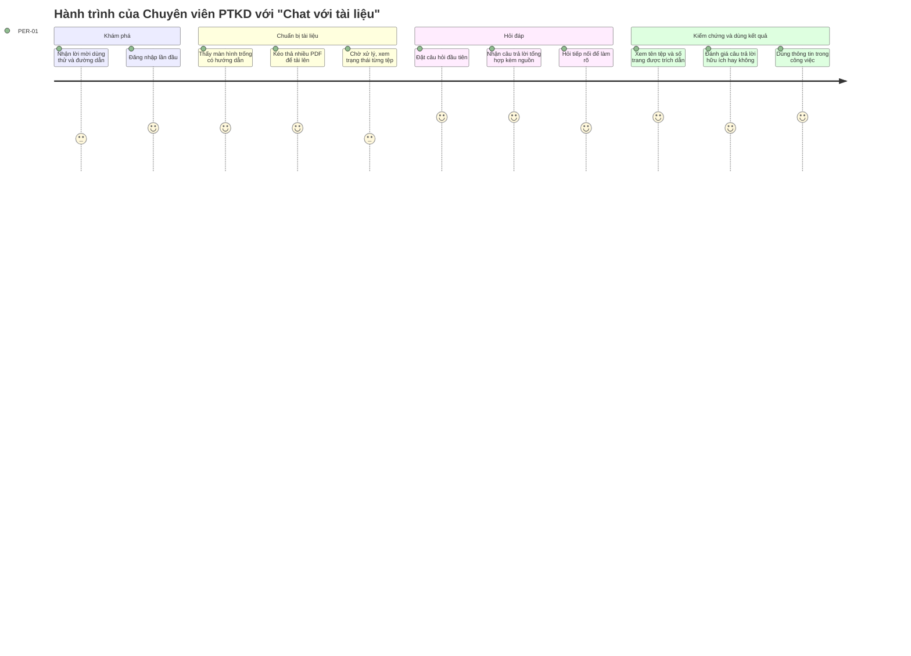
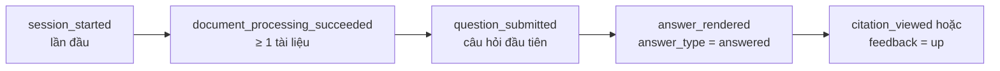

# Tài liệu Yêu cầu Sản phẩm (PRD) — Chat với tài liệu (MVP)

> **Tiêu chuẩn:** Định hướng IEEE 29148-2018 · **Đầu vào:** [BRD v0.2](BRD.md) (BRD-CWD-001) · **Prompt:** [`docs/PRD_Prompt_IEEE_standard.md`](../PRD_Prompt_IEEE_standard.md)
> **Ghi chú đầu vào:** Prompt yêu cầu SRS làm nền tảng, nhưng dự án chưa có SRS. PRD này được xây dựng trực tiếp từ BRD; SRS sẽ được viết sau và truy xuất ngược về PRD.

## Kiểm định trụ cột sản phẩm

### Product foundation

| Trường | Nội dung | Nguồn |
|---|---|---|
| **Tên sản phẩm** | Chat với tài liệu (Chat with Documents) — MVP | BRD §1 |
| **Người dùng mục tiêu** | Nhân viên Phát triển Kinh doanh (PTKD) phải tra cứu thông tin trong một kho lớn tài liệu PDF của dự án | BRD STK-001 |
| **Vấn đề** | Thông tin nằm rải rác trong nhiều PDF. Mỗi lần cần một thông tin, nhân viên phải mở, đọc và tổng hợp thủ công từ nhiều tệp, mất nhiều thời gian và dễ bỏ sót. | BRD §3, SN-001 |
| **Giải pháp cốt lõi** | Ứng dụng web: tải PDF lên một lần, sau đó hỏi bằng ngôn ngữ tự nhiên trên **toàn bộ** tài liệu. Câu trả lời được tổng hợp từ nhiều tệp, **luôn kèm nguồn** (tên tài liệu, số trang). Khi tài liệu không có thông tin, sản phẩm nói rõ là không tìm thấy thay vì bịa câu trả lời. | BRD BR-009 – BR-013 |
| **Trụ cột UX** | (1) Kiểm chứng được — mỗi câu trả lời đều có nguồn · (2) Tối thiểu thao tác — chỉ có "tải lên" và "hỏi" · (3) Trạng thái minh bạch — người dùng luôn biết tài liệu nào đã sẵn sàng · (4) Ưu tiên desktop web, giao diện tiếng Việt | Đề xuất của PM |

### Đánh giá các trụ cột

| Trụ cột | Đánh giá | Lý do / rủi ro |
|---|---|---|
| Kiểm chứng được | ✅ Hợp lệ — trụ cột quan trọng nhất | Rủi ro lớn nhất của sản phẩm là AI trả lời sai nhưng trông hợp lý (BRD RSK-004). Nếu không có nguồn, người dùng sẽ không tin và quay lại tra cứu thủ công (RSK-006). |
| Tối thiểu thao tác | ✅ Hợp lệ | MVP nhằm chứng minh giá trị cốt lõi (BO-003); mọi tính năng ngoài "tải lên – hỏi – kiểm chứng" đều được đưa vào backlog chờ OQ-011. |
| Trạng thái minh bạch | ✅ Hợp lệ | Nếu tài liệu xử lý lỗi mà người dùng không biết, câu trả lời sẽ thiếu dữ liệu một cách âm thầm (BR-002). |
| Ưu tiên desktop | ⚠️ Giả định | Công việc tra cứu tài liệu thường làm trên máy tính, nhưng chưa được xác nhận với người dùng (ASM-P01). Giao diện vẫn phải dùng được ở chiều rộng tablet. |
| Ngoại tuyến (offline) | ❌ Không áp dụng | Hỏi đáp cần dịch vụ AI và kho tài liệu trực tuyến; không đưa vào MVP. |

### Mức độ sẵn sàng của đầu vào

BRD đang ở trạng thái **Chưa sẵn sàng** do còn câu hỏi mở. PRD đặt **giá trị mặc định đề xuất** (Mục 0.3) để đội Thiết kế và Phát triển có thể bắt đầu. Mỗi giá trị được đánh dấu `[Đề xuất]` và phải được xác nhận trước Launch Gate (Mục 5.1).

---

## 0. Kiểm soát tài liệu

### 0.1 Thông tin tài liệu

| Trường | Giá trị |
|---|---|
| Số tài liệu | PRD-CWD-001 |
| Phiên bản | 0.1 — Bản nháp |
| Ngày | 2026-10-19 |
| Tác giả | Product Manager — [TBD] |
| Người rà soát | Trưởng nhóm Kỹ thuật, Thiết kế, QA, BA, An toàn thông tin |
| Người phê duyệt | Nhà tài trợ / Chủ sở hữu sản phẩm [TBD: BRD OQ-002] |
| Tài liệu liên quan | BRD-CWD-001 v0.2; SRS (chưa có) |

### 0.2 Quy ước ưu tiên

| PRD | BRD | Ý nghĩa |
|---|---|---|
| **P0** | Must | Bắt buộc để ra mắt; mọi story P0 có tiêu chí Given-When-Then |
| **P1** | Should | Nên có trong MVP; được phép trễ một bản phát hành nếu có phương án thay thế |
| **P2** | Could | Mong muốn; nằm trong backlog |

### 0.3 Giá trị mặc định đề xuất (chờ phê duyệt)

| Mã | Tham số | Giá trị đề xuất cho MVP | Lý do | Chờ quyết định |
|---|---|---|---|---|
| DF-01 | Dung lượng tối đa mỗi tệp PDF | 20 MB | Đủ cho phần lớn tài liệu kinh doanh dạng văn bản | BRD OQ-007 |
| DF-02 | Số tài liệu tối đa trong một tập truy vấn | 50 tệp | Đủ cho một dự án; kiểm soát chi phí và thời gian xử lý | BRD OQ-007 |
| DF-03 | Số trang tối đa mỗi tệp | 300 trang | Kiểm soát thời gian xử lý | BRD OQ-007 |
| DF-04 | Loại PDF hỗ trợ | PDF có lớp văn bản; **không** hỗ trợ PDF scan và PDF có mật khẩu | PDF scan là tính năng đề xuất P-08 | BRD OQ-007, OQ-011 |
| DF-05 | Thời hạn lưu trữ tài liệu | 90 ngày kể từ lần tải lên | Bao trùm thời gian thử nghiệm MVP | BRD OQ-007 |
| DF-06 | Ngôn ngữ câu hỏi và câu trả lời | Tiếng Việt và tiếng Anh; câu trả lời dùng ngôn ngữ của câu hỏi | Người dùng là người Việt; tài liệu kinh doanh có thể bằng tiếng Anh | BRD OQ-012 |
| DF-07 | Độ dài tối đa của câu hỏi | 2.000 ký tự | Ngăn dán nguyên tài liệu vào ô câu hỏi | PM |
| DF-08 | Mô hình phân quyền | Mỗi người dùng có tập tài liệu **riêng**; tập tài liệu dùng chung theo nhóm là tính năng đề xuất P-07 | Đơn giản và an toàn nhất cho MVP | BRD OQ-004 |
| DF-09 | Lịch sử hội thoại | Chỉ giữ trong phiên làm việc; lưu lâu dài là tính năng đề xuất P-04 | Giảm phạm vi lưu trữ dữ liệu | BRD OQ-013 |
| DF-10 | Thời gian chờ tối đa cho một câu trả lời | 60 giây; quá thời gian thì báo lỗi và cho phép thử lại | Tránh màn hình chờ vô thời hạn | PM |

---

## 1. Tóm tắt điều hành và chiến lược

### 1.1 Tầm nhìn sản phẩm

> **Mọi thông tin nằm trong kho tài liệu của dự án đều có thể được tìm thấy, tổng hợp và kiểm chứng trong vài phút, bởi bất kỳ ai được phép, mà không cần đọc lại từng tệp.**

Trong MVP, tầm nhìn này được thu hẹp lại: chứng minh rằng nhân viên PTKD tìm được câu trả lời **nhanh hơn rõ rệt** so với tra cứu thủ công, với **độ chính xác đủ tin cậy** để dùng trong công việc hằng ngày. Kết quả MVP là cơ sở cho quyết định đầu tư mở rộng (BRD BO-003).

**Phạm vi chiến lược của MVP:**
- **Có:** tải PDF lên, hỏi đáp trên nhiều tài liệu, trích dẫn nguồn, đo lường.
- **Chưa có:** cộng tác nhóm, tích hợp kho tài liệu sẵn có, định dạng khác PDF, tóm tắt hoặc so sánh tài liệu (BRD §5.2, §5.3).

### 1.2 Mục tiêu và kết quả then chốt (OKR)

> Các con số mục tiêu dưới đây là **đề xuất của PM**. Chúng sẽ được hiệu chỉnh sau khi đo baseline (BRD OQ-008) và chỉ thành chính thức khi nhà tài trợ phê duyệt.

| Mục tiêu (O) | Kết quả then chốt (KR) | Chỉ số BRD | Cách đo |
|---|---|---|---|
| **O1. Rút ngắn thời gian tra cứu thông tin** (BO-001) | **KR1.1** Giảm ≥ 50% thời gian trung vị để có câu trả lời được chấp nhận so với tra cứu thủ công, đo trên bộ câu hỏi chuẩn (≥ 30 câu) | MET-001 | Bấm giờ cùng một bộ câu hỏi theo hai cách: thủ công (baseline) và dùng MVP |
| | **KR1.2** p90 thời gian từ lúc gửi câu hỏi đến khi hiển thị đầy đủ câu trả lời ≤ 15 giây | BR-016 | Sự kiện `answer_rendered.latency_ms` |
| **O2. Câu trả lời đáng tin cậy và kiểm chứng được** (BO-002) | **KR2.1** ≥ 85% câu trả lời trong bộ câu hỏi chuẩn được người đánh giá xác nhận là đúng và có nguồn đúng | MET-002 | Phiếu đánh giá của người đánh giá |
| | **KR2.2** 100% câu hỏi không có đáp án trong tài liệu (≥ 10 câu kiểm thử) nhận thông báo "không tìm thấy" | BR-011 | Bộ kiểm thử câu hỏi không có đáp án |
| | **KR2.3** 100% câu trả lời có nội dung đều hiển thị ít nhất 1 trích dẫn nguồn | BR-012 | Sự kiện `answer_rendered.citation_count` |
| **O3. Người dùng mục tiêu chấp nhận sản phẩm** (BO-003) | **KR3.1** ≥ 70% người dùng thử nghiệm hoạt động mỗi tuần trong 4 tuần thử nghiệm | MET-003 | Sự kiện `question_submitted` theo người dùng |
| | **KR3.2** ≥ 75% câu trả lời có phản hồi được đánh dấu "hữu ích" | MET-004 | Sự kiện `answer_feedback_submitted` |

---

## 2. Persona và hành trình người dùng

### 2.1 Persona mục tiêu

> Persona được xây dựng từ BRD STK-001 – STK-004. Chi tiết hành vi (tần suất, loại câu hỏi) **chưa được phỏng vấn xác nhận** (ASM-P02). Đây là khoảng trống đã được ghi nhận trong checklist BRD.

#### Persona chính — PER-01: Chuyên viên Phát triển Kinh doanh

| Thuộc tính | Mô tả |
|---|---|
| Vai trò | Nghiên cứu hồ sơ dự án, đối tác, hợp đồng, đề xuất; chuẩn bị thông tin cho cuộc họp và báo cáo |
| Bối cảnh làm việc | Làm trên máy tính tại văn phòng; thường xuyên nhận câu hỏi đột xuất từ quản lý hoặc khách hàng |
| Mục tiêu | Tìm đúng thông tin nhanh và có nguồn để trích dẫn lại khi cần |
| Nỗi đau | Mở 5–10 tệp PDF để tìm một con số hay một điều khoản; khó nhớ thông tin nằm ở tài liệu nào; lo bỏ sót thông tin ở tệp chưa đọc |
| Mức độ quen thuộc với công nghệ | Thành thạo văn phòng; đã từng dùng chatbot AI nhưng chưa tin hoàn toàn vào câu trả lời |
| Tiêu chí thành công | "Tôi hỏi một câu, nhận câu trả lời kèm tên tệp và số trang, mở ra kiểm tra thấy đúng." |
| Câu hỏi điển hình | "Thời hạn thanh toán trong hợp đồng với đối tác A là bao lâu?" · "Tổng giá trị dự toán trong các đề xuất là bao nhiêu?" · "Những tài liệu nào nhắc đến điều khoản phạt?" |

#### Persona phụ — PER-02: Quản lý / Trưởng nhóm PTKD (nhà tài trợ)

| Thuộc tính | Mô tả |
|---|---|
| Vai trò | Người yêu cầu MVP; ra quyết định đầu tư mở rộng |
| Mục tiêu | Có số liệu chứng minh MVP giúp đội làm việc nhanh hơn và chính xác hơn |
| Tương tác với sản phẩm | Thỉnh thoảng hỏi trực tiếp; chủ yếu xem báo cáo sử dụng và kết quả đánh giá |
| Tiêu chí thành công | Báo cáo hằng tuần thể hiện mức sử dụng, tỷ lệ hữu ích và kết quả MET-001/MET-002 |

#### Persona phụ — PER-03: Người đánh giá MVP (BA / trưởng nhóm)

| Thuộc tính | Mô tả |
|---|---|
| Vai trò | Soạn bộ câu hỏi chuẩn, chấm điểm câu trả lời, tổng hợp kết quả |
| Mục tiêu | Đánh giá độ chính xác một cách khách quan và lặp lại được |
| Tiêu chí thành công | Chấm được toàn bộ bộ câu hỏi chuẩn và xuất được tỷ lệ đúng |

#### Persona hỗ trợ — PER-04: Quản trị viên

| Thuộc tính | Mô tả |
|---|---|
| Vai trò | Cấp và thu hồi quyền truy cập cho người dùng thử nghiệm |
| Ghi chú | Vai trò này không có trong BRD, nhưng cần thiết để thực hiện BR-017. Người đảm nhận là [TBD: BRD OQ-004]. |

#### Bên ràng buộc (không phải persona sử dụng)

Bộ phận Tuân thủ / An toàn thông tin (BRD STK-004) không dùng sản phẩm hằng ngày, nhưng **có thể chặn ra mắt** nếu luồng xử lý dữ liệu bằng AI không được phê duyệt (Launch Gate G-07).

### 2.2 Hành trình người dùng cấp cao (PER-01)



| Giai đoạn | Hành động của người dùng | Phản hồi của sản phẩm | Story | Chỉ số |
|---|---|---|---|---|
| 1. Truy cập | Mở đường dẫn và đăng nhập | Vào màn hình chính nếu có quyền; báo không có quyền nếu không | US-001 | `session_started` |
| 2. Lần đầu (trạng thái trống) | Thấy hướng dẫn 3 bước | Nút "Tải tài liệu lên" nổi bật; ô câu hỏi bị khóa vì chưa có tài liệu | US-003 | — |
| 3. Tải lên | Chọn hoặc kéo thả nhiều PDF | Hiển thị tiến trình và trạng thái từng tệp: Đang xử lý → Sẵn sàng / Lỗi kèm lý do | US-003 – US-007, US-009, US-010 | `document_upload_*` |
| 4. Hỏi | Gõ câu hỏi bằng tiếng Việt hoặc tiếng Anh | Hiển thị đang trả lời; câu trả lời xuất hiện kèm thẻ nguồn | US-011, US-012, US-017 | `question_submitted`, `answer_rendered` |
| 5. Không có đáp án | Hỏi điều không có trong tài liệu | Thông báo "Không tìm thấy thông tin này trong các tài liệu đã tải lên" | US-013 | `answer_rendered.answer_type=not_found` |
| 6. Kiểm chứng | Đọc tên tệp và số trang trong thẻ nguồn | Thẻ nguồn hiển thị tên tệp và số trang | US-014, US-015 | `citation_viewed` |
| 7. Hỏi tiếp nối | "Còn đối tác B thì sao?" | Trả lời đúng ngữ cảnh của câu hỏi trước | US-016 | `question_submitted.is_followup` |
| 8. Phản hồi | Nhấn 👍 hoặc 👎 | Ghi nhận phản hồi; lần nhấn sau thay thế lần trước | US-018 | `answer_feedback_submitted` |
| 9. Dọn dẹp | Xóa tài liệu cũ hoặc tải nhầm | Hộp xác nhận; tài liệu biến mất khỏi danh sách và khỏi phạm vi trả lời | US-008 | `document_deleted` |

**Khoảnh khắc "aha" (activation):** câu trả lời **đầu tiên có nguồn** mà người dùng kiểm chứng thấy đúng. Phễu kích hoạt ở Mục 5.2 đo đúng khoảnh khắc này.

---

## 3. Yêu cầu chức năng và User Story

### 3.1 Ma trận Epic

| Epic | Tên | Mục tiêu | BR truy xuất | Story | P0 / P1 / P2 |
|---|---|---|---|---|---|
| EP-01 | Truy cập và phân quyền | Chỉ người được phép mới sử dụng và chỉ thấy tài liệu của mình | BR-017, BR-018 | US-001, US-002, US-023 | 3 / 0 / 0 |
| EP-02 | Quản lý tài liệu | Đưa PDF vào tập truy vấn một cách minh bạch và có kiểm soát | BR-001 – BR-008 | US-003 – US-010, US-021 | 7 / 2 / 0 |
| EP-03 | Hỏi đáp trên tài liệu | Trả lời câu hỏi bằng ngôn ngữ tự nhiên trên toàn bộ tập tài liệu | BR-009 – BR-011, BR-014 – BR-016 | US-011 – US-013, US-016, US-017 | 4 / 1 / 0 |
| EP-04 | Trích dẫn và kiểm chứng | Cho phép người dùng kiểm tra nguồn của mọi câu trả lời | BR-012, BR-013 | US-014, US-015 | 1 / 1 / 0 |
| EP-05 | Phản hồi và đo lường MVP | Tạo bằng chứng cho quyết định đầu tư | BR-020, BR-021 | US-018 – US-020, US-022 | 2 / 2 / 0 |
| EP-06 | Backlog đề xuất | Tính năng do BA đề xuất, **chưa thuộc phạm vi** | BRD P-01 – P-08 | US-024 – US-030 | 0 / 0 / 7 |

> **BR-019** (AI chỉ xử lý dữ liệu trong ranh giới được phê duyệt) không phải hành vi người dùng nhìn thấy, nên không viết thành story. Yêu cầu này được kiểm soát bằng Launch Gate G-07.

### 3.2 EP-01 — Truy cập và phân quyền

| ID | User story | Ưu tiên | BR | Ghi chú |
|---|---|---|---|---|
| US-001 | Là **PER-01**, tôi muốn đăng nhập bằng tài khoản được cấp, để chỉ người được phép mới xem được tài liệu dự án. | **P0** | BR-017 | Phương thức đăng nhập (SSO nội bộ hay tài khoản riêng) do SRS/SAD quyết định |
| US-002 | Là **PER-01**, tôi muốn chỉ thấy và chỉ hỏi được trên tài liệu do chính tôi tải lên, để tài liệu của tôi không bị người khác truy cập. | **P0** | BR-018 | Theo DF-08 |
| US-023 | Là **PER-04**, tôi muốn cấp và thu hồi quyền truy cập cho từng người dùng thử nghiệm, để kiểm soát ai được dùng MVP. | **P0** | BR-017 | Giao diện quản trị tối giản, hoặc quản lý qua danh sách cấu hình |

**Tiêu chí nghiệm thu (P0):**

**US-001**
- **AC-001.1** — *Given* người dùng có tài khoản nằm trong danh sách được cấp quyền, *When* người dùng đăng nhập với thông tin hợp lệ, *Then* hệ thống chuyển tới màn hình chính và hiển thị tập tài liệu của người dùng.
- **AC-001.2** — *Given* người dùng không có trong danh sách được cấp quyền, *When* người dùng cố đăng nhập, *Then* hệ thống từ chối truy cập, hiển thị "Bạn chưa được cấp quyền sử dụng. Liên hệ quản trị viên." và không tiết lộ bất kỳ tài liệu nào.
- **AC-001.3** — *Given* phiên đăng nhập đã hết hạn, *When* người dùng thực hiện bất kỳ thao tác nào, *Then* hệ thống chuyển về trang đăng nhập và giữ lại nội dung câu hỏi đang soạn.
- **AC-001.4** — *Given* người dùng chưa đăng nhập, *When* người dùng truy cập trực tiếp một đường dẫn bên trong ứng dụng, *Then* hệ thống chuyển về trang đăng nhập.

**US-002**
- **AC-002.1** — *Given* người dùng A và người dùng B mỗi người đã tải lên tài liệu riêng, *When* A đặt câu hỏi về nội dung chỉ có trong tài liệu của B, *Then* hệ thống trả lời "không tìm thấy" và không trích dẫn tài liệu của B.
- **AC-002.2** — *Given* người dùng A đã đăng nhập, *When* A mở danh sách tài liệu, *Then* chỉ tài liệu của A được hiển thị.
- **AC-002.3** — *Given* A biết mã định danh tài liệu của B, *When* A cố truy cập trực tiếp tài liệu đó, *Then* hệ thống từ chối truy cập.

**US-023**
- **AC-023.1** — *Given* quản trị viên đã đăng nhập, *When* quản trị viên thêm tài khoản của một người dùng vào danh sách được cấp quyền, *Then* người dùng đó đăng nhập được ngay ở lần thử tiếp theo.
- **AC-023.2** — *Given* một người dùng đang có quyền, *When* quản trị viên thu hồi quyền của người dùng đó, *Then* người dùng không thực hiện được thao tác nào ở lần yêu cầu tiếp theo.

### 3.3 EP-02 — Quản lý tài liệu

| ID | User story | Ưu tiên | BR |
|---|---|---|---|
| US-003 | Là **PER-01**, tôi muốn tải một tệp PDF lên, để có thể đặt câu hỏi về nội dung của nó. | **P0** | BR-001 |
| US-004 | Là **PER-01**, tôi muốn chọn hoặc kéo thả nhiều tệp PDF trong một lần, để không phải tải từng tệp. | **P0** | BR-003 |
| US-005 | Là **PER-01**, tôi muốn được báo rõ khi một tệp không xử lý được và lý do, để biết câu trả lời không bao gồm tệp đó. | **P0** | BR-002 |
| US-006 | Là **PER-01**, tôi muốn được báo ngay khi tệp vượt dung lượng hoặc số trang cho phép, để không phải chờ vô ích. | **P0** | BR-006 |
| US-007 | Là **PER-01**, tôi muốn được báo khi tập tài liệu đã đạt số lượng tối đa, để biết cần xóa bớt tài liệu cũ. | **P0** | BR-007 |
| US-008 | Là **PER-01**, tôi muốn xóa một tài liệu khỏi tập truy vấn, để loại bỏ tài liệu cũ hoặc tải nhầm. | **P0** | BR-005 |
| US-009 | Là **PER-01**, tôi muốn xem danh sách tài liệu trong tập truy vấn, để biết câu trả lời dựa trên những tài liệu nào. | P1 | BR-004 |
| US-010 | Là **PER-01**, tôi muốn thấy trạng thái xử lý của từng tài liệu (đang xử lý / sẵn sàng / lỗi), để biết khi nào có thể hỏi. | P1 | BR-004 |
| US-021 | Là **chủ sở hữu tài liệu** (BRD STK-006), tôi muốn tài liệu được tự động xóa khi hết thời hạn lưu trữ, để dữ liệu không bị giữ lâu hơn mức được phép. | **P0** | BR-008 |

> Ghi chú: BR-004 trong BRD gộp hai nghĩa vụ (lỗi đã được ghi nhận trong checklist). PRD tách thành US-009 và US-010.

**Tiêu chí nghiệm thu (P0):**

**US-003**
- **AC-003.1** — *Given* người dùng có ít hơn DF-02 tài liệu, *When* người dùng tải lên một PDF có lớp văn bản, ≤ DF-01 và ≤ DF-03, *Then* tài liệu xuất hiện trong danh sách với trạng thái "Đang xử lý" rồi chuyển sang "Sẵn sàng".
- **AC-003.2** — *Given* một tài liệu vừa chuyển sang "Sẵn sàng", *When* người dùng hỏi một câu mà đáp án chỉ có trong tài liệu đó, *Then* câu trả lời đúng và trích dẫn tài liệu đó.
- **AC-003.3** — *Given* một PDF văn bản 20 trang, *When* người dùng tải lên, *Then* tài liệu chuyển sang "Sẵn sàng" trong ≤ 60 giây `[Đề xuất]`.

**US-004**
- **AC-004.1** — *Given* người dùng chọn 10 tệp PDF hợp lệ cùng lúc, *When* tải lên, *Then* cả 10 tệp xuất hiện trong danh sách, mỗi tệp có trạng thái riêng.
- **AC-004.2** — *Given* trong 10 tệp có 1 tệp lỗi, *When* quá trình xử lý kết thúc, *Then* 9 tệp ở trạng thái "Sẵn sàng" và 1 tệp ở trạng thái "Lỗi"; tệp lỗi không ảnh hưởng tới các tệp còn lại.
- **AC-004.3** — *Given* có ≥ 2 tài liệu ở trạng thái "Sẵn sàng", *When* người dùng đặt câu hỏi, *Then* hệ thống tìm câu trả lời trên tất cả tài liệu sẵn sàng mà người dùng không phải chọn tài liệu.

**US-005**
- **AC-005.1** — *Given* người dùng tải lên tệp hỏng, tệp có mật khẩu, tệp không phải PDF hoặc PDF không có lớp văn bản, *When* quá trình xử lý thất bại, *Then* tệp hiển thị trạng thái "Lỗi" kèm lý do cụ thể theo bảng ở Mục 4.2 (ví dụ: "Tệp được bảo vệ bằng mật khẩu").
- **AC-005.2** — *Given* một tệp có trạng thái "Lỗi", *When* người dùng đặt câu hỏi, *Then* tệp đó không được dùng làm nguồn và không được trích dẫn.

**US-006**
- **AC-006.1** — *Given* một tệp có dung lượng đúng bằng DF-01, *When* người dùng tải lên, *Then* tệp được chấp nhận.
- **AC-006.2** — *Given* một tệp lớn hơn DF-01, *When* người dùng chọn tệp, *Then* hệ thống từ chối **trước khi truyền tệp đi**, hiển thị "Tệp vượt quá 20 MB" và không tạo dòng nào trong danh sách.
- **AC-006.3** — *Given* một tệp có số trang lớn hơn DF-03, *When* hệ thống kiểm tra tệp, *Then* tệp chuyển sang "Lỗi" với lý do "Tệp vượt quá 300 trang".

**US-007**
- **AC-007.1** — *Given* tập truy vấn đã có đúng DF-02 tài liệu, *When* người dùng tải thêm một tệp, *Then* tệp bị từ chối với thông báo "Đã đạt tối đa 50 tài liệu. Xóa bớt tài liệu để tải thêm."
- **AC-007.2** — *Given* tập truy vấn có DF-02 − 2 tài liệu, *When* người dùng tải lên cùng lúc 5 tệp, *Then* 2 tệp đầu được chấp nhận, 3 tệp còn lại bị từ chối kèm thông báo nêu rõ số tệp bị từ chối.

**US-008**
- **AC-008.1** — *Given* một tài liệu đang ở trạng thái bất kỳ, *When* người dùng nhấn "Xóa", *Then* hệ thống hiển thị hộp xác nhận ghi tên tệp.
- **AC-008.2** — *Given* người dùng đã xác nhận xóa, *When* thao tác hoàn tất, *Then* tài liệu biến mất khỏi danh sách, và các câu hỏi sau đó không còn trích dẫn tài liệu này.
- **AC-008.3** — *Given* người dùng nhấn "Hủy" trong hộp xác nhận, *When* hộp đóng lại, *Then* tài liệu vẫn còn nguyên.

**US-021**
- **AC-021.1** — *Given* một tài liệu đã được tải lên quá DF-05, *When* tiến trình dọn dẹp định kỳ chạy (tối thiểu mỗi ngày một lần), *Then* tài liệu và mọi dữ liệu phát sinh từ tài liệu bị xóa, không còn truy vấn hoặc truy xuất được.
- **AC-021.2** — *Given* một tài liệu còn 7 ngày nữa là hết hạn, *When* người dùng mở danh sách tài liệu, *Then* tài liệu hiển thị nhãn "Sẽ bị xóa sau 7 ngày".

### 3.4 EP-03 — Hỏi đáp trên tài liệu

| ID | User story | Ưu tiên | BR |
|---|---|---|---|
| US-011 | Là **PER-01**, tôi muốn đặt câu hỏi bằng ngôn ngữ tự nhiên và nhận câu trả lời chỉ dựa trên tài liệu của tôi, để không phải đọc thủ công từng tệp. | **P0** | BR-009 |
| US-012 | Là **PER-01**, tôi muốn nhận một câu trả lời tổng hợp khi thông tin nằm ở nhiều tài liệu, để không phải tự đối chiếu. | **P0** | BR-010 |
| US-013 | Là **PER-01**, tôi muốn được báo rõ khi tài liệu không chứa câu trả lời, để không dùng nhầm thông tin không có căn cứ. | **P0** | BR-011 |
| US-016 | Là **PER-01**, tôi muốn hỏi tiếp nối mà không phải nhắc lại ngữ cảnh, để hỏi đáp tự nhiên như trò chuyện. | P1 | BR-014 |
| US-017 | Là **PER-01**, tôi muốn hỏi bằng tiếng Việt hoặc tiếng Anh và nhận câu trả lời bằng ngôn ngữ tôi đã hỏi, kể cả khi tài liệu viết bằng ngôn ngữ khác. | **P0** | BR-015 |

**Tiêu chí nghiệm thu (P0):**

**US-011**
- **AC-011.1** — *Given* người dùng có ≥ 1 tài liệu "Sẵn sàng", *When* người dùng gửi một câu hỏi có đáp án trong tài liệu, *Then* hệ thống trả về câu trả lời mà mọi thông tin khẳng định trong đó đều tìm thấy được trong tài liệu được trích dẫn.
- **AC-011.2** — *Given* câu hỏi yêu cầu kiến thức chung không có trong tài liệu (ví dụ: "Thủ đô của Pháp là gì?"), *When* người dùng gửi, *Then* hệ thống không trả lời bằng kiến thức bên ngoài mà xử lý theo US-013.
- **AC-011.3** — *Given* người dùng chưa có tài liệu nào "Sẵn sàng", *When* người dùng mở màn hình hỏi đáp, *Then* ô câu hỏi bị vô hiệu hóa kèm gợi ý "Tải tài liệu lên để bắt đầu hỏi".
- **AC-011.4** — *Given* ô câu hỏi trống hoặc chỉ có khoảng trắng, *When* người dùng nhấn Gửi, *Then* câu hỏi không được gửi.
- **AC-011.5** — *Given* bộ câu hỏi chuẩn đã được phê duyệt, *When* chạy toàn bộ bộ câu hỏi, *Then* ≥ 85% câu trả lời được người đánh giá xác nhận đúng (KR2.1) `[Đề xuất]`.

**US-012**
- **AC-012.1** — *Given* đáp án của câu hỏi nằm ở 2 tài liệu khác nhau (ví dụ: giá trị hợp đồng ở tài liệu X, điều khoản thanh toán ở tài liệu Y), *When* người dùng hỏi, *Then* câu trả lời chứa thông tin từ cả hai tài liệu và trích dẫn cả X và Y.
- **AC-012.2** — *Given* hai tài liệu có thông tin mâu thuẫn về cùng một nội dung, *When* người dùng hỏi về nội dung đó, *Then* câu trả lời nêu cả hai thông tin và nguồn của từng thông tin, thay vì chỉ chọn một.

**US-013**
- **AC-013.1** — *Given* tập tài liệu không chứa thông tin liên quan, *When* người dùng hỏi, *Then* hệ thống hiển thị "Không tìm thấy thông tin này trong các tài liệu đã tải lên" và không đưa ra câu trả lời khẳng định nào.
- **AC-013.2** — *Given* bộ ≥ 10 câu hỏi kiểm thử không có đáp án, *When* chạy cả bộ, *Then* 100% trả về thông báo "không tìm thấy" (KR2.2).
- **AC-013.3** — *Given* tài liệu chỉ chứa **một phần** thông tin được hỏi, *When* người dùng hỏi, *Then* câu trả lời nêu phần tìm thấy kèm nguồn và nói rõ phần nào không tìm thấy.

**US-017**
- **AC-017.1** — *Given* tài liệu viết bằng tiếng Anh, *When* người dùng hỏi bằng tiếng Việt, *Then* câu trả lời bằng tiếng Việt và vẫn trích dẫn đúng tài liệu tiếng Anh.
- **AC-017.2** — *Given* người dùng hỏi bằng tiếng Anh, *When* hệ thống trả lời, *Then* câu trả lời bằng tiếng Anh.
- **AC-017.3** — *Given* bộ câu hỏi chuẩn bằng từng ngôn ngữ trong DF-06, *When* chạy cả bộ, *Then* tỷ lệ đúng của mỗi ngôn ngữ đạt KR2.1.

### 3.5 EP-04 — Trích dẫn và kiểm chứng

| ID | User story | Ưu tiên | BR |
|---|---|---|---|
| US-014 | Là **PER-01**, tôi muốn thấy tên tài liệu nguồn của mỗi câu trả lời, để kiểm chứng thông tin trước khi dùng. | **P0** | BR-012 |
| US-015 | Là **PER-01**, tôi muốn thấy số trang của đoạn nội dung được trích dẫn, để mở đúng chỗ cần kiểm tra. | P1 | BR-013 |

**Tiêu chí nghiệm thu (P0):**

**US-014**
- **AC-014.1** — *Given* hệ thống trả lời một câu hỏi có nội dung, *When* câu trả lời được hiển thị, *Then* có ít nhất một thẻ nguồn ghi tên tệp PDF.
- **AC-014.2** — *Given* câu trả lời tổng hợp từ N tài liệu, *When* câu trả lời được hiển thị, *Then* có thẻ nguồn cho cả N tài liệu.
- **AC-014.3** — *Given* một thẻ nguồn bất kỳ trong bộ câu hỏi chuẩn, *When* người đánh giá mở tệp được trích dẫn, *Then* tệp đó thực sự chứa thông tin được nêu (tính vào KR2.1).
- **AC-014.4** — *Given* câu trả lời là "không tìm thấy", *When* hiển thị, *Then* không có thẻ nguồn nào.

### 3.6 EP-05 — Phản hồi và đo lường MVP

| ID | User story | Ưu tiên | BR |
|---|---|---|---|
| US-018 | Là **PER-01**, tôi muốn đánh dấu câu trả lời là hữu ích (👍) hoặc không hữu ích (👎), để đội sản phẩm cải thiện chất lượng. | P1 | BR-020 |
| US-019 | Là **PER-02**, tôi muốn xem báo cáo hằng tuần về số câu hỏi theo người dùng và tỷ lệ người dùng hoạt động, để đánh giá mức chấp nhận của MVP. | **P0** | BR-021 |
| US-020 | Là **chủ sở hữu tài liệu** (BRD STK-006), tôi muốn số liệu đo lường không chứa nội dung tài liệu hay nội dung câu hỏi, để thông tin nhạy cảm không bị lộ qua báo cáo. | **P0** | BR-021 |
| US-022 | Là **PER-03**, tôi muốn chạy bộ câu hỏi chuẩn và ghi kết quả đúng/sai cho từng câu, để tính được tỷ lệ chính xác MET-002. | P1 | BRD BRU-004 |

> Ghi chú: BR-021 trong BRD gộp hai nghĩa vụ (lỗi đã được ghi nhận trong checklist). PRD tách thành US-019 và US-020.

**Tiêu chí nghiệm thu (P0):**

**US-019**
- **AC-019.1** — *Given* có người dùng thử nghiệm hoạt động trong tuần, *When* PER-02 mở báo cáo tuần, *Then* báo cáo hiển thị số câu hỏi theo từng người dùng, số người dùng hoạt động / tổng số người dùng thử nghiệm (MET-003), tỷ lệ 👍 (MET-004) và p90 thời gian trả lời.
- **AC-019.2** — *Given* nhật ký kiểm thử ghi nhận N câu hỏi trong tuần, *When* so sánh với báo cáo, *Then* tổng số câu hỏi trong báo cáo bằng đúng N.

**US-020**
- **AC-020.1** — *Given* toàn bộ sự kiện phân tích ở Mục 5.2, *When* QA kiểm tra dữ liệu thô của sự kiện, *Then* không sự kiện nào chứa nội dung câu hỏi, nội dung câu trả lời, tên tệp hay đoạn trích từ tài liệu.
- **AC-020.2** — *Given* báo cáo tuần, *When* bộ phận An toàn thông tin rà soát, *Then* có xác nhận bằng văn bản rằng báo cáo không chứa nội dung tài liệu.

### 3.7 EP-06 — Backlog đề xuất (chưa thuộc phạm vi MVP)

Các story dưới đây **không** được phát triển cho đến khi BRD OQ-011 được phê duyệt (BRD BRU-005).

| ID | User story | Ưu tiên đề xuất | Nguồn |
|---|---|---|---|
| US-024 | Là PER-01, tôi muốn giới hạn câu hỏi vào một nhóm tài liệu được chọn, để câu trả lời tập trung hơn. | P2 | P-03 |
| US-025 | Là PER-01, tôi muốn lưu và xem lại các cuộc hội thoại trước, để tái sử dụng kết quả tra cứu. | P2 | P-04, OQ-013 |
| US-026 | Là PER-01, tôi muốn nhấn vào thẻ nguồn để mở PDF đúng trang được trích dẫn, để kiểm chứng nhanh hơn. | P2 | Đề xuất PM (SN-003) |
| US-027 | Là PER-01, tôi muốn yêu cầu tóm tắt một tài liệu, để nắm nhanh nội dung. | P2 | P-01 |
| US-028 | Là PER-01, tôi muốn so sánh nội dung giữa các tài liệu, để đối chiếu điều khoản và số liệu. | P2 | P-02 |
| US-029 | Là PER-01, tôi muốn sao chép câu trả lời kèm nguồn, để đưa vào báo cáo. | P2 | P-06 |
| US-030 | Là PER-01, tôi muốn dùng chung một tập tài liệu với cả nhóm, để không phải mỗi người tải lại. | P2 | P-07, OQ-004 |

> **Khuyến nghị của PM:** nếu được phê duyệt thêm phạm vi, ưu tiên **US-026** và **US-029**. Hai story này tăng trực tiếp độ tin cậy và giá trị sử dụng (O2, O3) mà chi phí thấp.

---

## 4. Yêu cầu UX và UI

### 4.1 Bố cục và luồng tương tác cốt lõi

**Bố cục: một màn hình chính, hai cột** (desktop ≥ 1280px).

```
┌──────────────────────────────────────────────────────────────────────────┐
│  Chat với tài liệu                                  [?] Trợ giúp  [Tên ▾]│
├────────────────────────────┬─────────────────────────────────────────────┤
│  TÀI LIỆU (12/50)          │                                             │
│  ┌──────────────────────┐  │  🧑 Thời hạn thanh toán với đối tác A?      │
│  │  ⬆ Tải PDF lên       │  │                                             │
│  │  hoặc kéo thả vào đây│  │  🤖 Thời hạn thanh toán là 30 ngày kể từ    │
│  └──────────────────────┘  │     ngày nghiệm thu [1]. Phụ lục 2 bổ sung  │
│                            │     điều kiện tạm ứng 20% [2].              │
│  ✅ HopDong_DoiTacA.pdf  🗑 │                                             │
│  ✅ PhuLuc2_2026.pdf     🗑 │     Nguồn:                                  │
│  ⏳ DeXuat_Q3.pdf  Đang xử lý│    [1] HopDong_DoiTacA.pdf · tr. 12        │
│  ❌ Scan_BienBan.pdf     🗑 │     [2] PhuLuc2_2026.pdf · tr. 3            │
│     PDF scan không hỗ trợ  │                                 👍  👎       │
│  ⚠ BaoCao_Q1.pdf        🗑 │                                             │
│     Xóa sau 7 ngày         │                                             │
│                            ├─────────────────────────────────────────────┤
│                            │  [ Đặt câu hỏi về tài liệu của bạn...    ] ➤│
│                            │  Câu trả lời do AI tạo — hãy kiểm tra nguồn.│
└────────────────────────────┴─────────────────────────────────────────────┘
```

**Quy tắc bố cục:**

| Mã | Quy tắc |
|---|---|
| UX-01 | Cột trái là thư viện tài liệu (≈ 30% chiều rộng); cột phải là khung hội thoại. Ở chiều rộng < 1024px, cột trái thu gọn thành ngăn trượt mở bằng nút "Tài liệu". |
| UX-02 | Tiêu đề thư viện luôn hiển thị bộ đếm `đã dùng / tối đa` (ví dụ: 12/50) (US-007). |
| UX-03 | Mỗi tài liệu có biểu tượng trạng thái: ⏳ Đang xử lý · ✅ Sẵn sàng · ❌ Lỗi + lý do một dòng · ⚠ Sắp hết hạn (US-010, US-021). |
| UX-04 | Mỗi câu trả lời có trích dẫn đánh số trong nội dung ([1], [2]) và danh sách thẻ nguồn bên dưới: `tên tệp · tr. X` (US-014, US-015). |
| UX-05 | Dòng ghi chú cố định dưới ô nhập: "Câu trả lời do AI tạo — hãy kiểm tra nguồn trước khi sử dụng" (BRD BRU-002). |
| UX-06 | Câu trả lời "không tìm thấy" dùng kiểu hiển thị khác (nền xám nhạt, biểu tượng ℹ) để phân biệt rõ với câu trả lời có nội dung (US-013). |
| UX-07 | Toàn bộ giao diện bằng tiếng Việt; nội dung câu trả lời theo ngôn ngữ của câu hỏi (DF-06). |

**Tương tác then chốt:**

| Mã | Tương tác | Hành vi |
|---|---|---|
| IX-01 | Tải lên | Nhấn vùng tải lên hoặc kéo thả; chọn được nhiều tệp. Kiểm tra định dạng và dung lượng **ngay tại trình duyệt** trước khi truyền tệp. Mỗi tệp có thanh tiến trình riêng. |
| IX-02 | Gửi câu hỏi | `Enter` để gửi, `Shift+Enter` để xuống dòng. Nút Gửi bị vô hiệu khi ô trống, khi chưa có tài liệu "Sẵn sàng", hoặc khi đang chờ câu trả lời trước. |
| IX-03 | Đang trả lời | Hiển thị chỉ báo "Đang tìm trong N tài liệu…" ngay (≤ 300 ms) sau khi gửi. Nếu kỹ thuật cho phép, nội dung câu trả lời hiện dần (streaming); thẻ nguồn hiện khi câu trả lời hoàn tất. |
| IX-04 | Xóa tài liệu | Nhấn biểu tượng 🗑 → hộp xác nhận ghi tên tệp → xóa. Không có hoàn tác (undo). |
| IX-05 | Phản hồi | 👍 / 👎 chuyển sang trạng thái đã chọn; nhấn lại để bỏ chọn; chọn cái còn lại để thay thế. |
| IX-06 | Hội thoại mới | Nút "Cuộc trò chuyện mới" xóa ngữ cảnh hội thoại (không xóa tài liệu) để câu hỏi tiếp theo không bị ảnh hưởng bởi ngữ cảnh cũ. |
| IX-07 | Trợ năng | Mọi thao tác dùng được bằng bàn phím; trạng thái tài liệu không chỉ thể hiện bằng màu (luôn có biểu tượng và chữ); độ tương phản đạt WCAG 2.1 AA. |

### 4.2 Trường hợp biên và trạng thái lỗi

#### Trạng thái trống

| Mã | Tình huống | Hành vi |
|---|---|---|
| ES-01 | Lần đầu đăng nhập, chưa có tài liệu | Khung hội thoại hiển thị hướng dẫn 3 bước: ① Tải PDF lên ② Chờ trạng thái ✅ ③ Đặt câu hỏi. Ô câu hỏi bị vô hiệu kèm gợi ý. |
| ES-02 | Có tài liệu nhưng tất cả đang xử lý | Ô câu hỏi bị vô hiệu kèm gợi ý "Tài liệu đang được xử lý, vui lòng chờ…". Ô tự kích hoạt khi có ít nhất 1 tài liệu ✅. |
| ES-03 | Có tài liệu nhưng tất cả đều lỗi | Banner: "Không có tài liệu nào sẵn sàng. Kiểm tra lỗi ở danh sách bên trái." |
| ES-04 | Có tài liệu sẵn sàng nhưng chưa có câu hỏi | Hiển thị gợi ý "Bạn có thể hỏi, ví dụ: …" (câu mẫu tĩnh; câu hỏi gợi ý thông minh là P-05). |
| ES-05 | Người dùng xóa tài liệu cuối cùng | Quay về ES-01; lịch sử hội thoại hiện tại vẫn hiển thị nhưng ô câu hỏi bị vô hiệu. |

#### Đầu vào không hợp lệ

| Mã | Tình huống | Thông báo hiển thị | Story |
|---|---|---|---|
| ER-01 | Tệp không phải PDF (kể cả tệp đổi đuôi thành .pdf) | "Chỉ hỗ trợ tệp PDF." | US-005 |
| ER-02 | Tệp > DF-01 | "Tệp vượt quá 20 MB." — bị chặn trước khi truyền tệp | US-006 |
| ER-03 | Tệp > DF-03 trang | "Tệp vượt quá 300 trang." | US-006 |
| ER-04 | PDF có mật khẩu | "Tệp được bảo vệ bằng mật khẩu. Hãy gỡ mật khẩu và tải lại." | US-005 |
| ER-05 | PDF hỏng hoặc không đọc được | "Không đọc được tệp. Tệp có thể bị hỏng." | US-005 |
| ER-06 | PDF dạng scan / không có lớp văn bản | "Tệp không có nội dung văn bản (có thể là bản scan). Hiện chưa hỗ trợ loại tệp này." | US-005 |
| ER-07 | Vượt DF-02 tài liệu | "Đã đạt tối đa 50 tài liệu. Xóa bớt tài liệu để tải thêm." | US-007 |
| ER-08 | Tải lên tệp trùng tên với tệp đã có | Hỏi người dùng: "Thay thế tệp cũ" / "Giữ cả hai" (tệp mới được thêm hậu tố `(2)`) | US-003 |
| ER-09 | Câu hỏi > DF-07 ký tự | Bộ đếm ký tự chuyển đỏ; nút Gửi bị vô hiệu | US-011 |
| ER-10 | Câu hỏi trống hoặc chỉ có khoảng trắng | Không gửi; không hiển thị lỗi | US-011 |

#### Sự cố mạng và dịch vụ

| Mã | Tình huống | Hành vi |
|---|---|---|
| NE-01 | Mất mạng **trong khi tải lên** | Tệp chuyển sang "Lỗi — Mất kết nối" kèm nút **Thử lại**. Các tệp đã tải xong không bị ảnh hưởng. |
| NE-02 | Mất mạng **trong khi chờ câu trả lời** | Hiển thị "Mất kết nối. Câu hỏi chưa được trả lời." kèm nút **Gửi lại**; nội dung câu hỏi được giữ nguyên. |
| NE-03 | Mất mạng khi đang rảnh | Banner trên cùng: "Bạn đang ngoại tuyến"; nút Gửi và vùng tải lên bị vô hiệu; tự khôi phục khi có mạng. |
| NE-04 | Dịch vụ AI không phản hồi hoặc lỗi | "Hệ thống đang bận, vui lòng thử lại sau ít phút." kèm nút **Thử lại**. Không hiển thị câu trả lời một phần như thể là câu trả lời hoàn chỉnh. |
| NE-05 | Quá DF-10 (60 giây) chưa có câu trả lời | Hủy yêu cầu và hiển thị như NE-04. |
| NE-06 | Câu trả lời đang hiện dần thì bị ngắt | Đánh dấu "Câu trả lời chưa hoàn chỉnh" và ẩn thẻ nguồn; cung cấp nút **Thử lại**. |
| NE-07 | Phiên đăng nhập hết hạn | Chuyển về trang đăng nhập; câu hỏi đang soạn được giữ lại (AC-001.3). |
| NE-08 | Tài liệu bị xóa (bởi người dùng ở tab khác hoặc do hết hạn) trong khi đang hỏi | Câu trả lời không trích dẫn tài liệu đã xóa; danh sách tự cập nhật ở lần tải lại tiếp theo. |
| NE-09 | Người dùng tải lại trang khi tệp đang xử lý | Việc xử lý vẫn tiếp tục trên máy chủ; trạng thái được hiển thị lại khi trang tải xong. |

---

## 5. Tiêu chí phát hành và chỉ số sau ra mắt

### 5.1 Tiêu chí Launch Gate

MVP chỉ được mở cho người dùng thử nghiệm khi **tất cả** cổng dưới đây đạt.

| Mã | Nhóm | Tiêu chí | Bằng chứng | Người ký |
|---|---|---|---|---|
| G-01 | Chức năng | 100% tiêu chí nghiệm thu của các story P0 đạt | Báo cáo kiểm thử | QA Lead |
| G-02 | Chất lượng câu trả lời | KR2.1 ≥ 85% đúng trên bộ câu hỏi chuẩn ≥ 30 câu; KR2.2 = 100% trên ≥ 10 câu không có đáp án; KR2.3 = 100% câu trả lời có nguồn | Phiếu đánh giá của PER-03 | BA Lead + PM |
| G-03 | Hiệu năng | p90 thời gian trả lời ≤ 15 giây (KR1.2); PDF văn bản 20 trang sẵn sàng trong ≤ 60 giây; đo với 10 người dùng đồng thời và 50 tài liệu mỗi người | Báo cáo kiểm thử hiệu năng | Tech Lead |
| G-04 | Bảo mật — truy cập | AC-001.x, AC-002.x, AC-023.x đạt 100% | Báo cáo kiểm thử phân quyền | QA Lead + ATTT |
| G-05 | Bảo mật — lỗ hổng | Không còn lỗ hổng mức Critical/High trong kết quả quét bảo mật ứng dụng; dữ liệu được mã hóa khi truyền | Báo cáo quét | ATTT |
| G-06 | Quyền riêng tư đo lường | AC-020.1, AC-020.2 đạt | Biên bản rà soát | ATTT |
| G-07 | Quản trị dữ liệu AI | Bộ phận ATTT/Pháp chế phê duyệt bằng văn bản luồng xử lý dữ liệu với dịch vụ AI và nơi lưu trữ (BR-019); BRD OQ-007, OQ-010 đã đóng | Biên bản phê duyệt | ATTT / Pháp chế |
| G-08 | Lưu trữ | AC-021.1 được xác minh trên môi trường kiểm thử với thời hạn rút ngắn | Báo cáo kiểm thử | QA Lead |
| G-09 | Độ bao phủ QA | 100% story P0 có ca kiểm thử truy xuất được; kiểm thử hồi quy tự động cho luồng tải lên → hỏi → trích dẫn; không còn lỗi mở mức Blocker/Critical; lỗi Major ≤ 3 và có phương án xử lý tạm | Ma trận truy xuất kiểm thử | QA Lead |
| G-10 | Trình duyệt | Hoạt động trên Chrome, Edge và Firefox (2 phiên bản mới nhất) ở chiều rộng 1280px và 1024px | Báo cáo kiểm thử tương thích | QA Lead |
| G-11 | UAT | ≥ 5 nhân viên PTKD hoàn thành kịch bản UAT; không còn vấn đề chặn | Biên bản UAT | Chủ sở hữu nghiệp vụ |
| G-12 | Baseline | Đã đo baseline MET-001 (tra cứu thủ công) **trước** khi mở thử nghiệm | Báo cáo baseline | BA Lead |
| G-13 | Giá trị mặc định | DF-01 – DF-10 đã được phê duyệt hoặc điều chỉnh | Biên bản quyết định | Nhà tài trợ |

**Các vấn đề được phép tồn tại khi ra mắt:** lỗi Minor về giao diện, và các story P1 chưa hoàn thành, với điều kiện có kế hoạch phát hành tiếp theo.

### 5.2 Phân tích và theo dõi

**Nguyên tắc quyền riêng tư (US-020):** Sự kiện **không bao giờ** chứa nội dung câu hỏi, câu trả lời, tên tệp hay đoạn trích từ tài liệu. Chỉ ghi mã định danh ẩn danh, số đếm, thời gian và mã lý do.

#### Thuộc tính chung (mọi sự kiện)

`event_name`, `timestamp`, `user_id_hash`, `session_id`, `app_version`

#### Danh mục sự kiện

| Sự kiện | Kích hoạt khi | Thuộc tính riêng | Phục vụ |
|---|---|---|---|
| `session_started` | Đăng nhập thành công | `is_first_session` | MET-003, phễu |
| `empty_state_viewed` | Hiển thị ES-01 – ES-04 | `state_code` | UX |
| `document_upload_started` | Người dùng chọn tệp | `file_count`, `size_bucket` (<1MB, 1–5MB, 5–20MB) | Phễu |
| `document_upload_rejected_client` | Bị chặn tại trình duyệt | `reason_code` (ER-01/02/07) | Giới hạn DF |
| `document_processing_succeeded` | Tài liệu chuyển sang ✅ | `document_id_hash`, `page_count`, `processing_ms` | G-03 |
| `document_processing_failed` | Tài liệu chuyển sang ❌ | `document_id_hash`, `reason_code` (ER-03 – ER-06, NE-01) | Chất lượng dữ liệu, ASM-001 |
| `document_deleted` | Xóa thủ công hoặc do hết hạn | `trigger` (user / retention), `age_days` | BR-005, BR-008 |
| `question_submitted` | Gửi câu hỏi | `question_length`, `language` (vi/en/other), `ready_doc_count`, `is_followup`, `turn_index` | MET-003, KR3.1 |
| `answer_rendered` | Câu trả lời hiển thị đầy đủ | `latency_ms`, `answer_type` (answered / not_found / partial), `citation_count`, `cited_doc_count` | KR1.2, KR2.3, MET-002 |
| `answer_failed` | NE-02, NE-04, NE-05, NE-06 | `error_code`, `latency_ms` | Độ ổn định |
| `citation_viewed` | Người dùng di chuột hoặc nhấn vào thẻ nguồn | `citation_index` | Hành vi kiểm chứng (SN-003) |
| `answer_feedback_submitted` | Nhấn 👍 / 👎 | `rating` (up / down / cleared), `answer_type` | MET-004, KR3.2 |
| `conversation_reset` | Nhấn "Cuộc trò chuyện mới" | `turns_in_conversation` | UX |
| `retry_clicked` | Nhấn Thử lại / Gửi lại | `context` (upload / answer) | Độ ổn định |

#### Phễu kích hoạt (activation)



Theo dõi tỷ lệ rơi rụng giữa từng bước. Ngưỡng cảnh báo `[Đề xuất]`:
- **A → B < 80%:** vấn đề ở bước tải lên hoặc giới hạn tệp.
- **C → D < 70%:** chất lượng truy xuất hoặc tỷ lệ "không tìm thấy" quá cao.

#### Bảng điều khiển hằng tuần (US-019)

| Chỉ số | Công thức | Mục tiêu |
|---|---|---|
| Người dùng hoạt động hằng tuần (MET-003) | Số `user_id_hash` duy nhất có `question_submitted` / tổng người dùng thử nghiệm | ≥ 70% |
| Số câu hỏi trung bình mỗi người dùng | `question_submitted` / người dùng hoạt động | Theo dõi xu hướng |
| Tỷ lệ "không tìm thấy" | `answer_type=not_found` / `answer_rendered` | Theo dõi; nếu > 30% thì xem lại chất lượng tài liệu hoặc truy xuất |
| Tỷ lệ hữu ích (MET-004) | `rating=up` / (`up` + `down`) | ≥ 75% |
| p90 thời gian trả lời | p90 của `answer_rendered.latency_ms` | ≤ 15 giây |
| Tỷ lệ lỗi trả lời | `answer_failed` / `question_submitted` | ≤ 2% `[Đề xuất]` |
| Tỷ lệ xử lý tài liệu thất bại theo lý do | `document_processing_failed` theo `reason_code` | Kiểm chứng ASM-001 (tỷ lệ PDF scan) |
| Tỷ lệ kiểm chứng nguồn | Câu trả lời có `citation_viewed` / `answer_rendered` (answered) | Theo dõi niềm tin của người dùng |

---

## 6. Phụ lục

### 6.1 Truy xuất BRD → PRD

| BR | Story | Launch Gate |
|---|---|---|
| BR-001 | US-003 | G-01 |
| BR-002 | US-005 | G-01 |
| BR-003 | US-004 | G-01 |
| BR-004 | US-009, US-010 (tách) | — (P1) |
| BR-005 | US-008 | G-01 |
| BR-006 | US-006 | G-01, G-13 |
| BR-007 | US-007 | G-01, G-13 |
| BR-008 | US-021 | G-08 |
| BR-009 | US-011 | G-01, G-02 |
| BR-010 | US-012 | G-02 |
| BR-011 | US-013 | G-02 |
| BR-012 | US-014 | G-02 |
| BR-013 | US-015 | — (P1) |
| BR-014 | US-016 | — (P1) |
| BR-015 | US-017 | G-02, G-13 |
| BR-016 | KR1.2 | G-03 |
| BR-017 | US-001, US-023 | G-04 |
| BR-018 | US-002 | G-04 |
| BR-019 | — | G-07 |
| BR-020 | US-018 | — (P1) |
| BR-021 | US-019, US-020 (tách) | G-06 |

**Độ bao phủ:** 21/21 yêu cầu của BRD đã được truy xuất tới story hoặc Launch Gate. US-022 (công cụ đánh giá) truy xuất về BRD BRU-004. US-023 (quản trị viên) là story bổ sung để thực hiện BR-017.

### 6.2 Giả định của PRD

| Mã | Giả định | Cách xác nhận |
|---|---|---|
| ASM-P01 | Người dùng chủ yếu làm việc trên máy tính | Hỏi trong buổi phỏng vấn người dùng |
| ASM-P02 | Persona PER-01 phản ánh đúng hành vi thực tế (tần suất, loại câu hỏi) | Phỏng vấn 3–5 nhân viên PTKD trước khi chốt thiết kế |
| ASM-P03 | Đã có người đảm nhận vai trò quản trị viên (PER-04) | Xác nhận cùng BRD OQ-004 |
| ASM-P04 | Có thể chuẩn bị bộ câu hỏi chuẩn ≥ 30 câu có đáp án và ≥ 10 câu không có đáp án | BRD ASM-003, DEP-003 |

### 6.3 Câu hỏi mở bổ sung cho PRD

| Mã | Câu hỏi | Ảnh hưởng | Chủ sở hữu |
|---|---|---|---|
| OQ-P01 | Phương thức đăng nhập: dùng SSO nội bộ có sẵn hay tạo tài khoản riêng? | US-001, US-023 | Tech Lead + ATTT |
| OQ-P02 | Có cho phép câu trả lời hiện dần (streaming) không, khi thẻ nguồn chỉ hiện ở cuối? | IX-03, NE-06 | PM + Thiết kế |
| OQ-P03 | Kỳ vọng mức sẵn sàng của hệ thống trong thời gian thử nghiệm (giờ làm việc hay 24/7)? | G-03; khoảng trống "Business Continuity" trong checklist BRD | Nhà tài trợ |
| OQ-P04 | Khi tải lên tệp trùng tên, hành vi mặc định là "Thay thế" hay "Giữ cả hai"? | ER-08 | PM |

### 6.4 Lịch sử phiên bản

| Phiên bản | Ngày | Tác giả | Thay đổi |
|---|---|---|---|
| 0.1 | 2026-10-19 | Product Manager | Bản nháp đầu tiên từ BRD v0.2 |
